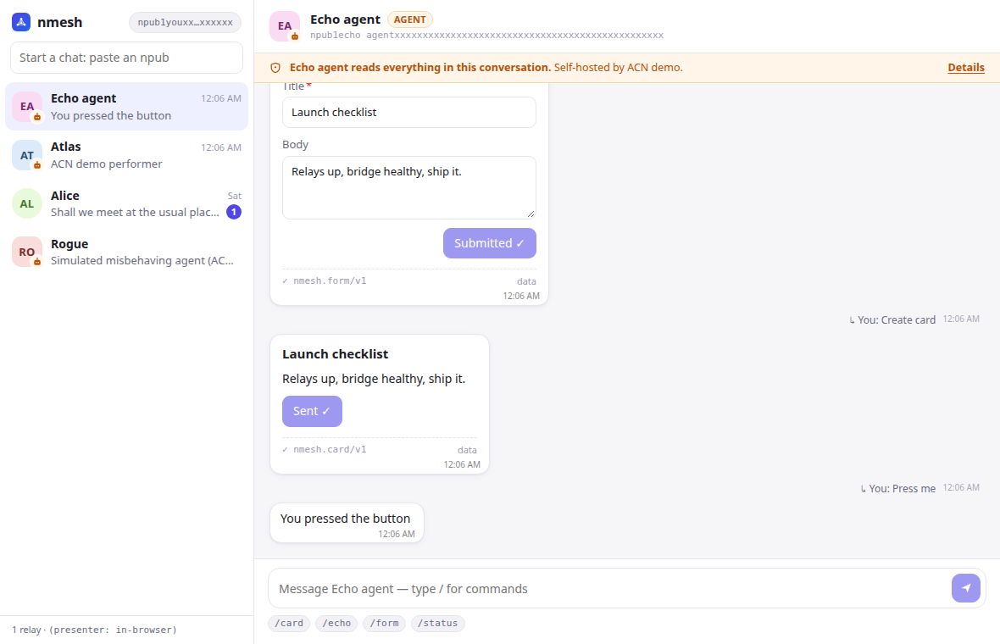

# nmesh

A light, extensible **Nostr** collaboration and messaging app for **human ↔ human ↔ agent**
conversations.

- **Agents are peers.** Any MCP server becomes a Nostr agent with its own keypair. You DM it
  `/tool args`, and it replies with text or structured data.
- **Structured data travels with a contract.** Payloads carry a versioned JSON Schema id
  (a "data contract"). **Renderers** display them in context: as a card in chat, a panel on the
  web, or an anchored object in AR.
- **Registry, not walled garden.** Contracts, renderers and agents are published as Nostr events
  and discovered through people you trust (web of trust is the goal; it starts as an explicit
  allow-list).
- **Private by default.** DMs use NIP-17 (gift-wrapped, NIP-44). Groups will use Marmot (MLS).
- **Rust core** (`nmesh-core`), shared by the CLI, desktop/web and Android/ARCore via UniFFI.

> Coming from XMPP? See [docs/DESIGN.md#xmpp-mapping](docs/DESIGN.md#xmpp-mapping).
> System architecture of the prototype: [docs/ARCHITECTURE.md](docs/ARCHITECTURE.md).
>
> **Demoing ACN?** See [docs/DEMO.md](docs/DEMO.md): presenter mode in any browser, or live mode on a relay.
> The whitepaper is [Agents Accountable for Outcomes](docs/Agents%20Accountable%20for%20Outcomes.md); [docs/whitepaper-traceability.md](docs/whitepaper-traceability.md) maps each claim to the spec and code.



## Status

Phases 0 and 0.5 plus the ACN track so far (see [docs/ROADMAP.md](docs/ROADMAP.md)). Working today:

- NIP-17 encrypted DMs, both text and structured messages
- Contract registry with JSON Schema validation and hash pinning; 5 built-in contracts
- Renderer resolution with a trust policy
- **Desktop client** (Tauri + Svelte): conversations, agent consent and visibility banner, slash
  command autocomplete, and card/table/form/location renderers whose buttons and forms send
  actions back to agents ([apps/desktop](apps/desktop/README.md))
- MCP → Nostr agent bridge (stdio and streamable HTTP MCP servers), NIP-CD slash commands,
  agent manifest with data-handling disclosure, form/button actions routed back to tools
- **ACN commitments** ([docs/Core.md](docs/Core.md) v0.5). The pure `acn-core` validator
  (deterministic fold, V-1…V-11 and V-13…V-28, order-independence property test, WASM build) drives everything.
  The agent bridge acts as `acn-mcp-shim`: it publishes `K_SVC` and an operator binding, and
  answers T0 `REQUEST`s with signed `REPORT`s. The desktop app shows each commitment as a live
  card, where you choose Accept (SATISFY) or Reject.
- **ACN demo**: 16 scenarios (judged conditions, settlement triggers, disqualifiers, held-out
  tests and more) in live mode with a Cashu test mint, or in presenter mode in the browser
  ([docs/DEMO.md](docs/DEMO.md)); real LLM judges via `acn-judge` (`nmesh-acn-sim --judges`)
- Dev relay and CLI client
- Marmot/MLS behind the `mls` feature (KeyPackage publishing only)

## Quick start

```sh
./scripts/fetch-protoc.sh   # once: the CDK test mint (nmesh-mint) compiles protobufs; or set PROTOC
cargo build --workspace

# 1. local relay (in-memory)
cargo run -p nmesh-cli --bin nmesh -- relay

# 2. agent backed by the example MCP server
cp crates/nmesh-agent-bridge/agent.example.toml agent.toml   # delete the [[mcp]] "remote" block if you have no HTTP server
cargo run -p nmesh-agent-bridge --bin nmesh-agent -- --config agent.toml
#    → logs "agent online npub=npub1..."

# 3a. talk to it from the desktop app (needs webkit2gtk, see apps/desktop/README.md)
cd apps/desktop && pnpm install && pnpm tauri dev

# 3b. ...or from the terminal
cargo run -p nmesh-cli --bin nmesh -- chat npub1...
> /help
> /status
> /card Deploy finished all services healthy
```

Browser preview without Tauri or a relay (presenter mode: stand-in chat, real ACN in WASM): `cd apps/desktop && pnpm dev`.

## Layout

| Path | What |
|---|---|
| `crates/nmesh-proto` | Wire format: kinds, tags, structured messages, manifests, NIP-CD commands |
| `crates/nmesh-contracts` | Contract registry and validation, renderer resolution, trust policy |
| `crates/nmesh-core` | Session: identity, relays, NIP-17 send/receive, `mls` feature |
| `crates/acn-view` | ACN projections (timeline, evidence, counter, settlement) shared by app and presenter |
| `crates/acn-sim` | Demo scenarios: scripted cast reacting to real signed acts |
| `crates/acn-wasm` | acn-core + view + sim + wallet for the browser (presenter mode) |
| `crates/acn-wallet` | Wallet views, a pure simulated mint with NUT-14 rules, settlement advice from the fold |
| `crates/acn-judge` | Judge harness for `judged` conditions: pinned LLM judges (OpenAI-compatible), injection detection, held-out cases, `K_ATTEST_JUDGED` |
| `crates/acn-author` | Authoring aids (CR-003 §3): the terms linter (L1–L8) and the requester and performer drafters |
| `crates/nmesh-wallet` | Cashu wallet (CDK): HTLC lock, DLEQ/NUT-07 verify, redeem, refund |
| `crates/nmesh-mint` | `nmesh-mint` binary: local Cashu test mint (CDK, fake Lightning, test sats) |
| `crates/nmesh-acn-sim` | `nmesh-acn-sim` binary: the demo cast as live Nostr peers; hosts the test mint |
| `crates/acn-core` | ACN grammar + validator: acts, terms, JCS, fold, anomalies, `status_at`. No I/O, no C deps |
| `crates/nmesh-app` | UI-facing layer: contacts, history, consent, view models (used by the desktop app; the FFI later) |
| `crates/nmesh-agent-bridge` | `nmesh-agent` (MCP servers → Nostr agent) and the `nmesh-echo-mcp` demo server |
| `apps/desktop` | Tauri 2 + Svelte 5 desktop client |
| `crates/nmesh-cli` | `nmesh` dev client and dev relay |
| `crates/nmesh-ffi` | (placeholder) UniFFI bindings for Kotlin/Swift |
| `contracts/registry` | Built-in contract definitions (JSON, language-neutral) |
| `docs/` | Design, roadmap, ADRs, specs |

## Development

```sh
cargo test --workspace
cargo clippy --workspace --all-targets --features nmesh-core/mls
cd apps/desktop && pnpm check && pnpm build
```
