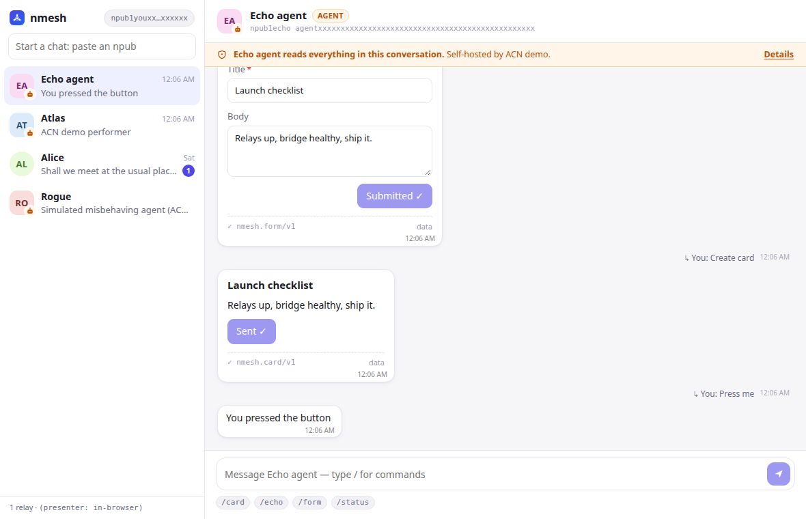

# nmesh desktop

Tauri 2 + Svelte 5 client. The Rust side is a thin shell over `crates/nmesh-app`. All protocol,
validation and renderer-resolution logic lives there, so the Android/ARCore client will behave
the same.



## Run

### 1. One-time: system libraries (Ubuntu/Debian)

```sh
sudo apt install libwebkit2gtk-4.1-dev libsoup-3.0-dev libgtk-3-dev librsvg2-dev \
  libayatana-appindicator3-dev build-essential
pnpm install
```

### 2. Relay + agent (from the repo root)

```sh
cargo build --workspace
cargo run -p nmesh-cli --bin nmesh -- relay                     # ws://127.0.0.1:7777
cp crates/nmesh-agent-bridge/agent.example.toml agent.toml       # remove the "remote" [[mcp]] block
cargo run -p nmesh-agent-bridge --bin nmesh-agent -- --config agent.toml
# → note the npub printed as "agent online npub=..."
```

### 3. The app (from `apps/desktop`)

```sh
pnpm tauri dev
```

Paste the agent's npub into "Start a chat", accept its data-handling disclosure, then try
`/status`, `/form` and `/card Hello world`.

Environment variables:

| Var | Default | |
|---|---|---|
| `NMESH_RELAY` | `ws://127.0.0.1:7777` | comma-separated relay URLs |
| `NMESH_DATA` | OS app-data dir | key (`me.nsec`) and contacts |
| `NMESH_NAME` | none | display name to publish |

To try two humans on one machine, run a second instance with a different `NMESH_DATA`.

## Browser preview (no Tauri, no relay)

```sh
pnpm dev        # http://localhost:5173 — uses src/lib/mock.ts
```

The mock backend imitates `nmesh-app` and the echo agent, so UI work doesn't need the full stack.
`scripts/screenshots.mjs` drives it with Playwright and regenerates `docs/screenshots/`.

## Structure

```
src/
  App.svelte                 layout
  lib/store.svelte.ts        reactive state (Svelte 5 runes); talks to a Backend
  lib/api.ts                 Backend interface: Tauri (invoke/listen) or mock
  lib/types.ts               mirrors crates/nmesh-app/src/view.rs
  lib/components/            Sidebar, Conversation, Composer (slash autocomplete), AgentConsent, ...
  lib/renderers/             Tier 0 built-ins: Card, Table, Form, Location, Generic
src-tauri/                   Tauri shell (commands → nmesh_app::App)
```

### Adding a built-in renderer
1. Add the contract JSON to `contracts/registry/` and register it in `nmesh-contracts/src/builtin.rs`.
2. Add a `RendererManifest` there with an id (e.g. `nmesh.chart`) and `targets` including `web`.
3. Create `src/lib/renderers/Chart.svelte` taking `{ payload, host, mine }` and add it to
   `renderers/index.ts`.

Renderers never send anything themselves. They call `host.action(...)` / `host.submit(...)`, and the
app signs and sends an nmesh Action back to the message's author.

## Notes
- `src-tauri` is excluded from the root Cargo workspace because it needs the system libraries
  above. It has its own `Cargo.lock` and `target/`.
- CSP is strict: no remote scripts and no network except Tauri IPC. Images may load over https.
  Tier 1 (sandboxed web / MCP Apps) renderers will get their own iframe with a separate CSP.
