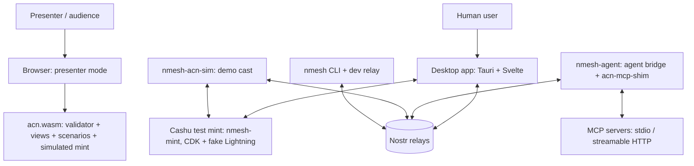
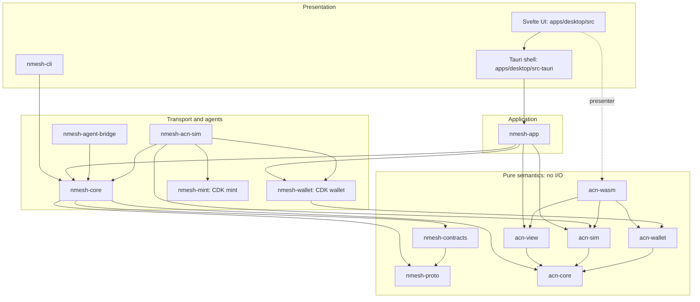
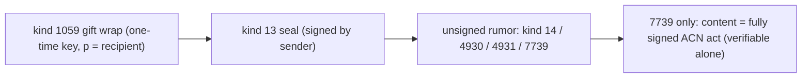
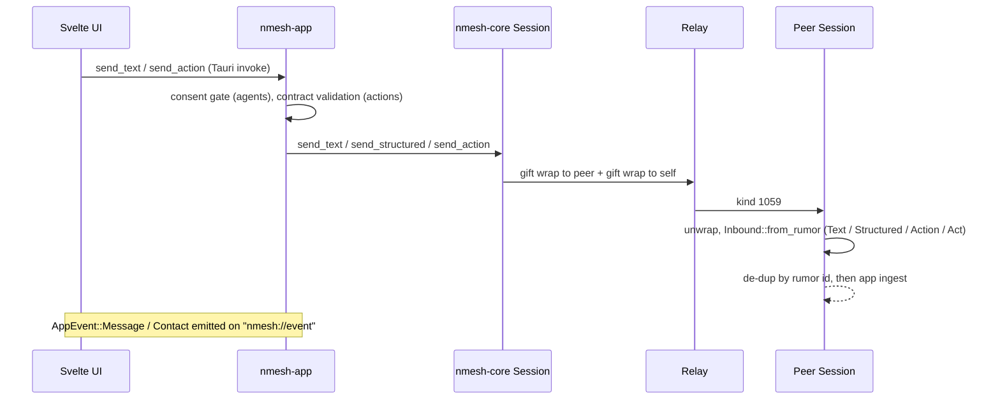
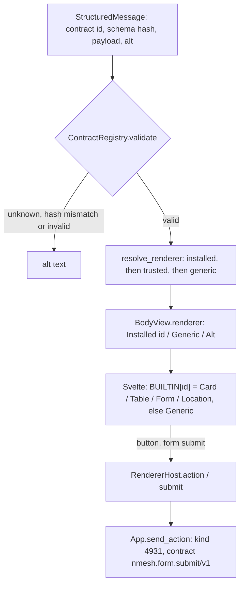
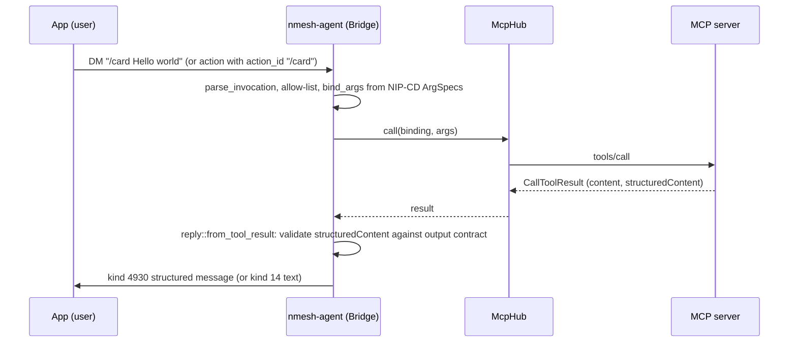
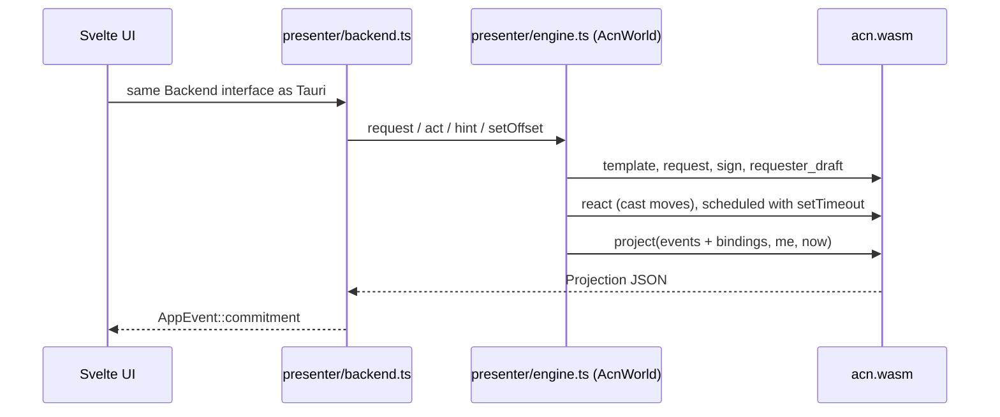

# nmesh + ACN prototype: system architecture

Status: prototype, Nov 8, 2026. Describes the code as it is. For intent and protocol rules see
[DESIGN.md](DESIGN.md) (nmesh) and [Core.md](Core.md) v0.2 (ACN); for the demo see
[DEMO.md](DEMO.md).

## 1. What the system is

Two things, built as one codebase:

- **nmesh:** a Nostr messenger for humans and agents. Agents are MCP servers exposed as Nostr
  peers. Structured payloads carry a data contract and render in context.
- **ACN:** Agent Commitments over Nostr. Commitments are signed events, and a pure, deterministic
  validator folds them into state. The app shows each commitment as a live card; the agent bridge
  and a simulated cast act as performers, verifiers, arbiters and gates.

Design rule that shapes everything below: **semantics live in pure Rust crates; everything else is
transport, storage or presentation.** The same validator runs in the desktop app, the agent
bridge, the simulator, and (as WebAssembly) in the browser.

## 2. System context



| Actor | Talks to | Over |
|---|---|---|
| Desktop app | relays | WebSocket, NIP-01; private content as NIP-17 / NIP-59 gift wraps |
| Agent bridge | relays; MCP servers | Nostr; MCP (`rmcp`) via stdio or streamable HTTP |
| Demo cast | relays | Nostr (six keys in one process) |
| Presenter mode | nothing | in-browser only; ACN logic and a simulated mint via WASM |
| CLI | relays | Nostr; also runs an in-memory dev relay |
| Desktop wallet, Atlas's wallet | Cashu mint | Cashu HTTP API (NUT-03/04/07/12/14) via CDK; the demo cast hosts the mint in-process |

## 3. Layers and components



### 3.1 Component catalogue

| Component | Kind | Responsibility | Key types / entry points | I/O | ~LoC |
|---|---|---|---|---|---|
| `nmesh-proto` | lib | nmesh wire format: kinds, structured messages, actions, manifests, NIP-CD slash commands | `StructuredMessage`, `Action`, `AgentManifest`, `SlashCommandDefinition`, `parse_invocation`, `bind_args` | none | 890 |
| `nmesh-contracts` | lib | Data contracts: JSON Schema registry, hash pinning, renderer resolution, trust policy | `ContractRegistry`, `schema_hash`, `resolve_renderer`, `TrustPolicy`, `builtin::*` | none | 450 |
| `acn-core` | lib | ACN grammar and validator: event model, BIP-340 verification, JCS, terms, bindings, the deterministic fold, `status_at`, act drafting | `fold`, `status_at`, `Draft`, `Terms`, `Template`, `instantiate`, `binding_status`, `Code` | none, no C deps | 3,460 |
| `acn-view` | lib | Projections of the fold for UIs: timeline, evidence, counter diff, settlement, allowed acts | `project`, `Projection`, `Entry`, `ConditionView`, `SettlementView` | none | 600 |
| `acn-sim` | lib | Demo scenarios: the cast, terms templates, reactions, requester hints | `SCENARIOS`, `template`, `react`, `requester_hint`, `requester_draft` | none | 940 |
| `acn-wallet` | lib | Wallet views shared by all hosts; `SimMint`, a pure Cashu-shaped mint with NUT-14 rules for presenter mode; settlement advice derived from the fold | `WalletView`, `Lock`, `SimMint`, `settlement::{check_payment, advise, request_token}` | none | 510 |
| `acn-wasm` | cdylib | Browser entry point: JSON-in/JSON-out ABI over core + view + sim + wallet | `acn_invoke` (`op`: `fold`, `project`, `react`, `hint`, `sign`, `mint_*`, `payment_check`, `advise`, ...) | none | 300 |
| `nmesh-wallet` | lib | Cashu wallet over CDK (wallet feature only): top up, HTLC lock, inspect (DLEQ + NUT-07 + lock shape), redeem, NUT-14 refund (manual swap), lock index + history per commitment | `CashuWallet` | mint HTTP; SQLite + JSON index | 500 |
| `nmesh-mint` | lib + bin | Local Cashu test mint: CDK mint + `cdk-fake-wallet` Lightning backend + `cdk-axum` | `start(MintConfig) -> RunningMint`; bin `nmesh-mint` | HTTP; SQLite | 150 |
| `nmesh-core` | lib | Nostr session: keys, relays, NIP-17 send/receive, inbox stream, peer discovery, ACN transport, MLS spike | `Session`, `Inbound`, `Body`, `PeerInfo`, `sign_act`, `send_act`, `acn_public`, `find_acn_services` | relays, key files | 810 |
| `nmesh-app` | lib | Application state and view models for UIs: contacts, history, consent, commitments, wallet, presenter clock and hints | `App`, `AppEvent`, `ContactView`, `MessageView`, `CommitmentView`, `WalletView` | via `nmesh-core` and `nmesh-wallet`; `contacts.json`, `wallet/` | 1,600 |
| `nmesh-agent-bridge` | lib + 2 bins | MCP servers as a Nostr agent; ACN T0 shim | `Bridge`, `McpHub`, `shim::Shim`; bins `nmesh-agent`, `nmesh-echo-mcp` | relays, MCP, key files | 1,530 |
| `nmesh-acn-sim` | lib + bin | The demo cast as live Nostr peers; hosts the test mint; Atlas verifies tokens and redeems | `start(Config) -> Running`, `MintSetup` | relays, key files, mint | 700 |
| `nmesh-cli` | bin | Dev client (`chat`, `send`, `card`, `listen`) and in-memory dev relay (`relay`) | `nmesh` | relays | 280 |
| `apps/desktop/src-tauri` | bin | Tauri shell: 22 commands delegating to `nmesh_app::App`; forwards `AppEvent`s | `nmesh-desktop` | WebView IPC | — |
| `apps/desktop/src` | Svelte 5 | UI: sidebar, conversation, renderers, commitment card, Director, wallet panel; Tauri or presenter backend | `store.svelte.ts`, `api.ts`, `presenter/*`, `WalletPanel.svelte` | IPC or WASM | 4,000 total incl. shell |
| `nmesh-ffi` | placeholder | Future UniFFI bindings (Kotlin / ARCore) | — | — | 0 |
| `contracts/registry/*.json` | data | Built-in contract definitions (card, table, form, form.submit, location) | embedded via `include_str!` | — | — |

**Purity boundary.** `nmesh-proto`, `nmesh-contracts`, `acn-core`, `acn-view`, `acn-sim`,
`acn-wallet` and `acn-wasm` contain no I/O, clocks or randomness (time and randomness are
parameters). CDK is confined to `nmesh-wallet` (wallet feature; no protoc) and `nmesh-mint`
(mint feature; needs `protoc`, fetched by `scripts/fetch-protoc.sh` into `.tools/`).
`acn-core` uses pure-Rust `k256` for BIP-340 so it builds for `wasm32-unknown-unknown` without a
C toolchain.

## 4. Data model

### 4.1 Event kinds

| Kind | Name | Defined in | Notes |
|---|---|---|---|
| 0, 14, 1059, 10050 | profile, DM rumor, gift wrap, DM inbox relays | NIPs 01/17/59 | agents set `"bot": true` in kind 0 |
| 31992 | slash command definition | NIP-CD | one per agent tool / scenario |
| 4930 / 4931 | nmesh structured message / action | `nmesh_proto::kinds` | `contract`, `alt`, `e` tags; travel as rumors |
| 24930 | agent status (reserved) | `nmesh_proto::kinds` | not used yet |
| 34930–34932 | contract / renderer / agent manifest | `nmesh_proto::kinds` | addressable; agent manifest is published |
| 7700–7712 | ACN acts (REQUEST … RULING) | `acn_core::kinds` | regular events, provisional (D-1) |
| 7720–7725 | attestations, interpretive report, endorse, score, judged attestation | `acn_core::kinds` | annotating; `K_SCORE` reserved; `K_ATTEST_JUDGED` = 7725 (CR-001) |
| 7730–7732 | bind, bind ack, bind revoke | `acn_core::kinds` | published publicly |
| 7739 | `K_PRIVATE_ACT` | `acn_core::kinds` | rumor whose content is one signed act |
| 37700 | `K_SVC` service advertisement | `acn_core::kinds` | addressable; tools, terms templates, data handling |

### 4.2 Envelopes



Every rumor is wrapped twice: once to the recipient and once to the sender, so the sender's
other devices see it (`Session::wrap_and_send`). Rumor ids are the stable message ids used for
replies, actions and de-duplication.

### 4.3 Terms, templates and settlement

- **Terms** (`acn_core::terms::Terms`) are JCS-canonical JSON, identified by their sha256 and
  inlined in `REQUEST` / `COUNTER` (≤ 16 KiB).
- **Templates** (`acn_core::draft::Template`) are published in `K_SVC` with relative times.
  `instantiate` fixes the deadline, review window, tool and input, and the hashlock / locktime.
- **Settlement (§8):** the requester generates `s`, puts `H = sha256(s)` and the locktime
  `L = deadline + review_window + 24 h` in the terms, and keeps `s` in `nmesh-app` (persisted in
  `contacts.json`). Before signing the `REQUEST` it locks the price as a **NUT-14 HTLC token**
  (hash `H`, receiver = performer key, refund key = requester key, locktime `L`) and puts it
  NIP-44-encrypted to the performer in `content.token`. `SATISFY` reveals `s` (V-10 checks it),
  which lets the performer redeem. For an arbiter, `s` is NIP-44-encrypted to the arbiter in an
  `escrow` tag, so a `RULING` for the performer can release it.
- **Keys:** Cashu P2PK/HTLC keys are the Nostr keys. An x-only Nostr key `X` is used as `02‖X`;
  NUT-11 signatures are BIP-340 over the x-only key, so parity doesn't matter.
- **Mints:** live mode uses a real CDK mint whose Lightning backend is fake (`nmesh-mint`, test
  sats). Presenter mode uses `SimMint` at `sim://mint`, which enforces the same rules without
  blind signatures. `SettlementView.simulated` is true only for `sim:` mints.

## 5. Data flows

### 5.1 Messaging (text and structured)



Inbox subscription: kind 1059 with `p` = me, `since` = now − 30 days in the app (at least 49 h,
because NIP-59 back-dates wraps). History is not stored locally; it is re-fetched from relays on
start.

### 5.2 Rendering a structured payload



The renderer decision is made in Rust (`nmesh-app/src/view.rs`), so all UIs agree. Renderers
never sign anything: they ask the host.

### 5.3 Agent tool call (MCP)



At startup the bridge connects to every MCP server, lists tools, derives contracts from
`outputSchema` (or maps them via `x-nmesh-contract`), and publishes kind 0 (`bot`), the agent
manifest, one NIP-CD definition per tool and, with `[acn]` enabled, `K_SVC` plus an operator
binding.

### 5.4 Discovering a peer

`Session::peer_info(pk)` makes four fetches against the relays:

1. Authored by `pk`: kinds 0, 34932 (agent manifest), 31992 (commands). The newest per
   (kind, `d`) is kept.
2. Authored by `pk`: kinds 37700 (`K_SVC`) and 7731 (bind ack), via `acn_public`.
3. Kind 7730 bindings tagged `p` = `pk`.
4. Kind 7732 revocations authored by those operators.

`acn_core::binding_status` evaluates the binding (V-8). `nmesh-app` stores the commands, the
`K_SVC` and the binding events per contact (the binding events are fold inputs) and produces a
`ContactView` with `agent`, `commands` and `acn`. The **🎬 ACN demo** button uses
`find_acn_services` to look up `K_SVC` by `d` = `acn-sim-atlas` / `acn-sim-rogue`.

### 5.5 ACN commitment (live)

```mermaid
sequenceDiagram
    participant UI as Svelte (card / Director)
    participant App as nmesh-app
    participant R as Relay
    participant P as Performer (shim or demo cast)
    UI->>App: request("/negotiate a logo")
    App->>App: bind_args, template from K_SVC, instantiate (s, H if hashlock; NIP-44 escrow if arbiter)
    App->>App: Draft::request, Session::sign_act
    App->>R: K_PRIVATE_ACT rumor in gift wrap
    R->>P: act
    P->>P: store; acn_sim::react / Shim::drive (computed from fold)
    P->>R: COUNTER / PROMISE / PROGRESS / REPORT ... (signed, private)
    R->>App: acts
    App->>App: on_act: group by commitment, then acn_view::project(acts + bindings, me, now + offset)
    App-->>UI: AppEvent::Commitment (CommitmentView)
    UI->>App: accept_counter / satisfy / reject / dispute / withdraw / run_hint
    App->>App: acn_sim::requester_draft from fold, sign (created_at ≥ head, V-15)
    App->>R: act
```

Properties of this flow:

- **No component keeps commitment state.** State is recomputed with `fold` over the stored
  signed acts every time (INV-2, INV-12). The shim and the cast decide their next move from the
  fold, so replays and restarts are idempotent. The bridge replays its own history before acting.
- **Third-party acts** (verifier, judge, arbiter, gate) are grouped into the conversation where
  the commitment's REQUEST lives (`State.owner`).
- **Time:** signing uses real time. `status_at` uses real time plus the presenter clock offset
  (`App::set_clock_offset`).

### 5.6 Presenter mode (browser)



Chat (Echo agent, Alice) is a small TypeScript stand-in. All ACN state, legality, anomalies,
hints and cast reactions come from WASM. Keys are fixed demo keys, and the npubs shown are
placeholders. The simulated mint's state is JSON owned by WASM (`mint_*` ops); the engine only
holds it. Refunds use the presentation clock, so the Director can fast-forward to the locktime.

### 5.7 Settlement (live, real ecash)

```mermaid
sequenceDiagram
    participant U as Requester (nmesh-app + nmesh-wallet)
    participant M as Mint (nmesh-mint)
    participant R as Relay
    participant A as Atlas (nmesh-acn-sim + nmesh-wallet)
    U->>M: top up (bolt11 quote; fake LN pays itself), mint proofs
    U->>U: s, H = sha256(s); instantiate terms (H, L)
    U->>M: swap to HTLC proofs (H, receiver = Atlas, refund = me, locktime L)
    U->>R: REQUEST {terms, token: NIP-44(token) to Atlas}
    R->>A: REQUEST
    A->>A: decrypt token
    A->>M: DLEQ check (NUT-12, offline) + state check (NUT-07)
    A->>A: check_payment(terms, verified): amount, H, receiver, locktime
    alt token ok
        A->>R: REPORT (T1) or PROMISE (N) with token_verified
    else token bad
        A->>R: DECLINE payment_invalid
    end
    U->>R: SATISFY {preimage: s}
    R->>A: SATISFY
    A->>A: settlement::advise -> Redeem
    A->>M: swap with preimage + signature (NUT-14 receiver path)
    A->>R: DM "Redeemed 21 sat"
    U->>M: NUT-07 state check: lock shows "redeemed by Atlas"
    Note over U,M: Unsatisfied close: after L, U swaps with its refund-key signature (NUT-14 refund path)
```

Properties:

- **No custodian.** Neither the app nor the cast holds the other's money; the mint enforces the
  spending conditions. The arbiter holds `s`, not funds.
- **Wallet facts are not protocol state.** Whether a token was redeemed or refunded comes from
  the mint (NUT-07) and the local lock index; it never feeds the fold. The card shows both side
  by side: the protocol's settlement status and "your token: redeemed by Atlas".
- **The mint's clock rules refunds.** The presentation clock can't open a refund in live mode;
  the app checks real time before trying, and the mint checks again.

## 6. Capability → implementation map

Status: ✅ built and tested · 🟡 partial / simulated · ⬜ not built.

### 6.1 Messaging and agents (nmesh)

| Capability | Implementation | Verified by | Status |
|---|---|---|---|
| Identity, local key | `nmesh_core::load_or_create_keys` (0600 file) | `dm_roundtrip` | 🟡 no NIP-46 / NIP-55 signer |
| Private 1:1 DMs, multi-device | `Session::send_text` / `wrap_and_send` / `inbox_with` | `dm_roundtrip` | ✅ |
| Structured messages with contracts | `nmesh_proto::StructuredMessage`; `ContractRegistry` | proto + contracts unit tests | ✅ |
| Contract hash pinning | `schema_hash`, `ContractError::HashMismatch` | `hash_pinning` | ✅ |
| Renderer resolution and trust | `resolve_renderer`, `TrustPolicy` (allow-list) | resolve unit tests | ✅ (web of trust ⬜) |
| Tier 0 renderers | `Card`, `Table`, `Form`, `Location`, `Generic` (Svelte); CLI `render.rs` (tui) | screenshot scripts | ✅ |
| Tier 1 (MCP Apps) and third-party renderers | — | — | ⬜ |
| Actions (buttons, forms) → tools | `App::send_action`; `Bridge::handle_action` | `app_flow` | ✅ |
| MCP servers as agents (stdio, HTTP) | `McpHub::connect`, `TokioChildProcess`, `StreamableHttpClientTransport` | `app_flow` (stdio) | ✅ (HTTP untested) |
| Output contracts from `outputSchema` | `register_output_contract`, `x-nmesh-contract` | `app_flow` | ✅ |
| NIP-CD slash commands, autocomplete | `SlashCommandDefinition`, `bind_args`; `Composer.svelte` | proto unit tests | ✅ |
| Agent disclosure and consent gate | `AgentManifest.data_handling`; `App::ensure_consent`; `AgentConsent.svelte` | `app_flow` | ✅ |
| Marmot / MLS groups | `nmesh_core::mls` (KeyPackage only, feature `mls`) | builds only | 🟡 spike |
| Local history store | — (refetched from relays) | — | ⬜ |
| Mobile / ARCore client | `nmesh-ffi` placeholder; `nmesh.location/v1` spatial block | — | ⬜ |

### 6.2 ACN (Core.md v0.2)

| Capability | Spec | Implementation | Verified by | Status |
|---|---|---|---|---|
| Event model, BIP-340, NIP-01 ids | V-1 | `acn_core::event` | `nostr_compat` (both directions) | ✅ |
| JCS hashing of terms | §5.3 | `acn_core::jcs` | jcs unit test | ✅ |
| Structure, version, kind checks | V-2, V-3 | `acn_core::act::parse` | scenarios | ✅ |
| Deterministic fold, sibling resolution | INV-2, §5.4, V-7, V-13 | `acn_core::fold` | `fold_is_order_independent` (all permutations ≤ 6 events, 300 samples above) | ✅ |
| 13-act state machine, profiles T0 / T1 / N | §6 | `Ctx::step` | `every_act_kind_is_exercised` | ✅ |
| Terms binding, counter while promised | INV-4, V-9, §6.1 | `Pending`, `ACCEPT` / `PROMISE` checks | `n_counter_accept`, `counter_while_promised` | ✅ |
| Operator bindings, scope, revocation | §4, V-8 | `acn_core::binding`; `shim::ensure_binding` | `bindings`, `revoked_binding`, `app_flow` | ✅ |
| Evidence classes, verifiers | INV-8, V-11 | `Ctx::attestation`, `ConditionStatus` | `evidence` | ✅ |
| Contradicted rejection | V-16 | `fold` post-pass | `evidence`, playthrough | ✅ |
| `judged` condition class, assurance labels | §7, INV-8, CR-001 | `terms::{Judged, Assurance}`, `Terms::assurance`; `Commitment.assurance`; card / tile labels | J-11 | ✅ |
| Judged evidence | V-11, V-17, CR-001 | `act::judged_content` (V-3), `Ctx::judged_evidence` | `cr001_judged_vectors_under_every_arrival_order` (J-1…J-8, J-3b, J-11…J-14) | ✅ |
| Audit as a condition (no holdback) | §7, CR-001 §2.4 (holdback dropped) | ordinary conditions; `Judged` rejects unknown fields | J-13, J-14 | ✅ |
| Governance endorsements | V-14 | `needs_endorsement` / `endorsed` | `governance` | ✅ |
| Causal monotonicity, late flags | V-15, §6.5 | `step` | `time_regress`, `late` | ✅ |
| Time-derived status (lapse) | §6.5 | `acn_core::status_at` | `time_status`, *silent* scenario | ✅ |
| Every anomaly code reachable | §10 | `Code::ALL` | `every_anomaly_code_is_exercised` | ✅ |
| Private-mode transport | §5.5 | `Session::send_act`; `Body::Act` | `app_flow`, `live` | ✅ |
| `K_SVC` with terms templates | §4, §7 | `shim::service_advertisement`; `nmesh_acn_sim::advertise` | `live` | ✅ |
| T0 over MCP (`acn-mcp-shim`) | §6.3, §11 | `shim::Shim::drive` | `app_flow` | ✅ price 0 only |
| Hashlock settlement (T1, N) | INV-6, V-10, §8 | preimage in `SATISFY` / `RULING`; `SettlementView` | `t1_preimage`, *paid*, *dispute* | ✅ |
| HTLC lock at request time, token in `content.token` | §8.2 steps 1–2 | `CashuWallet::lock_htlc`; `App::request` (NIP-44 to the performer) | `htlc`, `live` | ✅ test mint |
| Performer verifies before work (DLEQ + NUT-07 + terms) | §8.2 step 3, §13 forged token | `CashuWallet::inspect`; `settlement::check_payment`; `acn_sim::react_paid` (waits, or `DECLINE payment_invalid`) | `htlc`, `performer_waits_for_and_obeys_the_payment_check` | ✅ |
| Redeem with the revealed preimage | INV-6, §8.2 | `settlement::advise` → `CashuWallet::redeem` (Atlas) | `live` (balances move), `htlc` | ✅ |
| Refund after the locktime | §8.2, P1 gate | `CashuWallet::refund` (manual NUT-14 refund swap); `App::refund` | `htlc` (real mint), `presenter.mjs` (sim) | ✅ |
| Double spend rejected | P1 gate | the mint (CDK) | `htlc` | ✅ |
| Arbiter escrow | §8.4 | NIP-44 `escrow` tag; `nmesh_acn_sim::Sim::ingest` | `live` (*dispute*: Atlas redeems after the RULING) | ✅ |
| Integrated wallet UI | — | `WalletPanel.svelte`, sidebar chip, Director balances, card token state; `App::{wallet, top_up, refund}`, `AppEvent::Wallet` | `presenter.mjs` | ✅ |
| T0 paid (unlocked token, swapped before work) | §6.3, §8.3 | — (the shim is free-only) | — | ⬜ |
| Milestones, multiple tokens | §8.5 | — | — | ⬜ |
| Wallet backup / NIP-60, NWC top-up, real mints | — | — | — | ⬜ |
| Blossom artifacts, derivation records | §9 | `x` tags carried only | — | ⬜ |
| `K_SCORE`, reputation (D-13) | §11 | kind reserved | — | ⬜ |
| Binding API for external harnesses | §11, D-10 | — | — | ⬜ |
| Projections (thread / evidence view) | §12 | `acn_view::project`; `CommitmentCard.svelte` | playthrough, presenter script | ✅ |
| Board (queue view) across agents and roles | §12 | `acn_view::Lane`, `Projection.{lane, my_role, next, needs_me, pending_endorsement, updated_at}`; `App::board(closed_limit)`; `Board.svelte`, `BoardTile.svelte` | `board_lanes_follow_the_workflow`, `live` (paging, needs_me), `scripts/board.mjs` | ✅ (no drag-and-drop, by design) |
| Ledger view | §12 | wallet panel history only | — | 🟡 |

### 6.3 Demo

| Capability | Implementation | Verified by | Status |
|---|---|---|---|
| Nine scenarios, scripted cast | `acn_sim::SCENARIOS`, `react`, `template` | `playthrough` | ✅ |
| Live cast on relays | `nmesh-acn-sim` | `live` (all nine via the app layer) | ✅ |
| Director: next step, autopilot, clock | `requester_hint` / `run_hint`; `Director.svelte`; `set_clock_offset` | `live`, `scripts/presenter.mjs` | ✅ |
| Presenter mode in the browser | `acn-wasm` + `presenter/*` | `scripts/presenter.mjs` (all nine, no page errors) | ✅ |
| Reset demo | `App::reset_demo` (epoch cutoff + cleared ids, persisted); presenter `AcnWorld::reset`; the cast ignores requests older than its start | `live` (incl. restart), `presenter.mjs`, `board.mjs` | ✅ |
| Money in the demo | live: real ecash at the cast's test mint (`127.0.0.1:3338`); presenter: `SimMint`. Balances in the Director and wallet panel | `live`, `presenter.mjs` (29 / 71 sat, refund) | ✅ |
| Screencast | `scripts/screencast.mjs` → `docs/demo/acn-demo.mp4` | manual review | ✅ |

## 7. State, keys and persistence

| Data | Where | Notes |
|---|---|---|
| User key | `<NMESH_DATA or app-data>/me.nsec` | plaintext nsec, mode 0600 |
| Contacts, consent, **payment preimages** | `<data>/contacts.json` | ⚠ preimages are stored in plaintext (fine for test sats only) |
| Wallet | `<data>/wallet/<key>-<mint>.sqlite` (CDK proofs) + `.json` (NUT-13 seed, lock index, history) | ⚠ plaintext; the seed is random per database, not derived from the Nostr key |
| Atlas's wallet | `.nmesh/sim/wallets/` | |
| Test mint | `.nmesh/mint/mint.sqlite` + `.seed` | keys stay stable across runs, so stored tokens remain valid |
| Agent key | `agent.key_file` (e.g. `.nmesh/agents/echo.nsec`) | |
| Operator key (self-hosted binding) | `acn.operator_key_file` | should be cold / NIP-46 in production |
| Demo cast keys | `.nmesh/sim/*.nsec` | stable npubs across runs |
| Messages and acts | relays only; in memory in each process | nothing local beyond the above |
| Dev relay | in memory (`nmesh relay`) | lost on restart |
| Presenter mode | browser memory | fixed demo keys; nothing published |

## 8. Trust boundaries

- **Relays are untrusted.** They see gift-wrap metadata (recipient `p`, timing, size), never
  content. Validation never depends on which relay delivered an event.
- **The validator trusts only signatures and hashes.** UI, app and simulator state carry no
  semantics. A forged or out-of-order act is retained and reported, never applied.
- **Agents see plaintext.** This is disclosed before first contact and shown in a banner, and the
  app enforces the consent gate.
- **MCP servers** receive tool arguments from the bridge; the agent manifest lists them in
  `forwards_to`.
- **Simulation:** the cast's decisions are scripted, but every act it emits is signed and
  validated like any other.
- **The mint** is trusted for custody and for enforcing spending conditions, as in any Cashu
  deployment. It never sees commitments; tokens reach the performer encrypted, and relays never
  see amounts or the mint. The app accepts only its configured mint (`NMESH_MINT`) and refuses a
  request whose template names another one.

## 9. Build, run and test

| Target | Command | Notes |
|---|---|---|
| Workspace | `cargo build --workspace`; `cargo test --workspace`; `cargo clippy --workspace --all-targets --features nmesh-core/mls -- -D warnings` | `apps/desktop/src-tauri` is excluded (needs WebKitGTK) |
| WASM | `cd apps/desktop && pnpm wasm` | builds `acn-wasm` for `wasm32-unknown-unknown` into `public/acn.wasm` |
| Desktop | `pnpm tauri dev` / `pnpm tauri build` | deb, rpm, AppImage |
| Presenter | `pnpm dev` | no Tauri, no relay |
| Live demo | `nmesh relay`, then `nmesh-acn-sim`, then the desktop app | see DEMO.md |

| Test suite | Covers |
|---|---|
| `acn-core/tests/scenarios.rs` | P0 gates: every act, every anomaly, permutation property |
| `acn-core/tests/nostr_compat.rs` | signature interop with rust-nostr |
| `acn-sim/tests/playthrough.rs` | all nine scenarios reach their intended end; idempotent reactions |
| `nmesh-core/tests/dm_roundtrip.rs` | NIP-17 text and structured messages over a mock relay |
| `nmesh-agent-bridge/tests/app_flow.rs` | app ↔ relay ↔ bridge ↔ MCP: chat, forms, ACN T0 |
| `nmesh-acn-sim/tests/live.rs` | app ↔ relay ↔ cast ↔ mint: discovery, all nine scenarios via hints, real balances (100 → 29 / 71), insufficient funds |
| `nmesh-wallet/tests/htlc.rs` | real CDK mint: top up, lock, DLEQ/NUT-07 inspect, wrong preimage / wrong key / early refund rejected, redeem, double spend, refund after locktime, index survives reopen |
| `acn-wallet` unit, `acn-wasm` unit | `SimMint` rules; the same through the JSON ABI |
| `scripts/presenter.mjs`, `screenshots.mjs` | browser end-to-end and screenshots |
| `scripts/board.mjs` | board: lanes at mixed stages, overdue tile, needs-you filter, satisfy / accept counter from the drawer, open in chat, reset |
| `scripts/webkit_probe.py` | layout checks in the system WebKitGTK |

## 10. Known limitations and technical debt

- **Test sats only.** The mint's Lightning backend is fake. Preimages and wallet proofs sit in
  plaintext on disk. No NIP-60 backup, no NWC, no real mint, no binding `max_sat` caps.
- **Refund is a manual swap** (CDK's `receive` only tries the preimage path for HTLC proofs).
- **Live refunds wait for the real locktime** (≈ 25 h in the demo templates); presenter mode can
  fast-forward it.
- **The demo performer replays history on restart** and may act on old open commitments (for
  priced ones from before the wallet existed, it declines `payment_invalid`).
- **No local message store.** History comes back from relays (30-day window), and gift wraps
  sent to a single relay are lost when the dev relay restarts.
- **Keys are in files**, with no external signer (NIP-46 / NIP-55) yet.
- **Single-relay assumptions:** no outbox / gossip routing to recipients' NIP-17 inbox relays.
- **`nostr` is pinned to 0.44** because `mdk-core` 0.8 needs it; upgrade both together.
- **Kind numbers are provisional** (D-1). nmesh kinds (49xx, 349xx) and ACN kinds (77xx, 37700)
  are not registered.
- **`K_SVC` and the nmesh agent manifest coexist**; the spec intends `K_SVC` to replace it.
- **The bridge shim is T0, free only**, and declines anything else with a reason.
- **The commitment card re-projects all of a conversation's acts on every update**, which is
  fine at demo scale and O(n) per event.
- **Dev-server CSS glitch:** Vite once served raw `.svelte` source as a stylesheet, which
  broke the layout in the Tauri dev window. Restarting the dev server fixes it; production builds
  are unaffected.
- **Reputation under private commitments** is unresolved (D-13).
- **Reset is a local cutoff,** not a deletion: signed acts stay on relays. The board re-projects
  every conversation on each refresh (fine at demo scale).

## 11. Extension points

| To add | Touch |
|---|---|
| A built-in contract + renderer | `contracts/registry/*.json`, `nmesh_contracts::builtin`, `apps/desktop/src/lib/renderers/` |
| An MCP-backed agent | an `agent.toml` with `[[mcp]]` blocks; no code |
| A demo scenario | `acn_sim::SCENARIOS`, `template`, `react_one`, `requester_hint`; the playthrough test checks it |
| A new ACN act or rule | `acn_core::kinds`, `act::parse`, `fold::Ctx::step`; add a scenario per anomaly code |
| A new UI host (Android / ARCore) | `nmesh-ffi` over `nmesh-app`; reuse `acn-view` projections and contract renderers |
| External harness binding | `acn-core` drafts + `nmesh-core` transport today; the Binding API (D-10) later |
