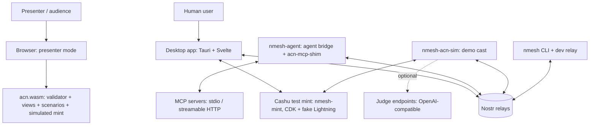
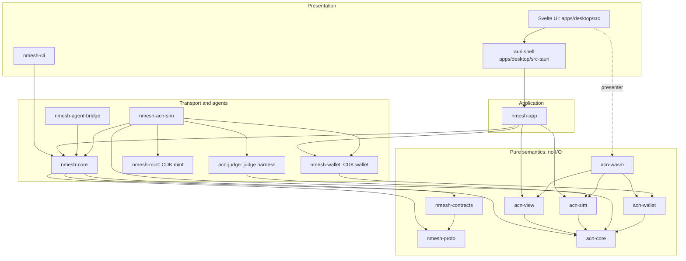
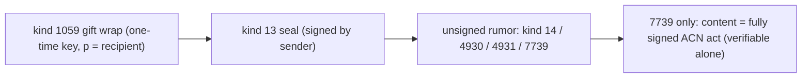
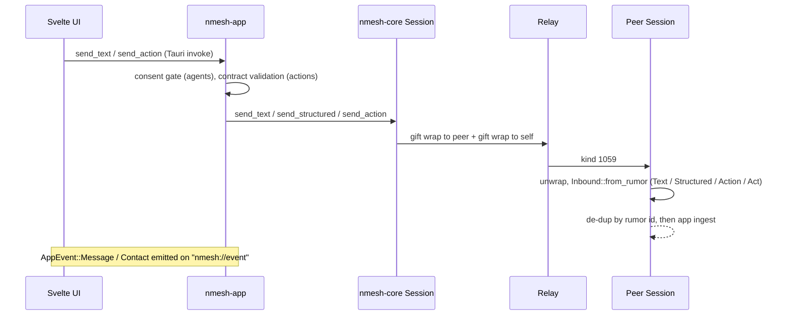
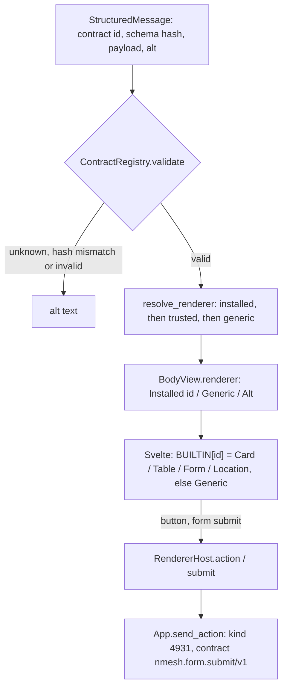
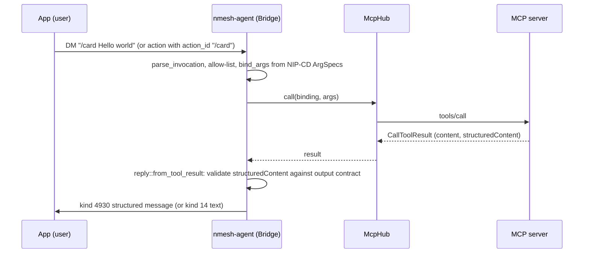

# nmesh + ACN prototype: system architecture

Status: prototype, Nov 9, 2026. Describes the code as it is. For intent and protocol rules see
[DESIGN.md](DESIGN.md) (nmesh) and [Core.md](Core.md) v0.5 (ACN; wire versions `acn/0.4` and
`acn-terms/0.5`); for the demo see [DEMO.md](DEMO.md).

## 1. What the system is

Two things, built as one codebase:

- **nmesh:** a Nostr messenger for humans and agents. Agents are MCP servers exposed as Nostr
  peers. Structured payloads carry a data contract and render in context.
- **ACN:** Agent Commitments over Nostr. Commitments are signed events, and a pure, deterministic
  validator folds them into state. The app shows each commitment as a live card; the agent bridge
  and a simulated cast act as performers, verifiers, arbiters and gates.

Design rule that shapes everything below: **semantics live in pure Rust crates; everything else is
transport, storage or presentation.** The same validator runs in the desktop app, the agent
bridge, the simulator, and (as WebAssembly) in the browser.

## 2. System context



| Actor | Talks to | Over |
|---|---|---|
| Desktop app | relays | WebSocket, NIP-01; private content as NIP-17 / NIP-59 gift wraps |
| Agent bridge | relays; MCP servers | Nostr; MCP (`rmcp`) via stdio or streamable HTTP |
| Demo cast | relays; judge endpoints (optional) | Nostr (six peers in one process, plus an operator key for Atlas's binding); with `--judges`, OpenAI-compatible chat completions over HTTP (`acn-judge`) |
| Presenter mode | nothing | in-browser only; ACN logic and a simulated mint via WASM |
| CLI | relays | Nostr; also runs an in-memory dev relay |
| Desktop wallet, Atlas's wallet | Cashu mint | Cashu HTTP API (NUT-03/04/07/12/14) via CDK; the demo cast hosts the mint in-process |

## 3. Layers and components



### 3.1 Component catalogue

| Component | Kind | Responsibility | Key types / entry points | I/O | ~LoC |
|---|---|---|---|---|---|
| `nmesh-proto` | lib | nmesh wire format: kinds, structured messages, actions, manifests, NIP-CD slash commands | `StructuredMessage`, `Action`, `AgentManifest`, `SlashCommandDefinition`, `parse_invocation`, `bind_args` | none | 890 |
| `nmesh-contracts` | lib | Data contracts: JSON Schema registry, hash pinning, renderer resolution, trust policy | `ContractRegistry`, `schema_hash`, `resolve_renderer`, `TrustPolicy`, `builtin::*` | none | 450 |
| `acn-core` | lib | ACN grammar and validator: event model, BIP-340 verification, JCS, terms (`acn-terms/0.5` only; unknown fields are malformed), bindings, the deterministic fold, `status_at`, act drafting, CR-003 checks (no hidden criteria, disqualifiers, closure rule), contingent sealing (NIP-44 v2 keyed by `k`), held-out instances (RFC 6962 pool proofs, two-seed sample), terms templates (typed slots, V-28 re-instantiation) | `fold`, `status_at`, `Draft`, `Terms`, `Template`, `instantiate`, `template::{TermsTemplate, TemplateRef, check}`, `binding_status`, `Code`, `sealed::{seal, open, ciphertext_hash}`, `instances::{root, proof, verify, sample, pool_root, reveal, HeldOut}` | none, no C deps | 4,670 |
| `acn-view` | lib | Projections of the fold for UIs: timeline, evidence, counter diff, settlement, allowed acts, board lanes; the terms card, terms versions and diffs, template provenance and records, the linter's findings (CR-003); attestation details (method, recipe, referent, judges, instances) and each `REPORT`'s derivation record; who may counter; terms read by reference (P2) | `project_with`, `project`, `Projection`, `Entry`, `ConditionView`, `DisqualifierView`, `SettlementView`, `Lane`, `TermsCard`, `TermsVersionView`, `DiffLine`, `InstancesView`, `TemplateView`, `template_records` | none | 1,330 |
| `acn-sim` | lib | Demo scenarios: the cast, service terms offers, Atlas's published terms template (`retry-change/v1`), reactions (incl. scripted judges, the contingent seal and the held-out pool with its proofs), requester hints | `SCENARIOS`, `template`, `react`, `react_with` (escrow, payments, performer keys, requester seeds), `Move.escrow`, `Move.judge` (`JudgeJob`: the host runs real judges and fills the content), `Cast.judge_panel`, `Cast.templates` (published ids, recorded by the host), `templates`, `requester_hint`, `requester_draft` (and `_with` variants that take terms documents); `react_negotiation` (Atlas answers a requester counter or an unclosed request, P2) | none | 1,690 |
| `acn-judge` | lib + example | Judge harness for `judged` conditions: a panel of pinned judges on OpenAI-compatible endpoints (Ollama, OpenAI, OpenRouter, ...), repeats and medians, artifact delimiting, injection scan plus model vote, held-out cases (the sample both seeds select, checked against the terms, shown to the judges and revealed with proofs), `K_ATTEST_JUDGED` content that V-17 and V-27 count; pinned by `harness_hash` | `Panel::{load, with_llm, fingerprints, evaluate}`, `HeldOut`, `PanelConfig`, `Llm`, `HttpLlm`, `harness_hash`; example `try_panel` | HTTP to the judges; reads `judges.toml` and API keys from env | 730 |
| `acn-author` | lib | Authoring aids (CR-003 §3), binding code: the terms linter (L1–L8) and the requester and performer drafters; deterministic, never invents a key | `lint`, `LintContext`, `Finding`, `draft_request`, `draft_counter`, `Intent`, `RequesterConfig`, `Capabilities`, `TemplateCandidate` | none | 1,150 |
| `acn-binding` | lib | The Binding API (D-10): the eight interfaces as object-safe traits, and `Performer`, the performer driver (folds every event with the terms documents it fetches through `Evidence::fetch`, declines what L0 can't meet, verifies and redeems tokens, writes evidence and the derivation record, folds each act before signing) | `Signer`, `Inbox`, `Executor`, `Evidence`, `Wallet`, `Gate`, `Verifier`, `TermsAuthor`, `ReferenceAuthor`, `Performer`, `StateChange`, `ServiceAd`, `call_offer`, `Level` | none | 870 |
| `acn-binding-nostr` | lib | The reference stack behind the traits: session as Signer and Inbox, CDK wallet, Blossom evidence; the performer run loop; `K_SVC`, BUD-03 list and operator binding, all pinned | `SessionBinding`, `MintWallet`, `BlossomEvidence`, `run`, `announce`, `ensure_binding` | relays, mint, Blossom | 230 |
| `acn-conformance` | lib | Conformance suites: `l0`, a scripted requester (own key and wallet) that drives a binding over relays and a mint and checks discovery, T0, T1, declines and that every act is clean | `l0`, `Env`, `Target`, `Report` | relays, mint, Blossom | 640 |
| `acn-cli-shim` | lib + bin | Second reference binding: any CLI harness (stdin → stdout, files as artifacts) as an L0 performer; no MCP | `CliShim`, `CliExecutor`, `Config`; bin `acn-cli-shim` | relays, mint, Blossom, child processes | 420 |
| `nmesh-blossom` | lib | Minimal dev Blossom server (BUD-01 get/head, BUD-02 upload with kind 24242 auth) and client (upload to every server, fetch with hash check), BUD-03 list | `serve`, `BlossomClient`, `fetch_from`, `server_list` | HTTP | 330 |
| `acn-wallet` | lib | Wallet views shared by all hosts; `SimMint`, a pure Cashu-shaped mint with NUT-14 rules for presenter mode; settlement advice derived from the fold | `WalletView`, `Lock`, `SimMint`, `settlement::{check_payment, advise, request_token}` | none | 740 |
| `acn-wasm` | cdylib | Browser entry point: JSON-in/JSON-out ABI over core + view + sim + wallet + author | `acn_invoke` (`op`: `fold`, `project`, `template`, `templates`, `lint`, `draft_request`, `draft_counter`, `request`, `react`, `hint`, `requester_draft`, `sign`, `mint_*`, `payment_check`, `advise`, ...) | none | 320 |
| `nmesh-wallet` | lib | Cashu wallet over CDK (wallet feature only): top up, HTLC lock, inspect (DLEQ + NUT-07 + lock shape), redeem, NUT-14 refund (manual swap), revealed preimage (NUT-07), lock index + history per commitment | `CashuWallet` | mint HTTP; SQLite + JSON index | 590 |
| `nmesh-mint` | lib + bin | Local Cashu test mint: CDK mint + `cdk-fake-wallet` Lightning backend + `cdk-axum` | `start(MintConfig) -> RunningMint`; bin `nmesh-mint` | HTTP; SQLite | 160 |
| `nmesh-core` | lib | Nostr session: keys, relays, NIP-17 send/receive, inbox stream, peer discovery, ACN transport, MLS spike | `Session`, `Inbound`, `Body`, `PeerInfo`, `sign_act`, `send_act`, `acn_public`, `find_acn_services` | relays, key files | 760 |
| `nmesh-app` | lib | Application state and view models for UIs: contacts, history, consent, commitments, board, wallet, presenter clock and hints; keeps the requester's preimages and held-out seeds; drafts and lints terms (`acn-author`); sends requester counters and drafted requests, moves terms over the inline limit to Blossom and fetches referenced terms (P2) | `App` (`request_terms`, `counter`, `lint_terms`, `draft_request`), `AppEvent`, `ContactView`, `MessageView`, `CommitmentView`, `BoardView`, `WalletView` | via `nmesh-core` and `nmesh-wallet`; `contacts.json`, `wallet/` | 1,930 |
| `nmesh-agent-bridge` | lib + 2 bins | MCP servers as a Nostr agent; `acn-mcp-shim`, an L0 performer on `acn-binding` (T0, T1 with a wallet, Blossom evidence) | `Bridge`, `McpHub`, `shim::McpExecutor`, `shim::offer`; bins `nmesh-agent`, `nmesh-echo-mcp` | relays, MCP, key files | 1,320 |
| `nmesh-acn-sim` | lib + bin | The demo cast as live Nostr peers; hosts the test mint; decrypts escrow for its holder (arbiter or settlement verifier) and requester seeds for the runner; Atlas verifies tokens (REQUEST or FUND), redeems, and claims with `k`; with `--judges`, Verity and Muse run real judges (`acn-judge`); hosts a Blossom server and stores every `REPORT`'s artifacts and derivation record there (P2) | `start(Config) -> Running`, `MintSetup`, `BlossomSetup`, `Config.judges` | relays, key files, mint, Blossom, judge endpoints | 850 |
| `nmesh-cli` | bin | Dev client (`whoami`, `chat`, `send`, `card`, `listen`) and in-memory dev relay (`relay`) | `nmesh` | relays | 280 |
| `apps/desktop/src-tauri` | bin | Tauri shell: 28 commands, 25 delegating to `nmesh_app::App` plus `build_info`, `update_check`, `restart_to_update` (dev builds: rebuild when the checkout moves); forwards `AppEvent`s | `nmesh-desktop` | WebView IPC | 370 |
| `apps/desktop/src` | Svelte 5 | UI: sidebar, conversation, renderers, commitment card, terms card, board, Director, wallet panel; Tauri or presenter backend | `store.svelte.ts`, `api.ts`, `presenter/*`, `TermsCard.svelte`, `WalletPanel.svelte` | IPC or WASM | 5,050 |
| `nmesh-ffi` | placeholder | Future UniFFI bindings (Kotlin / ARCore) | — | — | 0 |
| `contracts/registry/*.json` | data | Built-in contract definitions (card, table, form, form.submit, location) | embedded via `include_str!` | — | — |

~LoC is `wc -l` over each `src/` (inline unit tests included; `tests/` and `examples/` not).

**Purity boundary.** `nmesh-proto`, `nmesh-contracts`, `acn-core`, `acn-view`, `acn-sim`,
`acn-wallet` and `acn-wasm` contain no I/O, clocks or randomness (time and randomness are
parameters). `acn-judge` is not pure: it makes HTTP calls and reads its config and API keys. CDK is confined to `nmesh-wallet` (wallet feature; no protoc) and `nmesh-mint`
(mint feature; needs `protoc`, fetched by `scripts/fetch-protoc.sh` into `.tools/`).
`acn-core` uses pure-Rust `k256` for BIP-340 so it builds for `wasm32-unknown-unknown` without a
C toolchain.

## 4. Data model

### 4.1 Event kinds

| Kind | Name | Defined in | Notes |
|---|---|---|---|
| 0, 14, 1059, 10050 | profile, DM rumor, gift wrap, DM inbox relays | NIPs 01/17/59 | agents set `"bot": true` in kind 0 |
| 31992 | slash command definition | NIP-CD | one per agent tool / scenario |
| 4930 / 4931 | nmesh structured message / action | `nmesh_proto::kinds` | `contract`, `alt`, `e` tags; travel as rumors |
| 24930 | agent status (reserved) | `nmesh_proto::kinds` | not used yet |
| 34930–34932 | contract / renderer / agent manifest | `nmesh_proto::kinds` | addressable; agent manifest is published |
| 7700–7712 | ACN acts (REQUEST … RULING) | `acn_core::kinds` | regular events, provisional (D-1) |
| 7713–7715 | `K_RELEASE`, `K_FUND`, `K_CLAIM` (CR-002) | `acn_core::kinds` | advancing; `FUND` term-preserving, the others closing |
| 7720–7726 | attestations, interpretive report, endorse, score, judged attestation, escrow ack | `acn_core::kinds` | annotating; `K_SCORE` reserved; `K_ATTEST_JUDGED` = 7725 (CR-001); `K_ESCROW_ACK` = 7726 (CR-002) |
| 7727 | `K_TERMS_TEMPLATE` (CR-003) | `acn_core::kinds` | standalone, published publicly; its id pins it |
| 7730–7732 | bind, bind ack, bind revoke | `acn_core::kinds` | published publicly |
| 7739 | `K_PRIVATE_ACT` | `acn_core::kinds` | rumor whose content is one signed act |
| 37700 | `K_SVC` service advertisement | `acn_core::kinds` | addressable; tools with their terms offers, mints, data handling |

Every ACN act carries a `v` tag of `acn/0.4` (`acn_core::kinds::VERSION`); any other value is
`bad_version`.

### 4.2 Envelopes



Every rumor is wrapped twice: once to the recipient and once to the sender, so the sender's
other devices see it (`Session::wrap_and_send`). Rumor ids are the stable message ids used for
replies, actions and de-duplication.

### 4.3 Terms, templates and settlement

- **Terms** (`acn_core::terms::Terms`) are JCS-canonical JSON, identified by their sha256 and
  inlined in `REQUEST` / `COUNTER` (≤ 16 KiB). Only `acn-terms/0.5` is accepted; other versions
  and fields the schema doesn't define (e.g. `holdback`, `audit`) are `malformed`. Criteria must
  be public (`hidden_criteria` otherwise); conditions may be left `open` in a `REQUEST` or
  `COUNTER` but must be closed before `PROMISE` / `ACCEPT` (`unclosed_condition`).
- **Terms templates** (`acn_core::template`, CR-003) are signed `K_TERMS_TEMPLATE` events:
  conditions and disqualifiers with typed `{{slot}}` placeholders. Terms drafted from one carry
  `template_ref {event, hash, slots}`; the fold re-instantiates it (V-28) and flags
  `template_mismatch` if it doesn't reproduce the terms, which still apply. `acn-view` computes
  each template's record. Guidance and two templates: `docs/acn/cos-templates.md`,
  `docs/acn/templates/`.
- **Service terms offers** (`acn_core::draft::Template`) are published per tool in `K_SVC` with
  relative times. `instantiate` fixes the deadline, review window, tool and input, the hashlock / locktime, and
  (for held-out instances) every `instances.requester_seed_hash`. The requester sends its seed
  NIP-44-encrypted to the runner named by `Template.requester_seed_to` in a `seed` tag.
- **Settlement (§8):** the requester generates `s`, puts `H = sha256(s)` and the locktime
  `L = deadline + review_window + 24 h` in the terms, and keeps `s` in `nmesh-app` (persisted in
  `contacts.json`). Before signing the `REQUEST` it locks the price as a **NUT-14 HTLC token**
  (hash `H`, receiver = performer key, refund key = requester key, locktime `L`) and puts it
  NIP-44-encrypted to the performer in `content.token`. `SATISFY` reveals `s` (V-10 checks it),
  which lets the performer redeem. With an arbiter or a settlement verifier, `s` is
  NIP-44-encrypted to that holder in an `escrow` tag, so a `RULING` for the performer or a
  `RELEASE` can reveal it. Under the `contingent` trigger nothing is locked at request time: the
  requester locks only when it `FUND`s against the REPORT's hashlock.
- **Keys:** Cashu P2PK/HTLC keys are the Nostr keys. An x-only Nostr key `X` is used as `02‖X`;
  NUT-11 signatures are BIP-340 over the x-only key, so parity doesn't matter.
- **Mints:** live mode uses a real CDK mint whose Lightning backend is fake (`nmesh-mint`, test
  sats). Presenter mode uses `SimMint` at `sim://mint`, which enforces the same rules without
  blind signatures. `SettlementView.simulated` is true only for `sim:` mints.

## 5. Data flows

### 5.1 Messaging (text and structured)



Inbox subscription: kind 1059 with `p` = me, `since` = now − 30 days in the app (at least 49 h,
because NIP-59 back-dates wraps). History is not stored locally; it is re-fetched from relays on
start.

### 5.2 Rendering a structured payload



The renderer decision is made in Rust (`nmesh-app/src/view.rs`), so all UIs agree. Renderers
never sign anything: they ask the host.

### 5.3 Agent tool call (MCP)



At startup the bridge connects to every MCP server, lists tools, derives contracts from
`outputSchema` (or maps them via `x-nmesh-contract`), and publishes kind 0 (`bot`), the agent
manifest, one NIP-CD definition per tool and, with `[acn]` enabled, `K_SVC` plus an operator
binding.

### 5.4 Discovering a peer

`Session::peer_info(pk)` makes four fetches against the relays:

1. Authored by `pk`: kinds 0, 34932 (agent manifest), 31992 (commands). The newest per
   (kind, `d`) is kept.
2. Authored by `pk`: kinds 37700 (`K_SVC`) and 7731 (bind ack), via `acn_public`.
3. Kind 7730 bindings tagged `p` = `pk`.
4. Kind 7732 revocations authored by those operators.

`acn_core::binding_status` evaluates the binding (V-8). `nmesh-app` stores the commands, the
`K_SVC` and the binding events per contact (the binding events are fold inputs) and produces a
`ContactView` with `agent`, `commands` and `acn`. The **🎬 ACN demo** button uses
`find_acn_services` to look up `K_SVC` by `d` = `acn-sim-atlas` / `acn-sim-rogue`.

### 5.5 ACN commitment (live)

```mermaid
sequenceDiagram
    participant UI as Svelte (card / Director)
    participant App as nmesh-app
    participant R as Relay
    participant P as Performer (shim or demo cast)
    UI->>App: request("/negotiate a logo")
    App->>App: bind_args, template from K_SVC, instantiate (s, H if hashlock; escrow tag if arbiter or settlement verifier; seed tag if held-out)
    App->>App: Draft::request, Session::sign_act
    App->>R: K_PRIVATE_ACT rumor in gift wrap
    R->>P: act
    P->>P: store; acn_sim::react_with / Shim::drive (computed from fold)
    P->>R: COUNTER / PROMISE / PROGRESS / REPORT ... (signed, private)
    R->>App: acts
    App->>App: on_act: group by commitment, then acn_view::project(acts + bindings, me, now + offset)
    App-->>UI: AppEvent::Commitment (CommitmentView)
    UI->>App: accept_counter / satisfy / reject / dispute / withdraw / run_hint
    App->>App: acn_sim::requester_draft from fold, sign (created_at ≥ head, V-15)
    App->>R: act
```

Properties of this flow:

- **No component keeps commitment state.** State is recomputed with `fold` over the stored
  signed acts every time (INV-2, INV-12). The shim and the cast decide their next move from the
  fold. Only verified events enter a store: a copy that claims a known id but fails V-1 never
  replaces the original (`acn_binding::Store`, `nmesh_app::commitments::admit`).
- **Effects are journaled, not inferred from history.** The reference bindings record each
  execution intent (commitment, terms hash) in a JSON journal before running the tool, and the
  signed act before sending it. A restart never re-runs an intent without an outcome (it is
  declined `execution_uncertain` unless our act for it is in history) and resends unsent acts
  verbatim. Replayed plain commands are not re-executed (at most once, and only if under 120 s
  old at startup). The same admission policy (allowlist, `acn.enabled`) applies to history and
  live events. Deleting the journal falls back to history alone. The demo cast does not journal
  (a cast restart abandons open commitments, §10).
- **Third-party acts** (verifier, judge, arbiter, gate) are grouped into the conversation where
  the commitment's REQUEST lives (`owner` map in `nmesh-app`'s internal `State`).
- **Real judges** (`nmesh-acn-sim --judges judges.toml`): a `Move` with a `judge` job is held
  until the host runs `acn_judge::Panel::evaluate` and puts the result in the draft's content;
  if judging fails, nothing is sent. Without `--judges` the cast's scores are scripted.
- **Time:** signing uses real time. `status_at` uses real time plus the presenter clock offset
  (`App::set_clock_offset`).

### 5.6 Presenter mode (browser)

```mermaid
sequenceDiagram
    participant UI as Svelte UI
    participant PB as presenter/backend.ts
    participant E as presenter/engine.ts (AcnWorld)
    participant W as acn.wasm
    UI->>PB: same Backend interface as Tauri
    PB->>E: request / act / hint / setOffset
    E->>W: template, request, sign, requester_draft
    E->>W: react (cast moves; escrow, payments, keys, seeds), scheduled with setTimeout
    E->>W: project(events + bindings, me, now)
    W-->>PB: Projection JSON
    PB-->>UI: AppEvent::commitment
```

Chat (Echo agent, Alice) is a small TypeScript stand-in. All ACN state, legality, anomalies,
hints and cast reactions come from WASM. Judges are always scripted here. Keys are fixed demo
keys, and the npubs shown are placeholders. Every role is local, so escrow tags carry a
placeholder instead of ciphertext. The simulated mint's state is JSON owned by WASM (`mint_*` ops); the engine only
holds it. Refunds use the presentation clock, so the Director can fast-forward to the locktime.

### 5.7 Settlement (live, real ecash)

```mermaid
sequenceDiagram
    participant U as Requester (nmesh-app + nmesh-wallet)
    participant M as Mint (nmesh-mint)
    participant R as Relay
    participant A as Atlas (nmesh-acn-sim + nmesh-wallet)
    U->>M: top up (bolt11 quote; fake LN pays itself), mint proofs
    U->>U: s, H = sha256(s); instantiate terms (H, L)
    U->>M: swap to HTLC proofs (H, receiver = Atlas, refund = me, locktime L)
    U->>R: REQUEST {terms, token: NIP-44(token) to Atlas}
    R->>A: REQUEST
    A->>A: decrypt token
    A->>M: DLEQ check (NUT-12, offline) + state check (NUT-07)
    A->>A: check_payment(terms, verified): amount, H, receiver, locktime
    alt token ok
        A->>R: REPORT (T1) or PROMISE (N) with token_verified
    else token bad
        A->>R: DECLINE payment_invalid
    end
    U->>R: SATISFY {preimage: s}
    R->>A: SATISFY
    A->>A: settlement::advise -> Redeem
    A->>M: swap with preimage + signature (NUT-14 receiver path)
    A->>R: DM "Redeemed 21 sat"
    U->>M: NUT-07 state check: lock shows "redeemed by Atlas"
    Note over U,M: Unsatisfied close: after L, U swaps with its refund-key signature (NUT-14 refund path)
```

Properties:

- **No custodian.** Neither the app nor the cast holds the other's money; the mint enforces the
  spending conditions. The arbiter holds `s`, not funds.
- **Wallet facts are not protocol state.** Whether a token was redeemed or refunded comes from
  the mint (NUT-07) and the local lock index; it never feeds the fold. The card shows both side
  by side: the protocol's settlement status and "your token: redeemed by Atlas".
- **The mint's clock rules refunds.** The presentation clock can't open a refund in live mode;
  the app checks real time before trying, and the mint checks again.

## 6. Capability → implementation map

Status: ✅ built and tested · 🟡 partial / simulated · ⬜ not built.

### 6.1 Messaging and agents (nmesh)

| Capability | Implementation | Verified by | Status |
|---|---|---|---|
| Identity, local key | `nmesh_core::load_or_create_keys` (0600 file) | `dm_roundtrip` | 🟡 no NIP-46 / NIP-55 signer |
| Private 1:1 DMs, multi-device | `Session::send_text` / `wrap_and_send` / `inbox_with` | `dm_roundtrip` | ✅ |
| Structured messages with contracts | `nmesh_proto::StructuredMessage`; `ContractRegistry` | proto + contracts unit tests | ✅ |
| Contract hash pinning | `schema_hash`, `ContractError::HashMismatch` | `hash_pinning` | ✅ |
| Renderer resolution and trust | `resolve_renderer`, `TrustPolicy` (allow-list) | resolve unit tests | ✅ (web of trust ⬜) |
| Tier 0 renderers | `Card`, `Table`, `Form`, `Location`, `Generic` (Svelte); CLI `render.rs` (tui) | screenshot scripts | ✅ |
| Tier 1 (MCP Apps) and third-party renderers | — | — | ⬜ |
| Actions (buttons, forms) → tools | `App::send_action`; `Bridge::handle_action` | `app_flow` | ✅ |
| MCP servers as agents (stdio, HTTP) | `McpHub::connect`, `TokioChildProcess`, `StreamableHttpClientTransport` | `app_flow` (stdio) | ✅ (HTTP untested) |
| Output contracts from `outputSchema` | `register_output_contract`, `x-nmesh-contract` | `app_flow` | ✅ |
| NIP-CD slash commands, autocomplete | `SlashCommandDefinition`, `bind_args`; `Composer.svelte` | proto unit tests | ✅ |
| Agent disclosure and consent gate | `AgentManifest.data_handling`; `App::ensure_consent`; `AgentConsent.svelte` | `app_flow` | ✅ |
| Marmot / MLS groups | `nmesh_core::mls` (KeyPackage only, feature `mls`) | builds only | 🟡 spike |
| Local history store | — (refetched from relays) | — | ⬜ |
| Mobile / ARCore client | `nmesh-ffi` placeholder; `nmesh.location/v1` spatial block | — | ⬜ |

### 6.2 ACN (Core.md v0.5)

| Capability | Spec | Implementation | Verified by | Status |
|---|---|---|---|---|
| Event model, BIP-340, NIP-01 ids | V-1 | `acn_core::event` | `nostr_compat` (both directions) | ✅ |
| JCS hashing of terms | §5.3 | `acn_core::jcs` | jcs unit test | ✅ |
| Structure, version, kind checks | V-2, V-3 | `acn_core::act::parse` (`v` = `acn/0.4`) | scenarios | ✅ |
| One terms version, no unknown fields | §7 | `TERMS_VERSION` = `acn-terms/0.5`; `#[serde(deny_unknown_fields)]` on `Terms` | `cr003_one_coherent_terms_version` | ✅ (no backward compatibility) |
| Deterministic fold, sibling resolution | INV-2, §5.4, V-7, V-13 | `acn_core::fold` | `fold_is_order_independent` (all permutations ≤ 6 events, 300 samples above) | ✅ |
| State machine: 13 acts + `RELEASE`, `FUND`, `CLAIM`; profiles T0 / T1 / N | §6 | `Ctx::step` | `every_act_kind_is_exercised` (every kind in `kinds::ACTS`) | ✅ |
| Terms binding, counter while promised | INV-4, V-9, §6.1 | `Pending`, `ACCEPT` / `PROMISE` checks | `n_counter_accept`, `counter_while_promised` | ✅ |
| Operator bindings, scope, revocation | §4, V-8 | `acn_core::binding`; V-8 against the terms each act commits to (`Ctx::step`); `DECLINE`/`REVOKE` carry no value; `ensure_binding` (never re-issues a revoked binding); `Performer::authority` checks before work and signing, with binding events in every fold | `bindings`, `revoked_binding`, SC-1…SC-7b, `request_above_operator_scope_is_not_worked`, `revoked_binding_stops_work`, `app_flow` | ✅ |
| Evidence cutoff at the deciding act | V-20, V-22, V-25 | `verdicts_at` / `conditions_at` / `hits_at` / `reject_disqualifiers` take `until` = the act's `created_at` | C-6g, S-5b, S-7c | ✅ |
| Durable execution journal and outbox | Binding API rules 10–12 | `acn_binding::journal` (intent before effect, signed act before send, redemption after success); `acn_binding_nostr::run_with` (same admission for history and live) | `restart_does_not_reexecute`, `interrupted_run_is_not_rerun`, `failed_send_is_retried_with_the_same_act`, `failed_redemption_is_retried`, bridge `startup.rs` | ✅ reference bindings; the demo cast doesn't journal |
| Bounded fetches of other parties' URLs | Binding API rule 15 | `nmesh_blossom::{FetchPolicy, fetch_from, fetch_url, is_public}`; app fetches only in accepted conversations, after V-1 | `untrusted_fetches_are_bounded` | ✅ |
| Consent fails closed; action confirmation; images on click | ADR 0004, ADR 0006, spec 0003 host responsibilities | `view::Discovery`, `ContactView::needs_consent`, `App::ensure_consent` (discovers first); `ActionConfirm.svelte`; message-bound renderer hosts and backend target check; `App::fetch_image` | `discovery_tests`, `app_flow`, `screenshots.mjs` (05a) | ✅ |
| Contingent key without `CLAIM` | §8.2 | `App::recover_delivery_keys` (wallet's own `FUND` token, NUT-07 witness), persisted `keys`; `acn_view::project_keys` (checked against the hashlock) | `withheld_claim_key_is_recovered_from_the_mint` (incl. restart) | ✅ |
| Evidence classes, verifiers | INV-8, V-11 | `Ctx::attestation`, `ConditionStatus` | `evidence` | ✅ |
| Contradicted rejection, overruled judgement | V-16, D-28 | `fold` post-pass | `evidence`, J-15…J-17, playthrough | ✅ |
| `judged` condition class, assurance labels | §7, INV-8, CR-001 | `terms::{Judged, Assurance}`, `Terms::assurance`; `Commitment.assurance`; card / tile labels | J-11 | ✅ |
| Judged evidence | V-11, V-17, CR-001 | `act::judged_content` (V-3), `Ctx::judged_evidence` | `cr001_judged_vectors_under_every_arrival_order` (J-1…J-8, J-3b, J-11…J-18), `cr001_judged_condition_cannot_be_satisfied_by_the_wrong_evidence` | ✅ |
| Real judge harness | §7, §9, V-17, D-18 | `acn-judge` (`Panel`, `HttpLlm`, `harness_hash`); `nmesh-acn-sim --judges` | `acn-judge/tests/end_to_end.rs`, `live -- --ignored` with `NMESH_JUDGES` | ✅ (live mode only) |
| Settlement triggers: requester (default) and verifier | §7, §8.2, V-18…V-20, CR-002 Phase A | `Terms::settlement_combo`; `Ctx::{require_escrow, conditions_at}`, `K_ESCROW_ACK`, `K_RELEASE`, `Phase::Settled`; `Party::Verifier` lapse; app escrow + `SettlementPolicy`; shim `trigger_unsupported` | `cr002_verifier_trigger_vectors_under_every_arrival_order` (S-2, S-4…S-8c), `cr002_settlement_combinations`, `performer_redeems_after_release` | ✅ |
| Contingent settlement (encrypted until paid) | CR-002 Phase C, V-21…V-23 | fold: Offered/Funded, `K_FUND`, `K_CLAIM`, attestation binding, `passed_at`; `status_at` lapses; `acn_wallet::settlement` contingent advice; `CashuWallet::revealed_preimage`; `App::fund`; requester policy + `mint_has_capability` | `cr002_contingent_vectors_under_every_arrival_order` (S-9, S-11…S-18), `contingent_advice`, `htlc` (payer reads the preimage), `rail_capability_is_read_from_the_service_advertisement` | ✅ incl. demo (`/contingent`: sealed with `acn_core::sealed`, Verity decrypts and attests, `FUND`, Atlas redeems with `k` and `CLAIM`s, `acn-view` decrypts the card) |
| Audit as a condition (no holdback) | §7, CR-001 §2.4 (holdback dropped) | ordinary conditions; `Terms` and `Judged` reject unknown fields | J-13, J-14, `cr003_one_coherent_terms_version` | ✅ |
| No hidden criteria (public rubrics, checks, pool rules) | INV-14, V-24, CR-003 §2.1 | `Terms::check` → `hidden_criteria` | `cr003_cos_vectors_under_every_arrival_order` (C-1…C-2c), `cr003_instance_terms` | ✅ |
| Disqualifiers | §7, V-25, CR-003 §2.2 | `terms::Disqualifier`; `Ctx::disqualifier_attestation`, `reject_disqualifiers` (`disqualified`, `unsupported_disqualification`); `acn_view::DisqualifierView` | C-6…C-8 (incl. C-6b…C-6f, C-6j); *disqualified* scenario | ✅ |
| Open conditions, closure before promise | §6, V-26, CR-003 §2.4 | `Terms::unclosed`, `require_closed` (`unclosed_condition`); drafting in `COUNTER` | C-3…C-5c; *drafted* scenario | ✅ |
| Terms by reference | §7, §6.2 (`terms` tag hint) | `Draft::with_terms_by_reference`, `draft::referenced_terms`; `App::store_terms` / `fetch_referenced` (over `INLINE_LIMIT`); the cast's counters and `ingest`; `Performer` `resolve_terms`; every fold, hint and advice with documents (`project_with`, `requester_hint_with`, `advise_with`) | `acn-core` `ref_tests`; `t0-terms-by-reference`, `t1-terms-by-reference` (L0 suite, both bindings); `drafted_terms_by_reference_and_requester_counters` in `live` | ✅ |
| Requester counter-offer | §6.2 `COUNTER` (either party) | `Allowed.counter`, `Projection.negotiable_terms`; `App::counter`; `TermsEditor.svelte` (lint as you edit) and "Counter…" on the card; Atlas's `react_negotiation` (accepts closed, same-price counters without instances; else `counter_unacceptable`) | `requester_counters_and_atlas_answers` (playthrough), `live`, `presenter.mjs` | ✅ |
| Attestation details and evidence links | §9, §12 | `acn_view::AttestationDetail`, `ReportView.derivation`; expandable evidence rows and a provenance row on `CommitmentCard.svelte` | playthrough, `presenter.mjs` (p19) | ✅ |
| Terms card, versions, diffs | §12, CR-003 §2.7 | `acn_view::{card, diff}`; `Projection.{versions, terms_card, pending_card, terms_diff}`; `TermsCard.svelte` | playthrough (*drafted*, *held-out*), `presenter.mjs` | ✅ |
| Held-out instances, two-party seed | §7, V-27, CR-003 §2.3 (Phase B) | `terms::Instances`; `acn_core::instances` (RFC 6962 `root` / `proof` / `verify`, `sample` from both seeds); fold seed checks (`seed_mismatch`, `seed_withheld`, `instance_mismatch`); `seed` tag (`App::request`, `Template.requester_seed_to`); runners reveal with `instances::reveal` / `HeldOut::reveal_for`; judged items through `acn_judge::Panel::evaluate(.., held_out)`; the requester keeps its seed (`App::held_out`) | `cr003_held_out_vectors_under_every_arrival_order` (C-10…C-14), `cr003_instance_terms`, `instances` unit tests, `real_panel_judges_held_out_cases`, *held-out* scenario (mechanical and judged) in `playthrough`, `live`, `presenter.mjs` | ✅ (requester-side runner: P3) |
| Terms templates | §7, V-28, CR-003 §2.5 (Phase C) | `acn_core::template` (`TermsTemplate::{parse, instantiate}`, `TemplateRef`, `check`), `K_TERMS_TEMPLATE`, `Draft::template`, `Commitment.template`; `acn_view::{TemplateView, template_records}`; `Cast.templates`, `acn_sim::templates`; `docs/acn/templates/` | `cr003_template_vectors_under_every_arrival_order` (C-15…C-16e), `template` unit tests, `acn-judge/tests/templates.rs` (the published files), *drafted* / *disqualified* in `playthrough`, `live`, `presenter.mjs` | ✅ |
| Authoring aids: drafters and linter | CR-003 §3 (Phase D), §7 template `notes` | `acn-author` (`lint`, `draft_request`, `draft_counter`); `TermsCard.lint`; `App::draft_request`, lint before `REQUEST`; Atlas's counters; wasm ops `lint`, `draft_request`, `draft_counter` | `acn-author` unit tests (each rule; counter with and without an exact template fit; never inventing keys; request drafts), *drafted* counter reason and clean lint and *judged* L6/L8 in `playthrough`, `App::draft_request` against Atlas's published template in `live` | ✅ incl. the drafting screen (`DraftPanel.svelte`, `App::draft_request`, `presenter.mjs` p21–p22) |
| Governance endorsements | V-14 | `needs_endorsement` / `endorsed` | `governance` | ✅ |
| Causal monotonicity, late flags | V-15, §6.5 | `step` | `time_regress`, `late` | ✅ |
| Time-derived status (lapse) | §6.5 | `acn_core::status_at` | `time_status`, *silent* scenario | ✅ |
| Every anomaly code reachable | §10 | `Code::ALL` | `every_anomaly_code_is_exercised` | ✅ |
| Private-mode transport | §5.5 | `Session::send_act`; `Body::Act` | `app_flow`, `live` | ✅ |
| `K_SVC` with per-tool terms offers | §4, §7 | `shim::service_advertisement`; `nmesh_acn_sim::advertise` | `live` | ✅ |
| T0 and T1 over MCP (`acn-mcp-shim`), and over any CLI (`acn-cli-shim`) | §6.3, §11 | `acn_binding::Performer` with `shim::McpExecutor` / `acn_cli_shim::CliExecutor` | `app_flow`; the L0 suite, priced and free, in `acn-conformance/tests/l0.rs` and `acn-cli-shim/tests/l0.rs` | ✅ |
| Hashlock settlement (T1, N) | INV-6, V-10, §8 | preimage in `SATISFY` / `RULING`; `SettlementView` | `t1_preimage`, *paid*, *dispute* | ✅ |
| HTLC lock at request time, token in `content.token` | §8.2 steps 1–2 | `CashuWallet::lock_htlc`; `App::request` (NIP-44 to the performer) | `htlc`, `live` | ✅ test mint |
| Performer verifies before work (DLEQ + NUT-07 + the full lock policy + terms) | §8.2 step 3, §8.6 "Received locks", §13 forged token | `CashuWallet::inspect` (distinct proofs, one policy, exact state reply, keysets); `settlement::{check_payment_from, check_lock}` (receiver, refund key = requester, `n_sigs`, flag, locktime, keysets); used by `acn-binding`, the cast (request and `FUND` tokens) and `acn-wasm`; `acn_sim::react_paid` (waits, or `DECLINE payment_invalid`) | `htlc` (`inspect_rejects_hostile_tokens`), `acn-wallet` unit, `performer_waits_for_and_obeys_the_payment_check` | ✅ |
| Refund recovery and fees | §8.2, §8.6 | `CashuWallet::refund` in prepare / submit / finish steps with NUT-13 outputs and a persisted intent; `recover_refunds` on open (NUT-09 restore); outputs net of `input_fee_ppk`; orphan locks (no published `REQUEST`) refundable from the wallet's record (`App::refund` by lock id); the app saves `s` and the seed before publishing, or stops | `refund_recovers_after_interruption`, `refund_pays_input_fees` | ✅ test mints |
| Redeem with the revealed preimage | INV-6, §8.2 | `settlement::advise` → `CashuWallet::redeem` (Atlas) | `live` (balances move), `htlc` | ✅ |
| Refund after the locktime | §8.2, P1 gate | `CashuWallet::refund` (manual NUT-14 refund swap); `App::refund` | `htlc` (real mint), `presenter.mjs` (sim) | ✅ |
| Double spend rejected | P1 gate | the mint (CDK) | `htlc` | ✅ |
| Arbiter escrow | §8.4 | NIP-44 `escrow` tag; `nmesh_acn_sim::Sim::ingest` | `live` (*dispute*: Atlas redeems after the RULING) | ✅ |
| Integrated wallet UI | — | `WalletPanel.svelte`, sidebar chip, Director balances, card token state; `App::{wallet, top_up, refund}`, `AppEvent::Wallet` | `presenter.mjs` | ✅ |
| T0 paid (unlocked token, swapped before work) | §6.3, §8.3 | — (the shims do T0 free and T1 hash-locked) | — | ⬜ |
| Milestones | §8.5 (a sequence of commitments; no multi-token commitments) | composed above the protocol | — | n/a by design |
| Wallet backup / NIP-60, NWC top-up, real mints | — | — | — | ⬜ |
| Blossom artifacts, derivation records | §9 | `nmesh-blossom` (dev server, client); `Performer::report` stores artifacts and a derivation record per `REPORT` through `Evidence`; `K_SVC` `blossom` and a BUD-03 list; the demo cast stores each `REPORT`'s result (or decoded sealed payload) and a derivation record (`with_evidence`), shortening the inline copy past 16 KiB | `nmesh-blossom` unit test; the L0 suite fetches and hash-checks every artifact and record; `live` does the same for every scenario | ✅ reference bindings and demo cast |
| `K_SCORE`, reputation (D-13) | §11 | kind reserved | — | ⬜ |
| Binding API for external harnesses | §11, D-10; `harness-binding-API.md` | `acn-binding` traits and `Performer`; `acn-binding-nostr` adapters; `binding_level` in `K_SVC` (shown as a claim in the consent dialog; claimed only with public evidence and an operator binding); the L0 suite (`acn-conformance`: the paid by-reference case gets the full checks, the wrong-hash decline must be `payment_invalid`, execution counts prove declined requests did no work); two bindings at L0 | `acn-binding` unit tests; both L0 suite runs | ✅ L0; ⬜ L1–L3 suites, requester bindings on the traits |
| Projections (thread / evidence view) | §12 | `acn_view::project`; `CommitmentCard.svelte` | playthrough, presenter script | ✅ |
| Board (queue view) across agents and roles | §12 | `acn_view::Lane`, `Projection.{lane, my_role, next, needs_me, pending_endorsement, updated_at}`; `App::board(closed_limit)`; `Board.svelte`, `BoardTile.svelte` | `board_lanes_follow_the_workflow`, `live` (paging, needs_me), `scripts/board.mjs` | ✅ (no drag-and-drop, by design) |
| Ledger view | §12 | wallet panel history only | — | 🟡 |

### 6.3 Demo

| Capability | Implementation | Verified by | Status |
|---|---|---|---|
| Sixteen scenarios, scripted cast | `acn_sim::SCENARIOS`, `react_with`, `template` | `playthrough` (outcomes and lanes) | ✅ |
| MVP: pay only if two judges score ≥ θ | `/judged` (verifier trigger, Verity runs the judges and `RELEASE`s), `/injected` (`injection_detected`, no release), `/judged-auto` (Muse runs, requester auto-satisfies); scripted judges by default and in presenter mode, real ones with `nmesh-acn-sim --judges judges.toml` (`acn-judge`) | `playthrough`, `live`, `presenter.mjs`; real judges: `acn-judge/tests/end_to_end.rs`, `live -- --ignored` with `NMESH_JUDGES` | ✅ |
| Conditions authorship in the demo (CR-003) | `/drafted` (open condition closed by Atlas's `COUNTER`, drafted by `acn_author::draft_counter` from its published `retry-change/v1` template, one line per change; disqualifiers clear), `/disqualified` (d2 hit, breach, no rework), `/held-out` (Verity's 20-test pool, 5 drawn from both seeds, and an 8-case review pool, 3 drawn for the judges; Merkle proofs) | `playthrough`, `live`, `presenter.mjs` | ✅ |
| Live cast on relays | `nmesh-acn-sim` | `live` (all sixteen via the app layer; top up 300, then 39 / 201 sat, 60 locked) | ✅ |
| Director: next step, autopilot, clock | `requester_hint` / `run_hint`; `Director.svelte`; `set_clock_offset` | `live`, `scripts/presenter.mjs` | ✅ |
| Presenter mode in the browser | `acn-wasm` + `presenter/*` | `scripts/presenter.mjs` (all sixteen, no page errors) | ✅ |
| Reset demo | `App::reset_demo` (epoch cutoff + cleared ids, persisted); presenter `AcnWorld::reset`; the cast ignores requests older than its start | `live` (incl. restart), `presenter.mjs`, `board.mjs` | ✅ |
| Money in the demo | live: real ecash at the cast's test mint (`127.0.0.1:3338`); presenter: `SimMint`. Balances in the Director and wallet panel | `live`, `presenter.mjs` (from 100: 29 / 71 sat, refund; after reset and a 100-sat top-up, 10 / 130 sat after the judged and contingent runs) | ✅ |
| Screencast | `scripts/screencast.mjs` → `docs/demo/acn-demo.mp4` | manual review | 🟡 no CR-003 scenes yet |

## 7. State, keys and persistence

| Data | Where | Notes |
|---|---|---|
| User key | `<NMESH_DATA or app-data>/me.nsec` | plaintext nsec, mode 0600 |
| Contacts, consent, **payment preimages** | `<data>/contacts.json` | ⚠ preimages are stored in plaintext (fine for test sats only) |
| Wallet | `<data>/wallet/<key>-<mint>.sqlite` (CDK proofs) + `.json` (NUT-13 seed, lock index, history) | ⚠ plaintext; the seed is random per database, not derived from the Nostr key |
| Atlas's wallet | `.nmesh/sim/wallets/` | |
| Test mint | `.nmesh/mint/mint.sqlite` + `.seed` | keys stay stable across runs, so stored tokens remain valid |
| Agent key | `agent.key_file` (e.g. `.nmesh/agents/echo.nsec`) | |
| Operator key (self-hosted binding) | `acn.operator_key_file` | should be cold / NIP-46 in production |
| Demo cast keys | `.nmesh/sim/*.nsec` (incl. `operator.nsec`) | stable npubs across runs |
| Cast secrets: escrowed preimages, Atlas's per-commitment key `k`, requester seeds | `nmesh-acn-sim` memory | lost on restart |
| Judge panel | `judges.toml` (`--judges` / `NMESH_JUDGES`); API keys from the env vars it names | never stored in the file |
| Messages and acts | relays only; in memory in each process | nothing local beyond the above |
| Dev relay | in memory (`nmesh relay`) | lost on restart; sessions republish their pinned public events (profile, inbox relays, `K_SVC`, commands, binding, templates) on every reconnect (`Session::pin`) |
| Presenter mode | browser memory | fixed demo keys; nothing published |

## 8. Trust boundaries

- **Relays are untrusted.** They see gift-wrap metadata (recipient `p`, timing, size), never
  content. Validation never depends on which relay delivered an event.
- **The validator trusts only signatures and hashes.** UI, app and simulator state carry no
  semantics. A forged or out-of-order act is retained and reported, never applied.
- **Agents see plaintext.** This is disclosed before first contact and shown in a banner, and the
  app enforces the consent gate. The gate fails closed: a contact is `pending` until discovery
  runs (sending first runs it), a key with no profile at all is `unresolved` and needs the
  same acceptance as an agent, and a later fetch that misses an agent's advertisements never
  turns it into a human.
- **Renderers don't act on their own.** A card button or form submit shows the host's
  confirmation (`ActionConfirm.svelte`) with the command and values that will actually be sent,
  and to whom; the sender's label is shown as the sender's words. Each message's renderer host is
  bound to that message's conversation, and the backend refuses an action whose target isn't a
  message from that peer. Remote card images don't load by themselves: a hash-pinned image is
  fetched natively on click (bounded, public addresses only) and shown only if its hash matches;
  an unpinned one can only be opened in the browser.
- **Other parties' URLs.** Terms hints, advertised Blossom servers and image URLs are fetched
  only after the carrying event verifies (and, for terms, only in accepted conversations), only
  to public addresses (no loopback, private, link-local or CGNAT ranges; DNS answers pinned),
  without redirects, under time and size bounds (`nmesh_blossom::FetchPolicy`). Servers the
  user configured may be local.
- **Evidence is private by default.** The reference bindings upload artifacts and derivation
  records only with `evidence = "public"`, and only after the gate and the fold accept the
  `REPORT`.
- **MCP servers** receive tool arguments from the bridge; the agent manifest lists them in
  `forwards_to`.
- **Simulation:** the cast's decisions are scripted, but every act it emits is signed and
  validated like any other.
- **Judge endpoints** (with `--judges`) receive the task, rubric and artifact in plaintext. The
  validator never calls them: it counts only the scores a listed runner signed in a
  `K_ATTEST_JUDGED`, checked against the pinned judges, rubric and harness (V-17).
- **The mint** is trusted for custody and for enforcing spending conditions, as in any Cashu
  deployment. It never sees commitments; tokens reach the performer encrypted, and relays never
  see amounts or the mint. The app accepts only its configured mint (`NMESH_MINT`) and refuses a
  request whose template names another one, and checks the mint's own NUT-06 info before locking.
  Received tokens are checked against the complete lock policy (Core §8.6 "Received locks"):
  exactly one receiver key, one refund key (the requester's), `n_sigs` 1, `SIG_INPUTS`, no unknown
  or repeated tags, distinct proofs, keysets the terms name, and a state reply for exactly those
  proofs (`nmesh_wallet::lock_policy`, `acn_wallet::settlement::check_lock`).
- **Judge endpoints are trusted to run the model they name.** The harness requests exactly the
  pinned `model_id` and fails a run whose response reports another, but can't verify
  `model_version` or that the provider ran the model.

## 9. Build, run and test

| Target | Command | Notes |
|---|---|---|
| Workspace | `cargo build --workspace`; `cargo test --workspace`; `cargo clippy --workspace --all-targets --features nmesh-core/mls -- -D warnings` | `apps/desktop/src-tauri` is excluded (needs WebKitGTK) |
| WASM | `cd apps/desktop && pnpm wasm` | builds `acn-wasm` for `wasm32-unknown-unknown` into `public/acn.wasm` |
| Desktop | `pnpm tauri dev` / `pnpm tauri build` | deb, rpm, AppImage |
| Presenter | `pnpm dev` | no Tauri, no relay |
| Live demo | `nmesh relay`, then `nmesh-acn-sim [--judges judges.toml]`, then the desktop app | see DEMO.md; without `--judges` the judges are scripted. The cast hosts Blossom on :3400 (`--blossom-listen`, or `--blossom` / `NMESH_BLOSSOM` for an external one); the app uses `NMESH_BLOSSOM` (default `http://127.0.0.1:3400`) |
| A binding at L0 | `nmesh blossom` (dev server on :3400), then `nmesh-agent --config agent.toml` with `[acn] blossom`, `price_sat`, `mint`, or `acn-cli-shim --config crates/acn-cli-shim/shim.example.toml` | add the agent's npub in the desktop app; the consent dialog shows "claims L0" |
| Try a judge panel | `cargo run -p acn-judge --example try_panel -- crates/acn-judge/judges.example.toml [artifact.txt]` | judges once, as is and with the demo's injection line; prints the attestation content |

| Test suite | Covers |
|---|---|
| `acn-core/tests/scenarios.rs` (+ `tests/common/`) | P0 gates: every act, every anomaly, permutation property over every scenario; CR-001 (J-…), CR-002 (S-…), CR-003 Phase A / B / C (C-…) and scope / release-cutoff (SC-1…SC-7b, C-6g, S-5b, S-7c) vectors under every arrival order; terms version and instance-terms checks. Slowest suite (~3 min in debug) |
| `acn-core/tests/nostr_compat.rs` | signature interop with rust-nostr in both directions; sealed payloads are NIP-44 v2 |
| `acn-core` unit | JCS canonical form; `sealed` round trip and padding; `instances` RFC 6962 vectors, proofs, two-seed sample; `template` parse and typed / textual instantiation |
| `acn-sim/tests/playthrough.rs` | all sixteen scenarios reach their intended end and outcome; board lanes; payment check; idempotent reactions; a requester counter accepted by Atlas |
| `acn-judge/tests/end_to_end.rs` | a real-judge panel (scripted models) plays `/judged`, `/judged-auto`, `/injected` and `/held-out` (only the sampled cases reach the judges) through the fold; refuses a pool or seed that doesn't match the terms; model-vote injection; refuses unpinned judges and wrong rubrics; `HttpLlm` against an OpenAI-compatible stub |
| `acn-author` unit | each lint rule L1–L8 and its exceptions; the performer drafter closes from a template (with a reference that re-instantiates) or merges without one, declines what it can't close, never invents a key; the requester drafter matches a template and leaves the rest open |
| `acn-judge/tests/templates.rs` | the published templates (`docs/acn/templates/`) parse, instantiate into terms that parse and close, re-instantiate exactly (V-28); rubric files match their hashes; judges pinned to this harness and `judges.example.toml` |
| `nmesh-core/tests/dm_roundtrip.rs` | NIP-17 text and structured messages over a mock relay |
| `nmesh-core/tests/relay_restart.rs` | a relay restarted on the same port gets the pinned events back, with the same ids; unpinned ones stay lost |
| `nmesh-agent-bridge/tests/app_flow.rs` | app ↔ relay ↔ bridge ↔ MCP: chat, forms, ACN T0 (no Blossom: no level claimed); an action on a message outside the conversation is refused; a key with no profile is gated until accepted |
| `nmesh-agent-bridge/tests/startup.rs` | the bridge's startup applies the allowlist and `acn.enabled` to history; a restart repeats no MCP call (counted through `NMESH_ECHO_CALL_LOG`); priced tools refuse direct commands |
| `acn-conformance/tests/l0.rs`, `acn-cli-shim/tests/l0.rs` | the L0 suite against `acn-mcp-shim` (echo MCP server) and `acn-cli-shim` (`wc -w`), each priced and free (incl. terms by reference), on a local relay, CDK test mint and Blossom server |
| `acn-binding` unit, `nmesh-blossom` unit | the driver's REPORT evidence and derivation record, idempotence, declines; a corrupt same-id copy changes nothing; above-scope requests declined `out_of_scope` without work, revoked bindings sign nothing; governance declined before work; failed sends resent with the same act; failed redemptions retried; gate denial and private evidence upload nothing; restart and interrupted runs don't re-execute; admission applies to replayed history. Blossom: upload auth, hash-checked fetch, untrusted fetches refused for non-public addresses, redirects, oversize bodies, other schemes |
| `nmesh-acn-sim/tests/live.rs` | app ↔ relay ↔ cast ↔ mint: `withheld_claim_key_is_recovered_from_the_mint` (Atlas redeems the `FUND` token and withholds `CLAIM`; the app recovers `k` from the mint, opens the delivery, and still does after a restart); discovery, all sixteen scenarios via hints, real balances (300 → 39 available + 60 locked; Atlas 201), insufficient funds, board paging, reset (incl. restart), the app's `held_out` reproduces the judges' revealed sample; every `REPORT`'s artifacts and derivation record fetch from the cast's Blossom and match; a drafted request answered by a by-reference counter, and a requester counter; opt-in (`--ignored`, `NMESH_JUDGES`): `/judged`, `/injected` and `/held-out` with real judges |
| `nmesh-wallet/tests/htlc.rs` | real CDK mint: top up, lock, DLEQ/NUT-07 inspect, wrong preimage / wrong key / early refund rejected, redeem, payer reads the preimage, double spend, refund after locktime, insufficient funds, index survives reopen; hostile tokens rejected (a repeated proof, mixed locks, an extra receiver, 2-of-2, `SIG_ALL`, two refund keys, a substituted refund key); a refund interrupted after or before submission is recovered on reopen (NUT-13 outputs, NUT-09 restore); refunds pay a fee-bearing mint's input fees |
| `nmesh-wallet/tests/preimage_visibility.rs` | CR-002 spike: the payer learns the preimage from NUT-07 after the receiver redeems (in-process CDK mint, or `NMESH_SPIKE_MINT`) |
| `acn-wallet` unit, `acn-wasm` unit | `SimMint` rules; settlement advice (release, contingent); every lock-policy deviation rejected, legacy facts fail closed, named keysets enforced; the same through the JSON ABI |
| `acn-judge` unit | injection scan, single-pass prompt fill, strict reply parsing (every field required and typed; injection-positive needs a span), the descriptor's reply schema and sampling keys match the parser and fingerprint, the provider's reported model must be the pinned one, every request parameter is in the fingerprint, stable `harness_hash` |
| `nmesh-app` unit | settlement policy filters the verifier trigger; rail capability read from `K_SVC`; a corrupt same-id act never replaces a verified one; discovery states (pending and unresolved contacts aren't consented; an incomplete fetch never downgrades an agent) |
| `nmesh-proto` unit, `acn-author` unit | a structured message without an `alt` is malformed; unparseable terms lint as one `L0` error, never as an empty list |
| `scripts/presenter.mjs`, `screenshots.mjs` | browser end-to-end and screenshots |
| `scripts/board.mjs` | board: lanes at mixed stages, overdue tile, needs-you filter, satisfy / accept counter from the drawer, open in chat, reset |
| `scripts/webkit_probe.py` | layout checks in the system WebKitGTK |

## 10. Known limitations and technical debt

- **Test sats only.** The mint's Lightning backend is fake. Preimages and wallet proofs sit in
  plaintext on disk. No NIP-60 backup, no NWC, no real mint. The demo cast's operator binding
  has no scopes (no `max_sat`).
- **The reference bindings are L0 only.** `acn-mcp-shim` and `acn-cli-shim` serve T0 and T1 under
  the requester trigger and decline profile N, other triggers, held-out instances and
  disqualifiers (`Performer::refusal`). There are no L1–L3 suites yet, and the demo cast and the
  app's requester side don't run on the traits. `nmesh blossom` is a dev server (no deletion,
  quotas or mirroring).
- **Refund is a manual swap** (CDK's `receive` only tries the preimage path for HTLC proofs).
- **Live refunds wait for the real locktime** (≈ 25 h in the demo templates); presenter mode can
  fast-forward it.
- **A cast restart abandons open commitments.** The cast ignores REQUESTs signed more than 60 s
  before it started, and its escrowed secrets, keys `k` and requester seeds are in memory only.
- **No backward compatibility.** Only `acn/0.4` acts and `acn-terms/0.5` terms are accepted;
  acts from older runs still on relays show as `bad_version` / `malformed`.
- **Real judges are opt-in and live-only** (`nmesh-acn-sim --judges`). Presenter mode and the
  default cast use scripted scores. Judges need network access and, for hosted models, API keys;
  if judging fails, no attestation is sent and the review window applies.
- **The held-out pools are public in the demo:** `acn_sim::HELD_OUT` and `REVIEW_POOL` are
  constants in the same crate as Atlas's reactions, so "Atlas never sees them" holds only in the
  story.
- **No requester-side runner yet:** the app keeps its requester seed and assembles a runner's
  `HeldOut` (`App::held_out`), but doesn't run checks or judges itself; the runner is a third
  party (Verity) in the demo.
- **The drafters are heuristic.** `acn-author` matches templates and requirements by shared
  words and a few synonyms; a harness can put a model behind the same signatures. The drafting
  screen uses them. The app's linter doesn't run L2 (it does no fetches while you edit).
  Template records are per template, not yet split by slot range.
- **The demo performer's negotiation is a fixed rule:** Atlas accepts a requester counter only if
  it is closed, has no held-out instances and keeps the price; anything else is declined.
- **No local message store.** History comes back from relays (30-day window), and gift wraps
  sent to a single relay are lost when the dev relay restarts (public metadata is republished,
  private acts are not).
- **Keys are in files**, with no external signer (NIP-46 / NIP-55) yet.
- **Single-relay assumptions:** no outbox / gossip routing to recipients' NIP-17 inbox relays.
- **`nostr` is pinned to 0.44** because `mdk-core` 0.8 needs it; upgrade both together.
- **Kind numbers are provisional** (D-1). nmesh kinds (49xx, 349xx) and ACN kinds (77xx, 37700)
  are not registered.
- **`K_SVC` and the nmesh agent manifest coexist**; the spec intends `K_SVC` to replace it.
- **Remediated audit findings still have residuals:** the judge provider is trusted to run the
  named model; `model_version` is a claim. The cast (demo) keeps no journal. The action
  confirmation's "don't ask again" lasts until restart, per command and conversation; nmesh can't
  classify what a command does. A requester binding with no `refund_key` in the terms relies on
  `check_payment_from` to compare the refund key (the reference callers use it).
- **The commitment card re-projects all of a conversation's acts on every update**, which is
  fine at demo scale and O(n) per event.
- **Dev-server CSS glitch:** Vite once served raw `.svelte` source as a stylesheet, which
  broke the layout in the Tauri dev window. Restarting the dev server fixes it; production builds
  are unaffected.
- **Reputation under private commitments** is unresolved (D-13).
- **Reset is a local cutoff,** not a deletion: signed acts stay on relays. The board re-projects
  every conversation on each refresh (fine at demo scale).
- **The screencast predates CR-003:** no drafted / disqualified / held-out scenes, and one
  caption still says "sealed rubric".

## 11. Extension points

| To add | Touch |
|---|---|
| A built-in contract + renderer | `contracts/registry/*.json`, `nmesh_contracts::builtin`, `apps/desktop/src/lib/renderers/` |
| An MCP-backed agent | an `agent.toml` with `[[mcp]]` blocks; no code |
| A demo scenario | `acn_sim::SCENARIOS`, `template`, `react_one`, `requester_hint`; the playthrough test checks it; add its expected end to `live.rs` and to `EXPECT` / `TITLES` in `scripts/presenter.mjs` |
| A new ACN act or rule | `acn_core::kinds`, `act::parse`, `fold::Ctx::step`; add a scenario per anomaly code |
| A new UI host (Android / ARCore) | `nmesh-ffi` over `nmesh-app`; reuse `acn-view` projections and contract renderers |
| External harness binding | `acn-core` drafts + `nmesh-core` transport today; the Binding API (D-10) later |
