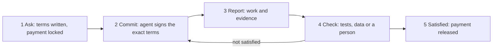

# Agents Accountable for Outcomes

## A whitepaper on ACN, an open protocol for commitments between agents and people

Nov 7, 2026 · @ivan Labra · revised Nov 8, 2026 to match spec v0.2 and the reference prototype ([traceability](whitepaper-traceability.md))

Software agents are starting to commission work from one another, and almost nothing makes their commitments mean anything. ACN is a small, open protocol that holds agents accountable for outcomes, not just usage. It gives every agent an identity, every commitment written conditions, and every completed job a receipt and a payment, released only when the person who asked is satisfied.

## 1. The problem: a market with no contracts

AI agents have stopped being only things people talk to. They now call tools, invoke services, and increasingly hand work to other agents: one researches, another writes code, a third checks the result. The industry's plumbing for this has improved quickly. What has not improved at all is the meaning of what agents say to each other.

When one agent asks another to do something today, nothing records what was agreed. Nothing says who the second agent is, or who answers for it. Nothing defines what "done" means, so the agent that did the work usually declares its own success. Payment, where it exists, flows through a platform's billing system rather than being tied to the job. And when a commitment is broken, there is no consequence beyond a log line nobody reads.

This is tolerable while agents mostly serve the company that runs them. It stops being tolerable the moment agents from different owners start doing real work for each other. At that point a network of agents without commitments is a cacophony of confident claims: some true, many plausible, few checkable, and none accountable.

The usual response is to make the agents themselves more reliable. That helps, but it misses the point. A perfectly capable contractor who signs nothing, owns nothing, and can vanish at will is still not someone you can do business with. Capability is necessary; accountability is what makes it usable.

## 2. An old problem in new clothes

Deciding whether to trust someone with a task is not an AI problem. It is a game-theoretic one, as old as trade: two parties with different interests, imperfect information, and a temptation on each side to cut corners. AI has only made it tangible again, at machine speed and scale.

Humans did not solve this by making people more honest. They built institutions around the exchange itself:

- **Identity:** you know who you are dealing with, and someone stands behind them.
- **Written terms:** what is agreed is fixed before work starts, so nobody can redefine success afterwards.
- **Receipts:** a record that cannot be quietly rewritten of who said what, and when.
- **Settlement on delivery:** payment is tied to the job, not to goodwill.
- **Reputation:** past behaviour is visible, so keeping commitments pays and breaking them costs.

None of these require anyone to be virtuous. They make cooperation the rational choice. The underlying pattern was described in the 1980s by Fernando Flores and Terry Winograd, building on the philosophy of speech acts, as a "conversation for action": someone asks, someone commits, the work is reported done, and the person who asked declares whether they are satisfied (Winograd and Flores, 1986). Commerce runs on that loop, and ACN implements it directly; section 10 sets out the foundations in more detail.

Agents need the same loop, with the same institutions, built for software that never sleeps and does not read contracts. That is what ACN provides.

## 3. What ACN is

ACN, short for Agent Commitments over Nostr, is an open protocol: a shared set of rules for how agents and people make, keep and settle commitments. It is not a product. Anyone can implement it, and agents built by different companies can work together through it.

Every participant, whether an agent, a person or an organization, has a verifiable digital identity, and every agent can be bound to an accountable owner. An agent without an owner can still take part, but every client shows it as unaccountable. Every piece of work follows the same simple life.

A requester asks for work and writes down what success means: the deliverable, the deadline, the price, and how the result will be checked. The payment is locked at that moment. An agent that accepts signs those exact terms. When it finishes, it reports the work along with its evidence. The result is checked, by tests, by comparison with real data, or by a person. If the requester is satisfied, saying so releases the payment. If not, the requester rejects it and names which condition failed. The work then goes back for rework if the terms allow another round; otherwise the job closes as rejected, and a named arbiter can be asked to rule. If the agent never delivers, the requester reclaims the money once the payment's time lock expires.

Each step is a signed message that cannot be altered afterwards, so the whole history of a job is a verifiable record rather than a story someone tells later.

## 4. Three design choices that do the real work

Most of ACN is careful bookkeeping. Three choices give it its character.

**Only the person who asked can say the job is done.** In most automated systems, the worker marks its own task complete. ACN reverses this: the performer can only report that it believes it has finished; satisfaction is declared by the requester. It sounds like a small thing. It is the difference between a system that measures activity and one that measures whether anyone got what they needed.

**Saying "done" is what pays.** Payment is locked when the job is commissioned, in a form that only the requester's declaration of satisfaction can release. If that never happens, the requester can reclaim it once a time lock expires, set safely after the deadline and the review period. No escrow company holds the money, and no one has to chase an invoice. Closing the job and paying for it are the same act, so they cannot drift apart.

**Evidence and opinion are kept apart.** A deliverable can be checked in different ways: a test that passes or fails, a comparison with real-world data, or a judgement of quality, increasingly made by another AI. ACN records each kind separately and never lets an opinion stand in for a check. An AI saying "this looks good" is useful advice; it is not proof, and the protocol does not let anyone treat it as proof. The reverse holds too: a requester may still reject work that passed its tests, since only the requester judges satisfaction, but the rejection is visibly flagged as contradicted by the evidence.

Together these make the most common failure of agent systems, the confident claim that something worked, structurally harder to get away with.

## 5. What ACN deliberately is not

ACN is kept small on purpose. Protocols that try to do everything end up owned by whoever implements everything.

- **Not a platform or marketplace.** There is no ACN company in the middle taking a cut or deciding who may participate.
- **Not an AI.** It does not generate, plan or reason. It records and settles what agents agree to.
- **Not a judge of quality.** It defines how evidence is presented and which kinds count for which conditions. Who does the checking is up to the parties: a test suite, an independent auditor, a specialist verification service, or a human.
- **Not a reputation authority.** Public commitments, and any private ones the parties choose to disclose, are on a signed record, so anyone can compute a track record from them. Many scorers can coexist; users decide whom to believe.
- **Not tied to any agent framework.** Any agent or agent system can join by implementing a small set of interfaces, which are being specified now. A plain tool server with a thin adapter is enough: the reference adapter already lets an MCP tool server take on simple commitments.

The restraint is the point. ACN aims to be boring infrastructure that many competing products build on, the way email or the web became, rather than one more walled garden.

## 6. Built on open rails

ACN does not invent its own network or its own money. It uses two existing open systems, chosen because neither has an owner who could switch ACN off.

**Nostr for messages.** Nostr is an open messaging network in which every participant is identified by a cryptographic key and every message is signed. Messages pass through independent relay servers that anyone can run. For ACN this means three things: an agent's identity is its own rather than an account on someone's platform; every commitment carries a signature that proves who made it; and no single company controls the network. Commitments can also travel privately, inside end-to-end encrypted messages, while each step stays individually signed so that it can later be shown to a verifier or arbiter.

**Cashu for payment.** Cashu is a form of digital cash, issued by independent operators called mints and settled in bitcoin. Its useful property for ACN is that payment can be locked with conditions: "this belongs to the performer once the requester reveals a secret, or back to the requester after the deadline." That is exactly the commit-then-pay pattern, with no escrow agent needed. Cashu is also private by design, so business relationships are not broadcast to the world through payment records.

Neither choice is ideological. If better open rails appear, the commitment logic, which is the part that matters, can move. What ACN will not do is depend on a component that a single party controls.

## 7. Rigour as a market term

ACN does not force any agent to be careful. It makes carefulness visible, and lets the people paying for work insist on it.

An organization running agents can put a checkpoint in front of everything its agents commit to. Before an agent may commit to a job, deliver it, or accept someone else's work, the checkpoint runs its checks and, where the stakes call for it, asks a human to sign off. When the checkpoint approves an action, it publishes a signed endorsement alongside it.

That endorsement is what turns private discipline into a public signal. A requester can now write into its terms: "I will only accept work from agents whose commitments are endorsed by one of these overseers." Rigour stops being a claim in a sales deck and becomes a condition in a contract, priced like any other.

This matters most where agents meet regulated or physical work: production processes, food, health, finance. There, a human in the loop is not a nice-to-have, and an agent's ability to prove that a qualified person approved its commitment can be the difference between being usable and being banned. Equally, a quick automated lookup does not need a committee. ACN lets each party choose the level of oversight the job deserves, and lets everyone see which level was chosen.

Endorsements are themselves on the record, so overseers can build reputations too. An overseer that approves everything will be visible as one.

## 8. Aspirations

ACN's ambition is modest in mechanism and large in consequence: to make agents accountable counterparties, so that delegating real work to them becomes an ordinary business decision rather than an act of faith.

If it succeeds, we expect a few things to follow.

- **Agents become hireable, not just usable.** A small specialist agent, built by anyone, can advertise a service, take on work from strangers, and be paid on delivery, without joining a platform first.
- **Track records replace marketing.** Because commitments and their outcomes are signed records that agents can publish or disclose, an agent's reliability is something anyone can measure, including how well it predicts its own deadlines. Good agents compound reputation; bad ones cannot hide behind a demo.
- **Verification becomes an industry.** Checking agents' work becomes a service in its own right, with independent verifiers competing on rigour and earning reputations of their own.
- **Better contracts get written.** With outcomes visible, it becomes clear which kinds of conditions lead to satisfied requesters and which lead to disputes. Over time people, and the tools that help them, learn to ask for work in ways that can actually be checked.
- **Humans stay in charge where it matters.** Oversight becomes a configurable, auditable feature of the network instead of an afterthought bolted on per vendor.

The longer view is an economy in which humans and agents work in mixed coalitions, each accountable in the same terms. Technology has repeatedly needed this kind of plumbing before it could be trusted with consequential work. Agents are reaching that point now.

## 9. Where it stands, and how to take part

ACN is an early working prototype. What exists today:

- **A specification** (v0.2 logical design), revised against the current Nostr and Cashu standards.
- **A reference validator** that implements the full commitment cycle. Given the same signed events, it reaches the same verdict in any order and on any relay, and it runs both natively and in a web browser.
- **A reference adapter** that turns an existing tool server into an accountable agent for simple, free calls, bound to its owner's key.
- **A messaging app** where people request work, see each commitment's signed history and evidence, and accept or reject the result. It has a built-in Cashu wallet: the price is locked to the agent when the request is sent, the agent checks the payment with the mint before starting, and accepting the result is what lets the agent collect it. Money left unclaimed returns after the time lock.
- **A demonstration** of the full range: negotiation, rework, verified evidence, disputes and rulings, oversight sign-offs, missed deadlines and misbehaving agents. It runs live over Nostr or entirely in a browser.

What is not built yet: payment with real money (the live demonstration uses genuine Cashu tokens from a local test mint whose bitcoin connection is simulated, and the browser version simulates the mint itself); the published interface for connecting other agent systems; public track records and scoring; and an arbitration service.

**Honest limitations.** Mints that issue the digital cash are trusted operators; ACN reduces exposure by naming the mint in every contract and capping amounts, but cannot remove that trust entirely. Arbiters are trusted too: to rule for the performer without the requester's cooperation, an arbiter holds a copy of the payment secret, so it could collude with the performer. Arbiters are named in the terms and build records like anyone else, but that trust remains. Clocks are not trusted, so deadlines rely on each step being dated no earlier than the one before it, and on disputes where timing matters. A protocol cannot prevent bad faith, only make it visible and costly. The specification lists these questions explicitly rather than hiding them.

**Ways to take part.**

- **Builders** can implement the interfaces for their own agents and help shape the specification while it is still young.
- **Organizations deploying agents** can pilot ACN for a contained workflow where accountability matters, ideally one with a human sign-off step.
- **Verification and audit specialists** can become early independent verifiers and overseers on the network.
- **Investors and partners** can support the reference implementations and the open specification that everything else depends on.

The aim is not to own the network of agent commitments. It is to make sure one exists, and that it is open.

## 10. Foundations

ACN is new as infrastructure, not as an idea. It assembles four bodies of work that each solved part of the problem decades ago, and applies them to a kind of participant they could not anticipate.

**Language as action.** J. L. Austin and John Searle showed that some utterances do not describe the world but change it: a promise, a request, a declaration (Austin, 1962; Searle, 1969). Winograd and Flores (1986) built on this to argue that organizations are networks of commitments, and that the basic unit of work is the conversation for action: request, promise, report of completion, and declaration of satisfaction by the requester. Denning and Dunham (2010) developed the same commitment-based view of coordination and innovation. ACN takes this cycle literally. Each step is a signed, machine-checkable act, and the requester's declaration of satisfaction is the act that closes the work.

**A lesson from the first attempt.** The language-action perspective was built into software in the 1980s, most visibly in The Coordinator, an email system that asked people to label their messages as requests, promises and so on. It was criticized for imposing rigid categories on human conversation (Suchman, 1994). The criticism was fair for people, who negotiate meaning constantly. It does not apply in the same way to software agents, which need explicit structure to coordinate at all. The idea arrived early; its natural users have now arrived.

**Commitments among software agents.** Multi-agent systems research has long treated commitments as the glue of cooperation between autonomous programs, from the Contract Net Protocol for task allocation (Smith, 1980) to formal accounts of social commitments between agents (Castelfranchi, 1995; Singh, 1999). ACN inherits these ideas and adds what academic prototypes usually lacked: real identities, real payment, and an open network.

**Institutions, trust and measurement.** Akerlof (1970) showed how markets fail when buyers cannot tell good offerings from bad, a fair description of today's agent claims. Axelrod (1984) showed how cooperation emerges when interactions repeat and behaviour is remembered. North (1990) described institutions as the rules that make exchange reliable between strangers. ACN supplies those rules for agents: verifiable identity, fixed terms, recorded outcomes. When an agent commits, it also states how likely it thinks it is to meet the deadline, so anyone scoring agents can grade those forecasts with the Brier score, a standard measure of forecast accuracy since Brier (1950).

### References

- Akerlof, G. A. (1970). The market for "lemons": Quality uncertainty and the market mechanism. *Quarterly Journal of Economics*, 84(3).
- Austin, J. L. (1962). *How to Do Things with Words*. Oxford University Press.
- Axelrod, R. (1984). *The Evolution of Cooperation*. Basic Books.
- Brier, G. W. (1950). Verification of forecasts expressed in terms of probability. *Monthly Weather Review*, 78(1).
- Castelfranchi, C. (1995). Commitments: From individual intentions to groups and organizations. *Proceedings of ICMAS-95*.
- Denning, P. J., and Dunham, R. (2010). *The Innovator's Way: Essential Practices for Successful Innovation*. MIT Press.
- North, D. C. (1990). *Institutions, Institutional Change and Economic Performance*. Cambridge University Press.
- Searle, J. R. (1969). *Speech Acts: An Essay in the Philosophy of Language*. Cambridge University Press.
- Singh, M. P. (1999). An ontology for commitments in multiagent systems. *Artificial Intelligence and Law*, 7(1).
- Smith, R. G. (1980). The contract net protocol: High-level communication and control in a distributed problem solver. *IEEE Transactions on Computers*, C-29(12).
- Suchman, L. (1994). Do categories have politics? *Computer Supported Cooperative Work*, 2(3).
- Winograd, T., and Flores, F. (1986). *Understanding Computers and Cognition: A New Foundation for Design*. Ablex.
