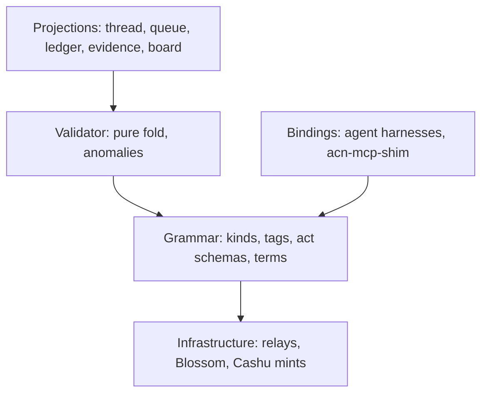
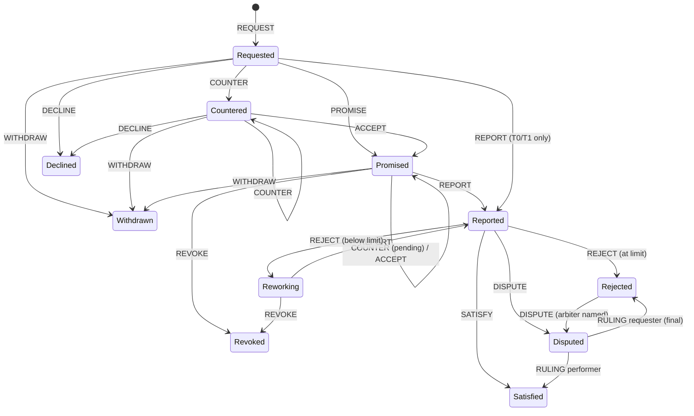

# Agent Commitments over Nostr — Logical Design Spec v0.2

Nov 7, 2026 · @ivan Labra · v0.2 revision aligned with current NIPs/NUTs and the nmesh prototype.
v0.1 is preserved at [Core-v0.1.md](Core-v0.1.md); see the [change log](#appendix-a-change-log-v01--v02).

## 1. Purpose and scope

This spec defines a commitment protocol where agents, MCP microservice endpoints, humans and
verifiers act as Nostr peers. They make, fulfil, verify and close commitments, with Cashu
conditional settlement and verifiable provenance. Working name: **ACN** (Agent Commitments over
Nostr).

The conversation is not the protocol. ACN defines an event grammar and a deterministic state
machine. Any chat thread, board or queue is a projection over it.

**In scope:** identity and key binding, event envelope and causal linking, act vocabulary and
state machine, terms documents, Cashu settlement, provenance and attestations, validation rules,
governance endorsements, bindings and reputation, implementation phases.

**Two profiles:**

- **Transactional** (T0 unconditional, T1 conditional): single-shot microservice calls. The request
  carries payment (or a zero price), and a report is an implicit promise. This is the default for MCP tool calls.
- **Negotiated** (N): the full commitment automaton with counter-offers, rework and optional
  arbitration, for work with real conditions of satisfaction.

**Non-goals:** UI design; NIP-90 compatibility (NIP-90 is now marked unrecommended upstream);
mandating a transport for the underlying MCP invocation. Nostr-native or direct HTTP are both
valid, since ACN wraps the call as a commitment.

**Reference status.** NIP and NUT references were checked on 2026-11-07 against
`nostr-protocol/nips` and `cashubtc/nuts` master. Re-check before freezing (D-1).

## 2. Design invariants (normative)

These invariants override any section below that appears to conflict with them. MUST, SHOULD and
MAY follow RFC 2119.

1. **INV-1 Immutability.** Commitment acts are regular (non-replaceable) events. Commitment state
   MUST NOT be stored in replaceable or addressable events. State is a fold over the act set.
2. **INV-2 Deterministic fold.** `fold(events, documents)` MUST yield the same commitment state and
   the same anomaly set for the same inputs, regardless of arrival order or relay. Time-dependent
   status (§6.5) is a separate pure function `status_at(state, now)` and is never part of the fold.
3. **INV-3 Causal order from hashes.** Ordering derives from `prev` references between event ids.
   `created_at` never orders acts. It is used only for deadline and window comparisons (§6.5),
   and only under the causal monotonicity rule (V-15).
4. **INV-4 Terms binding.** Every promise or acceptance binds to a content-addressed terms hash.
   Terms are immutable; changing them means a new hash.
5. **INV-5 Requester closure.** Only the requester can declare satisfaction (or an arbiter, by
   `RULING`, where the terms name one). A performer's report asserts completion; it is never
   closure.
6. **INV-6 Closure is settlement.** In conditional profiles, the satisfaction event reveals the
   payment preimage. Closing and paying are one signed act.
7. **INV-7 Signatures prove authorship only.** A signature never counts as evidence that a claim
   is true.
8. **INV-8 Interpretive is not provenance.** Interpretive reports (e.g. LLM-as-judge) use a
   distinct event kind. A validator MUST NOT satisfy a mechanical or grounding condition with an
   interpretive report.
9. **INV-9 Artifacts by hash.** Deliverables and evidence are referenced by sha256 and stored
   off-relay (Blossom). Inline content is limited to small payloads (≤ 16 KiB).
10. **INV-10 Accountable keys.** Agent keys are bound to an operator key by a signed binding.
    Unbound keys MAY participate but are flagged unaccountable.
11. **INV-11 Evidence retention.** Invalid, stale or conflicting events are retained and reported
    as anomalies. They are never applied and never silently dropped.
12. **INV-12 Projections carry no semantics.** No client-side state may affect commitment
    semantics.
13. **INV-13 Protocol neutrality.** The core names no implementation. Verification, governance,
    scoring and storage are roles filled by keys and bindings.

## 3. Roles and system layers

Five roles sign acts in one grammar. Relays, blob stores and mints are untrusted infrastructure
underneath it.

| Role | Signs | Holds |
|---|---|---|
| **Requester** | `REQUEST`, `COUNTER`, `ACCEPT`, `WITHDRAW`, `SATISFY`, `REJECT`, `DISPUTE` | the payment preimage `s` |
| **Performer** | `PROMISE`, `COUNTER`, `ACCEPT`, `DECLINE`, `REVOKE`, `PROGRESS`, `REPORT`, `DISPUTE` | a binding to an operator |
| **Verifier** | `K_ATTEST_MECH`, `K_ATTEST_GROUND`, `K_INTERP_REPORT` | a verifier-scoped binding |
| **Arbiter** | `RULING` | an escrowed copy of `s` (§8.4), if named in the terms |
| **Operator / governance** | `K_BIND`, `K_BIND_REVOKE`, `K_ENDORSE` | long-lived accountable keys |



Trust comes from signatures, hashes and the shared validator, never from the transport. Every
binding and client runs the same validator, so all compute the same state from the same events.

## 4. Identity, key binding, service advertisement

Every participant is a secp256k1 keypair (BIP-340 x-only). Operators hold long-lived keys. Each
agent or endpoint holds its own key, bound to an operator by a signed, scoped, expiring binding.

**Key classes.**

- **Operator key:** the accountable legal or organizational party. Kept cold where possible
  (NIP-46 remote signer recommended). Signs bindings and revocations only.
- **Agent key:** one per agent or endpoint instance. Signs all commitment acts.
- **Verifier key:** signs attestations. May be an agent key with a verifier scope.

**Binding (`K_BIND`, regular).** Signed by the operator. Tags:
- `p`: the agent pubkey;
- `scope`: one tag per granted capability (`["scope", "kinds", "7700,7708,..."]`,
  `["scope", "max_sat", "<int>"]`, `["scope", "mint", "<url>"]`, `["scope", "verifier", "true"]`);
- `expires`: unix seconds;
- `svc` (optional): `a`-coordinate of the `K_SVC`.

NIP-26 delegation is not used (it is unrecommended upstream).

**Binding acceptance (`K_BIND_ACK`, regular).** Signed by the agent key, referencing the binding
with `["e", <binding id>]`. A binding is effective only once acknowledged. This proves key
possession and stops an operator claiming someone else's key.

**Revocation (`K_BIND_REVOKE`, regular).** Signed by the operator, referencing the binding with
`e`. An optional `supersedes` tag names a replacement binding, for rotation. Effectiveness rules
are in V-8.

**Service advertisement (`K_SVC`, addressable, `d` = service id).** Signed by the agent key.
Addressable is allowed here because it is metadata, not commitment state (INV-1). Content (JSON):

- tools offered, with input/output schema hashes (JCS-sha256) and, optionally, nmesh contract ids;
- profiles supported (`T0`, `T1`, `N`);
- price schedule and minimum price;
- accepted mints and the NUTs each supports;
- terms templates by hash;
- verifier requirements;
- the MCP invocation transport (`nostr` or an HTTPS endpoint);
- the silence threshold (D-3);
- data handling (`sees_plaintext`, `retention`, `forwards_to`).

This is how an MCP endpoint becomes a discoverable peer. In nmesh, `K_SVC` supersedes the
provisional nmesh agent manifest (kind 34932). Clients SHOULD show the binding status ("bound to
operator X" vs "unaccountable") before first contact.

## 5. Event envelope, tags, causal linking

ACN events are standard NIP-01 events. There is one regular kind per act, so relays can filter
by kind. The commitment id lives in an indexed single-letter tag, so one filter retrieves a whole
commitment.

### 5.1 Kind allocation (provisional, D-1)

Commitment acts and attestations MUST be in the regular range (1000–9999). The provisional block
7700–7739 is clear of the kind registry as of 2026-11-07 (nearest neighbours: Cashu 7374–7376,
geocaching 7516–7517). Code MUST reference symbolic names.

| Kind | Name | Kind | Name |
|---|---|---|---|
| 7700 | `K_REQUEST` | 7720 | `K_ATTEST_MECH` |
| 7701 | `K_COUNTER` | 7721 | `K_ATTEST_GROUND` |
| 7702 | `K_ACCEPT` | 7722 | `K_INTERP_REPORT` |
| 7703 | `K_PROMISE` | 7723 | `K_ENDORSE` |
| 7704 | `K_DECLINE` | 7724 | `K_SCORE` |
| 7705 | `K_WITHDRAW` | 7730 | `K_BIND` |
| 7706 | `K_REVOKE` | 7731 | `K_BIND_ACK` |
| 7707 | `K_PROGRESS` | 7732 | `K_BIND_REVOKE` |
| 7708 | `K_REPORT` | 7739 | `K_PRIVATE_ACT` (rumor-only, §5.5) |
| 7709 | `K_SATISFY` | 37700 | `K_SVC` (addressable) |
| 7710 | `K_REJECT` | | |
| 7711 | `K_DISPUTE` | | |
| 7712 | `K_RULING` | | |

### 5.2 Tags

| Tag | Cardinality | Meaning |
| --- | --- | --- |
| `c` | 1 (all acts except request) | Commitment id = event id of the root request. Indexed. NIP-34 also uses `c` (git commit tips on 1618/1619), so filters MUST include `kinds`. |
| `e` … `"prev"` | 1 (all acts except request) | `["e", <id>, <relay?>, "prev"]`: the immediate causal predecessor. |
| `p` | 1+ | Counterparty pubkeys. On `REQUEST`: exactly one performer (v0.2; open requests deferred). Routing only. |
| `terms` | 0–1 | sha256 (JCS) of the terms document + optional Blossom URL hint. Required on `REQUEST`, `COUNTER`, `ACCEPT`, `PROMISE`. |
| `x` | 0+ | sha256 of referenced artifacts. |
| `parent` | 0–1 | Parent commitment id (subcontracting). |
| `profile` | 1 on request | `T0`, `T1` or `N`. |
| `v` | 1 | Protocol version, `acn/0.2`. |

### 5.3 Content

Content is JSON, with a schema per act (§6.2). Hash-relevant documents use RFC 8785 canonical
JSON (JCS) before sha256. Inline content limit: 16 KiB; larger material goes to Blossom by hash.

### 5.4 Causal DAG, head and concurrency

The request is the root. Acts are **advancing** (they change state and can become the head) or
**annotating** (`PROGRESS`, attestations, interpretive reports, endorsements). Annotating acts
reference an event with `prev`, but never become the head, so liveness pings and attestations
can't make the other party's in-flight acts stale.

Every advancing act carries exactly one `prev`, which MUST belong to the same commitment. The
**effective chain** is built from the root: at each head, the candidate children are the
advancing acts whose `prev` is that head and that pass V-1…V-9 and V-14. The winner is chosen
deterministically (INV-2):

1. **Closing acts** (`WITHDRAW`, `DECLINE`, `REVOKE`, `SATISFY`, `RULING`) win over
2. **term-preserving acts** (`PROMISE`, `ACCEPT`, `REPORT`, `REJECT`, `DISPUTE`), which win over
3. **term-changing acts** (`COUNTER`).
4. Remaining ties break on the lowest event id (lexicographic hex).

Ids can be ground, so only rule 4 can be gamed, and only between acts of the same class. Losing
siblings, and advancing acts whose `prev` is not on the effective chain, are **stale**: retained
as evidence, not applied (INV-11). A party whose act goes stale re-issues against the new head.

### 5.5 Private mode

NIP-59 requires that "the inner event MUST always be unsigned" (the rumor), and NIP-17 / Marmot
rely on this for deniability. ACN needs non-repudiation, so it **does not** put signed events
inside seals. Instead, a private act is sent as:

```text
gift wrap (1059) → seal (13) → rumor kind K_PRIVATE_ACT (7739), content = JSON of the fully signed act
```

The rumor stays unsigned, so NIP-59 is satisfied. The embedded act is a normal signed ACN event,
so a party can show any single act to a verifier and it verifies on its own (selective
disclosure). The same envelope works inside Marmot (MLS) group messages. Validators ingest the
embedded act; the envelope carries no semantics.

## 6. Act vocabulary and commitment state machine

The negotiated profile implements Flores's conversation-for-action. Transactional profiles are a
short path through the same machine.

### 6.1 State

State is a record, not a single label:

```text
State {
  phase:          Requested | Countered | Promised | Reported | Reworking
                | Satisfied | Rejected | Disputed | Declined | Withdrawn | Revoked
  terms:          hash of the terms currently in force (request terms until a promise/accept)
  pending:        Option<(counter terms hash, countering party)>   // a counter awaiting ACCEPT
  promised:       bool          // a promise is in force
  rework_count:   u32
  report:         Option<event id>
  rejected_at:    Option<event id>
  head:           event id
}
```

A `COUNTER` made while a promise is in force does not withdraw the promise. Phase stays
`Promised` and `pending` is set. `REPORT` remains legal against the standing promise.



**Terminal phases:** `Satisfied`, `Declined`, `Withdrawn`, `Revoked`. `Rejected` is terminal when
the terms name no arbiter, or after a `RULING`. Otherwise it is *closed-disputable*: `DISPUTE`
remains legal.

### 6.2 Acts

| Act | Signer | Legal from (phase) | Result | Required content (JSON) |
| --- | --- | --- | --- | --- |
| `REQUEST` | requester | — (root) | Requested | `terms` tag; content: `{terms?: <inline doc>, token?: <NIP-44 ciphertext to performer>, note?}` |
| `COUNTER` | either | Requested, Countered, Promised (N only) | Countered, or Promised with `pending` | new `terms` tag; `{terms?: <inline doc>, reason}` |
| `ACCEPT` | the non-countering party | Countered, or Promised with `pending` | Promised (`terms` := counter terms) | `terms` tag = pending counter terms |
| `PROMISE` | performer | Requested (N) | Promised | `terms` tag = current terms; `{p_on_time: 0..1, token_verified: bool}` |
| `DECLINE` | performer | Requested, Countered | Declined | `{reason}` |
| `WITHDRAW` | requester | Requested, Countered, Promised | Withdrawn | `{reason}` |
| `REVOKE` | performer | Promised, Reworking | Revoked (scored) | `{reason}` |
| `PROGRESS` | performer | Promised, Reworking (annotating) | unchanged | `{p_on_time?, note?}` |
| `REPORT` | performer | Promised, Reworking; Requested in T0/T1 | Reported | `x` tags for artifacts; `{result?: <inline JSON ≤16 KiB>, contract?: <id>, derivation?: <hash>, note?}` |
| `SATISFY` | requester | Reported | Satisfied | `{preimage?: <hex>}`; required when the terms carry a hashlock |
| `REJECT` | requester | Reported | Reworking, or Rejected at the rework limit (always Rejected in T0/T1) | `{gaps: [{condition, evidence: [..], note?}]}`, non-empty; conditions must exist in terms |
| `DISPUTE` | either | Reported; Rejected (if disputable) | Disputed | `{reason, evidence?: [..]}`; terms must name an arbiter |
| `RULING` | arbiter | Disputed | Satisfied or Rejected (final) | `{decision: "performer"\|"requester", rationale?: <hash>, preimage?: <hex>}` |

Profile restrictions: `COUNTER`, `ACCEPT`, `PROMISE`, `REVOKE`, `DISPUTE` and `RULING` are only
legal in profile `N`.

### 6.3 Transactional profiles

- **T0 unconditional.** `REQUEST` carries an unlocked token (or none, at price 0). The performer
  redeems on receipt and replies with `REPORT`. `SATISFY`/`REJECT` are optional and feed scoring
  only. For cheap, idempotent tool calls.
- **T1 conditional.** `REQUEST` carries a hash-locked token. The performer replies directly with
  `REPORT` (an implicit promise at the request's terms), and the requester's `SATISFY` releases
  payment. No counter, no rework.

### 6.4 Zero-price calls

A `K_SVC` MAY advertise a minimum price of 0. A T0 `REQUEST` with `price.amount = 0` carries no
token. This lets free tools build reputation through the same grammar.

### 6.5 Time

Deadlines and windows are compared using `created_at` of the acts involved, under V-15 (causal
monotonicity). A performer can therefore only backdate a `REPORT` as far back as its `prev`.
Requesters who doubt a timestamp can dispute with external evidence (§13).

`status_at(state, now)` derives:

- **Lapsed (performer):** phase `Promised`/`Reworking`, and `now > terms.deadline`.
- **Lapsed (requester):** phase `Reported`, and `now > report.created_at + terms.review_window`.
  This is recorded as a requester-side fault for scoring.
- **Expired dispute window:** a disputable `Rejected` becomes final after `review_window`.

A `REPORT` with `created_at > terms.deadline` is applied but flagged `late`. A `SATISFY` after the
review window is applied but flagged `late` (payment may already have been refunded at `L`).

## 7. Terms documents

A terms document is the conditions of satisfaction, made content-addressed: JCS-canonical JSON,
identified by its sha256, immutable. Small terms (≤ 16 KiB) MAY be inline in the `REQUEST` or
`COUNTER` content, in which case `sha256(JCS(content.terms))` MUST equal the `terms` tag.
Otherwise they are stored on Blossom and supplied to the validator as a document.

**Fields.**

| Field | Type | Meaning |
| --- | --- | --- |
| `v` | string | Terms schema version (`acn-terms/0.2`) |
| `deliverable` | object | `description`; optional `output_schema` hash, `output_contract` id, `tool` name, `input` arguments |
| `conditions` | array | Conditions of satisfaction; each has `id`, `class`, and class-specific fields |
| `deadline` | unix s | Latest `REPORT` time |
| `review_window` | seconds | Time the requester has after `REPORT` to `SATISFY` or `REJECT` |
| `rework_limit` | integer | Max `REJECT` → rework cycles before Rejected (0 in T profiles) |
| `price` | object | `{amount, unit: "sat"}` |
| `payment` | object or null | `{mint, keysets[], hashlock?, locktime?, refund_key?}` (§8); null at price 0 |
| `verifiers` | array | `[{pubkey, classes: [..]}]`: pubkeys whose attestations count, per condition class |
| `arbiter` | pubkey or null | Required for `DISPUTE` to be legal |
| `provenance` | object | Required derivation-record fields |
| `subcontracting` | bool | Whether child commitments are permitted |
| `disclosure` | enum | `public` or `private` (§5.5) |
| `governance` | object or null | `{keys: [..], kinds: [..], window: seconds}` (V-14) |

**Condition classes.** The class decides which evidence can satisfy a condition. This is where
INV-8 is enforced.

- **`mechanical`:** a deterministic check (tests, schema validation, hash match). Satisfied only by
  a mechanical attestation from a listed verifier.
- **`grounding`:** agreement with an external referent (dataset, resolved market, sensor log),
  named by hash and source. Satisfied only by a grounding attestation.
- **`interpretive`:** quality judgement (rubric). Interpretive reports MAY inform it, but the
  requester always judges it in the end.
- **`human`:** the requester's own judgement, expressed by `SATISFY` or `REJECT`.

**Templates.** Service advertisements publish terms templates by hash. A request that uses a
template unchanged references the template hash directly, which keeps transactional calls cheap.

## 8. Cashu conditional settlement

Conditional payment uses Cashu tokens hash-locked to a preimage that only the requester holds,
spendable by the performer's key, and refundable after a timelock. Revealing the preimage in
`SATISFY` is both closure and payment (INV-6). No escrow agent holds funds.

### 8.1 Lock spec (T1 and N)

A proof has exactly one NUT-10 secret kind, so the lock is a single **NUT-14 `HTLC`** secret, not
"P2PK combined with HTLC":

```json
["HTLC", {"nonce": "...", "data": "<H = sha256(s)>",
  "tags": [["pubkeys", "02<performer x-only>"], ["locktime", "<L>"], ["refund", "02<requester x-only>"]]}]
```

Nostr keys are x-only; use the compressed form with a `02` prefix, as NIP-61 does. NUT-11 compares
keys by x-coordinate.

The receiver path (preimage + performer signature) stays open **even after `L`** (NUT-11
"Locktime MultiSig conditions continue to apply"). After `L` the requester can also refund, so
late redemption is a race, not a hard cutoff.

### 8.2 Flow

1. The requester generates a 32-byte secret `s`, computes `H = sha256(s)`, and mints or swaps
   tokens with the lock spec at a mint listed in the terms (`payment.hashlock = H`).
2. `REQUEST` carries the locked token NIP-44-encrypted to the performer (`content.token`).
   Encryption avoids leaking amount and mint to relays.
3. The performer verifies the token **offline with DLEQ proofs (NUT-12)** and **online with NUT-07**
   (state `UNSPENT`) before `PROMISE` (or before work, in T1), then sets `token_verified`. NUT-07
   alone isn't enough: a forged `C` would also show as unspent.
4. The performer delivers and issues `REPORT`.
5. The requester issues `SATISFY` containing `s`. Validators MUST check `sha256(s) = H` (V-10).
6. The performer redeems with `s` plus its signature.
7. If no `SATISFY` arrives, the requester reclaims after `L` with the refund key.

**Timing constraint.** `L` MUST exceed `deadline + review_window + redeem_margin`. Recommended
`redeem_margin` ≥ 24 h.

### 8.3 T0

An unlocked token, NIP-44-encrypted in the request (or none at price 0). The performer MUST swap
it at the mint immediately, before doing any work, to prevent double-spend.

### 8.4 Arbitrated settlement (replaces v0.1 2-of-3 refund)

When the terms name an arbiter, the requester escrows `s` to the arbiter at request time (NIP-44,
in an `["escrow", <ciphertext>]` tag addressed to the arbiter). The arbiter MUST check
`sha256(s) = H` and acknowledge before the performer promises.

- **Ruling for the performer:** `RULING` carries `s`, and the performer redeems.
- **Ruling for the requester:** the arbiter withholds `s`, and the requester refunds alone after `L`.

No multisig is needed, so the lock spec in §8.1 is unchanged. The v0.1 2-of-3 refund path is
dropped because it let performer + arbiter jointly take the refund after `L`. **Trust
assumption:** the arbiter holds `s` and could collude with the performer. Arbiters are scored
keys like any other. Rulings MUST land before `L - redeem_margin`.

### 8.5 Milestones

The terms MAY split payment into several tokens, each with its own hashlock, released by
`SATISFY` events scoped to milestone condition ids (D-8). An optional unconditional up-front
portion reduces performer risk on larger jobs.

### 8.6 Mint risk

Mints are custodial trust points. The terms MUST name the mint URL and keyset ids. Operators
SHOULD set per-mint value caps in bindings. Support for NUT-07, NUT-11, NUT-12 and NUT-14 varies
and MUST be checked via NUT-06 info at service-advertisement time. A mint that does not support
NUT-14 may treat HTLC proofs as anyone-can-spend.

## 9. Provenance: artifacts, derivation, attestations

Provenance is layered, and each layer proves one thing. The grammar keeps the layers in separate
fields and kinds, so no consumer can mistake one for another.

| Claim | Mechanism | Proves | Does not prove |
| --- | --- | --- | --- |
| Authorship | Event signature | This key said this | That it is true |
| Integrity | sha256 of artifacts (Blossom) | Artifact is unchanged | That it is correct |
| Causality | `prev` chain | What the act responded to | When it happened |
| Derivation | Derivation record | What the performer claims it used and did | That the claim is honest |
| Correctness | Mechanical attestation | A named check passed on named hashes, reproducibly | Fitness for purpose |
| Grounding | Grounding attestation | Agreement with a named external referent | Correctness beyond that referent |
| Existence-before | External timestamp anchor (D-11) | The event existed before a point in time | Anything about content |
| Opinion | Interpretive report | What a judge concluded | Anything counted as provenance (INV-8) |

**Artifacts.** Stored on Blossom (NIP-B7, sha256-addressed). `REPORT` lists them in `x` tags.
Performers SHOULD replicate to at least two Blossom servers. An artifact that can't be retrieved
within the review window is grounds for `REJECT` with gap code `artifact_unavailable`.

**Derivation record.** JCS JSON, stored by hash, referenced from `REPORT`. Modelled on W3C PROV.
Fields: `inputs[]`, `outputs[]` (hashes with roles), `tools[]` (tool, model and service
identifiers with versions), `env` (environment digest), `subcommitments[]`, `log` (hash of the
execution log), `started`/`ended` (advisory).

**Attestation kinds** (annotating). Signed by verifier keys. Tags: `c`; `["e", <REPORT id>, "",
"report"]`; `["cond", <condition id>]`; `x` subject hashes.

- **`K_ATTEST_MECH`:** `{result: "pass"|"fail", method, recipe?, env?}`.
- **`K_ATTEST_GROUND`:** `{result, referent: {source, hash}, method}`.
- **`K_INTERP_REPORT`:** `{judge, rubric?, verdict, rationale?}`. Always advisory.

**Subcontracting.** A child commitment carries `parent` = the parent commitment id, and the
parent's derivation record lists it. Accountability to a requester stays with its direct
performer, however deep the chain.

**Governance endorsements (`K_ENDORSE`, annotating).** Signed by a governance key. Tags: `c`,
`["e", <endorsed act id>, "", "endorses"]`, `["policy", <hash>]`, `["endorser",
"human"|"automated"]`. When the terms carry a `governance` requirement, an act of a listed kind
by the governed party takes effect only once a matching endorsement arrives (V-14). An
endorsement proves a gate signed off, not that the gate is rigorous.

## 10. Validation rules

A validator is a pure function from (event set, document set) to (commitment states, anomaly
list). Every rule failure produces an anomaly with a code and a severity:

- **reject:** the event is retained, not applied (INV-11);
- **flag:** applied, noted for scoring and display;
- **pending:** a dependency is missing; re-evaluated when more events or documents arrive.

1. **V-1 Signature.** NIP-01 id and BIP-340 signature valid. `bad_sig` (reject).
2. **V-2 Version and kind.** `v` supported; kind is a known ACN kind. `bad_version`, `unknown_kind` (reject).
3. **V-3 Structure.** Required tags present with correct cardinality; content matches the act
   schema; inline content ≤ 16 KiB. `malformed` (reject).
4. **V-4 Linkage.** `c` resolves to a `REQUEST`; `prev` resolves to an event in the same
   commitment. `foreign_prev` (reject), `pending_ref` (pending).
5. **V-5 Authority.** The signer holds the role the act requires. `unauthorized` (reject).
6. **V-6 Legality.** The act is legal from the state at its `prev`, under the commitment's profile.
   `illegal_transition` (reject).
7. **V-7 Head.** `prev` is on the effective chain and the act won sibling resolution (§5.4).
   `stale` (reject).
8. **V-8 Binding.** The agent key has an acknowledged binding with `expires > act.created_at`, whose
   scope covers the act kind and value. A revocation applies to acts with `created_at` ≥ the
   revocation's `created_at`. Bindings and commitments are separate DAGs, so there is no causal
   order between them; disputed ordering is resolved with external anchors (D-11).
   `unbound` (flag), `out_of_scope` (reject), `revoked` (reject).
9. **V-9 Terms binding.** `PROMISE`/`ACCEPT` terms hash equals the hash under negotiation; inline
   terms hash to the tag; the terms document is parseable. `terms_mismatch` (reject),
   `pending_terms` (pending).
10. **V-10 Settlement.** `sha256(preimage) = H` from the terms, for `SATISFY` and performer-side
    `RULING`. `bad_preimage` (reject). A missing preimage when the terms carry a hashlock is
    `malformed`.
11. **V-11 Evidence class.** A condition counts as satisfied only with evidence of its class from a
    listed verifier. Interpretive reports never satisfy mechanical or grounding conditions.
    `wrong_evidence_class` (flag on the attestation; not counted), `unlisted_verifier` (flag).
12. **V-12 Availability.** *Moved out of the validator* (it needs network I/O). Availability is a
    liveness annotation computed by clients and bindings, alongside `status_at`. It never changes
    the fold.
13. **V-13 Equivocation.** Two valid advancing acts from the same signer with the same `prev` and
    different ids are flagged on the signer. `equivocation` (flag).
14. **V-14 Endorsement.** Where the terms require governance, an act of a governed kind by the
    governed party is a candidate only once a valid `K_ENDORSE` from a listed key references it,
    with `endorse.created_at ≤ act.created_at + window`. `pending_endorsement` (pending),
    `unendorsed` (reject, once a later act from the other party proves the window was observed).
15. **V-15 Causal monotonicity (new).** An act's `created_at` MUST be ≥ its `prev`'s `created_at`.
    `time_regress` (reject).
16. **V-16 Rejection grounding (new).** A `REJECT` gap that names a `mechanical` condition with a
    passing attestation from a listed verifier, and no failing one, is flagged
    `contradicted_rejection` (flag). The rejection still applies (INV-5); the contradiction is
    visible.

Deadline-related flags: `late` (flag) for a `REPORT` after the deadline or a `SATISFY`/`REJECT`
after the review window.

**Conformance.** The reference validator ships with scenario tests: event sets with expected
state and anomalies. A property test MUST show identical output for every permutation of arrival
order (INV-2).

## 11. Bindings, governance and reputation

ACN Core defines what is signed and how it is judged. How an agent decides what to sign is its
binding's concern. A **binding** is the adapter that lets an external harness's agents take part
in the network and offer value-added terms of satisfaction (their own condition classes,
verifiers and governance). Any harness participates by implementing the Binding API.
`acn-mcp-shim`, which wraps MCP tools, is the first reference binding.

**Governance is opt-in and demandable.** A binding MAY gate its own acts (policy checks, human
sign-off) and publish `K_ENDORSE` for what it lets through. Terms MAY require endorsement. The
core neither mandates nor inspects governance; it checks only that required endorsements exist
and come from listed keys.

**Reputation is a projection.** Commitment outcomes by party, and signed `p_on_time` forecasts,
are the inputs. For public commitments they are public. Private commitments (§5.5) contribute
only what their parties disclose; how outcomes are disclosed without exposing content is open
decision **D-13**. Anyone MAY publish `K_SCORE` events naming the aggregate, window, method hash
and the commitment ids (or outcome receipts) used. A score over public inputs can be recomputed
by anyone; a score over privately disclosed inputs MUST say so, and is trusted, not recomputable. Consumers choose which scorers to
trust; no scorer is privileged. Scorers MAY additionally publish NIP-85 Trusted Assertions
(`30382:rank`) so that general Nostr clients can consume a summary.

## 12. Clients and projections

A client subscribes, validates, folds and renders; it owns no semantics (INV-12).

**Client obligations.** Use the reference validator library (or pass its conformance scenarios).
Show anomalies, not just state: a stale or unauthorized act is information. Sign acts only through
the act schemas. Free-text messages in a commitment thread are ordinary messages and carry no
commitment meaning.

**Projections.** All are derived from the same fold, and any can be generated or replaced without
touching the protocol:

- **Thread view** (default): acts rendered as structured cards in a conversation, with free-text
  messages between them.
- **Queue view:** per-agent open commitments ordered by deadline and head state.
- **Ledger view:** settlement status per commitment (locked, redeemed, refunded) and per mint.
- **Evidence view:** terms → acts → artifacts → attestations → settlement.
- **Board view:** columns by state.

**Implementation stack.**
- Rust: `acn-core` is the validator, with no I/O and no C dependencies (pure-Rust BIP-340 via
  `k256`), compiled to `wasm32-unknown-unknown` for web clients.
- `rust-nostr` handles events and relays in clients and bindings.
- Cashu Dev Kit (CDK) handles wallet and mint interaction, with a CDK or Nutshell test mint.
- In nmesh, `nmesh-app` folds ACN events per conversation and renders the thread view through
  the renderer registry.

## 13. Adversarial cases and game theory

The protocol can't prevent bad faith; it makes bad faith visible, attributable and costly. Every
row needs a scenario test in the conformance suite.

| Threat | Vector | Mitigation |
| --- | --- | --- |
| Requester griefing | Silence after a valid `REPORT`; the locked payment refunds at `L` | Requester lapse is recorded as a fault; arbiter path for high-value terms; milestones and an up-front portion |
| Performer griefing | `PROMISE` then nothing | Short deadlines; `PROGRESS` liveness expectations; `REVOKE` and lapse scored; Brier penalty on `p_on_time` |
| Unjust rejection | `REJECT` with fabricated gaps | Gaps must name condition ids; V-16 flags rejections contradicted by mechanical attestations; dispute path |
| Sybil identities | Fresh keys to escape bad scores | Bindings to accountable operators; unbound keys flagged; scores attach to operators too |
| Request spam | Floods of free requests | T0 pre-payment; minimum price in `K_SVC`; NIP-13 proof-of-work for unpaid negotiation openers |
| Equivocation | Conflicting acts sent to different relays | Deterministic sibling resolution; V-13 flags the signer; evidence retained |
| Id grinding | Grinding event ids to win a same-class tie | Class precedence (§5.4) leaves only same-class ties to the id; equivocation is flagged |
| Relay withholding | A relay hides or drops acts | Multi-relay publishing; rebroadcast; `pending_ref` gap detection |
| Key compromise | A stolen agent key signs acts | Value caps in binding scope; fast revocation; external anchors for disputed ordering |
| Mint failure | A custodial mint exits or censors | Mint named in terms; per-mint caps; mint diversity |
| Forged token | Bogus proof that shows "unspent" | DLEQ (NUT-12) verification before promising |
| Arbiter collusion | Arbiter + performer use the escrowed `s` | Arbiters are scored keys; arbiter choice is in the terms; high-value work splits into milestones |
| Judge gaming | Optimizing for a judge model | Interpretive reports are never sufficient (INV-8, V-11) |
| Timestamp lies | Backdated `created_at` | Causal order from hashes (INV-3); V-15 monotonicity bounds backdating to the predecessor |
| Metadata leakage | A public commitment graph reveals business relationships | Private mode (§5.5); encrypted tokens. Reputation then needs a disclosure mechanism (D-13) |
| Highlight-reel reputation | Parties publish only flattering outcomes from private commitments | Open (D-13): disclosure consent in the terms; negatives published by the party with the incentive, with signed proof |
| Rubber-stamp governance | A gate that endorses everything | Endorsements carry a policy hash; governance keys are scored on the outcomes they endorsed |

**Default for silence.** Below a value threshold set by the performer in `K_SVC`, requester
silence is handled by scoring only. Above it, performers SHOULD require an arbiter in the terms.

## 14. Open decisions

- [ ] **D-1 Kind numbers and tag letters.** 7700–7739 and 37700 are provisional; confirm and
  propose as a NIP. `c` overlaps NIP-34 (mitigated by kind filters).
- [x] **D-2 Private mode.** Resolved in v0.2: signed act embedded in an unsigned `K_PRIVATE_ACT`
  rumor (§5.5). Still open: how verifiers receive selective disclosures (direct gift wrap of the
  embedded act is the proposal).
- [ ] **D-3 Silence default.** The value threshold for requiring an arbiter (currently a `K_SVC`
  field set by the performer).
- [x] **D-4 Arbiter settlement.** Resolved in v0.2: escrowed-preimage design (§8.4); no multisig
  required. Still to validate against the CDK test mint.
- [ ] **D-5 MCP invocation transport.** Nostr-native (ContextVM or nmesh NIP-17 DM) vs. HTTPS, declared in `K_SVC`. The prototype uses the nmesh DM transport.
- [ ] **D-6 Terms schema language.** The prototype uses JSON Schema (aligned with nmesh data contracts).
- [ ] **D-7 Standard score aggregates.**
- [ ] **D-8 Partial reports / milestones.**
- [ ] **D-9 Endorsement timing.**
- [ ] **D-10 Binding API surface.** Deferred with intent packs; the prototype binding is `acn-mcp-shim` inside the nmesh agent bridge.
- [ ] **D-11 External timestamp anchors (new).** NIP-03 (OpenTimestamps) is now marked
  "unrecommended" upstream. Choose an anchoring mechanism, or rely on V-15 and disputes.
- [ ] **D-12 Open requests (new).** A `REQUEST` addressed to several performers (RFP), with the
  first `PROMISE` winning.
- [ ] **D-13 Reputation under private commitments (new).** §11 assumes public outcomes, but
  private mode (§5.5, and the prototype default) hides them. Reputation must be *derived*
  without exposing commitment content. The core difficulty is **negative outcomes**: performers
  will volunteer their successes, so a scheme that publishes only what each party chooses becomes a
  highlight reel. Any design must say who publishes a negative outcome and what proves it.

  | Option | Public | Privacy | Recomputable | Main risk |
  |---|---|---|---|---|
  | A. Outcome receipts | Small signed event per closed commitment: parties, outcome, value/time bands, hash of the closing act | Content hidden; relationship visible | Yes, over receipts | Sybil inflation; non-publication |
  | B. Disclosure to scorers | Aggregates only (`K_SCORE`, NIP-85) | Strong publicly; scorer sees all | No (trusted) | Biased or captured scorer |
  | C. ZK / anonymous credentials | Proofs ("≥ N satisfied from distinct bound requesters") | Strongest | Yes | Forcing negatives into the proof; maturity |

  **Proposal (public skeleton, private detail):**
  1. Terms field `outcome_disclosure: none | receipt | full`, signed by both parties, so consent
     to being rated is itself a contract term.
  2. Each party publishes the receipts it has an incentive to publish, with signed proof: the
     performer publishes positives (backed by the requester's `SATISFY`); the requester publishes
     negatives (backed by the performer's own `PROMISE`/`REVOKE`/`REPORT` acts). Rejections flagged
     `contradicted_rejection` (V-16) are discounted. Any act can be shown on its own, because private
     mode keeps each act verifiable (§5.5).
  3. Sybil weighting: count receipts from bound requesters only; weight by value at stake and by
     the requester's own standing / web-of-trust distance.
  4. Competing scorers publish `K_SCORE` (method hash) over public receipts, optionally mirrored
     as NIP-85. Scores over privately disclosed acts (option B) are labelled as trusted.
  5. Option C as a later privacy upgrade.

  **Residual risks:** a receipt reveals who worked with whom (hiding it means one-off keys,
  which defeats sybil resistance); small counts can identify parties (bucketing, minimum counts);
  retaliation and collusion are reduced, not removed; requester lapses are hard to prove
  publicly, since a missing `SATISFY` can't be proven, so they likely go through scorers or
  arbiters. **Affects:** §11, the terms schema (§7), a new receipt kind (§5.1), the
  whitepaper's track-record claims.

## 15. Implementation phases and acceptance criteria

Each phase is gated by acceptance criteria that a coding agent can test mechanically.

1. **P0 Grammar and validator crate (`acn-core`).** Act schemas, terms schema, JCS hashing, the
   fold, sibling resolution, V-1…V-11 and V-13…V-16, anomaly codes, `status_at`.
   - Gate: scenario tests for every act and every anomaly code pass.
   - Gate: a property test shows identical state and anomalies under arrival-order permutations
     of each scenario (INV-2).
   - Gate: no I/O in the crate; `wasm32-unknown-unknown` build succeeds.
2. **P1 Transactional profiles (T0, T1).** `K_SVC`, `REQUEST`/`REPORT`/`SATISFY`, Cashu via CDK
   against a test mint, `acn-mcp-shim` wrapping MCP tools.
   - Gate: T0 call end to end (price 0 first, then a swapped token before work starts).
   - Gate: the T1 satisfied path redeems with the preimage; the unsatisfied path refunds after `L`.
   - Gate: replaying the T0 token fails at the mint.
3. **P2 Negotiated profile and provenance.** The full act set, terms on Blossom, derivation
   records, attestations, `K_INTERP_REPORT`, `K_ENDORSE`.
4. **P3 Binding API and reference bindings.** `acn-binding` traits and conformance suites, a complete
   `acn-mcp-shim`, and a second independently written binding completing a T1 commitment.
5. **P4 Hardening.** Private mode, the arbiter path, anchoring (D-11), revocation ordering, and the
   adversarial scenarios from §13.

**Instructions for coding agents.** Implement only what this spec states. Where it is silent or
ambiguous, stop and raise a question against the relevant section or open decision; do not
invent patterns. Kind numbers and tag letters are symbolic until D-1 closes.

## Appendix A. Change log v0.1 → v0.2

| Area | Change | Why |
|---|---|---|
| INV-2, INV-3, §6.5 | Fold is time-free; `status_at(now)` derives lapse; deadlines use `created_at` under new V-15 | v0.1 forbade `created_at` yet required deadlines and windows |
| §5.4 | Advancing vs annotating acts; `PROGRESS`/attestations never become head | v0.1 let liveness pings make the counterparty's acts stale |
| §5.4 | Class precedence before id tie-break | Reduces id-grinding to same-class ties |
| §5.5 | Signed act embedded in an unsigned `K_PRIVATE_ACT` rumor | NIP-59: "the inner event MUST always be unsigned" |
| §6.1 | State is a record; counter-while-promised keeps `Promised` + `pending` | v0.1 left `REPORT` illegal while a promise "stands" |
| §6.1 | `Rejected` disputable only with an arbiter, then final | v0.1 called it terminal but allowed `DISPUTE` |
| §6.2 | Profile restrictions explicit; T0/T1 `REPORT` legal from Requested | Implicit in v0.1 |
| §6.4 | Zero-price T0 | Lets free MCP tools participate |
| §8.1 | Single NUT-14 HTLC secret (pubkeys/locktime/refund) | A proof has one secret kind; NUT-14 already includes P2PK tags |
| §8.1 | Receiver path stays open after `L` | NUT-11 semantics |
| §8.2 | DLEQ (NUT-12) + NUT-07 before promising | NUT-07 alone doesn't detect forged proofs |
| §8.4 | Escrowed-preimage arbitration; 2-of-3 refund dropped | v0.1 refund multisig let performer+arbiter take funds |
| §9 | NIP-03 demoted; anchoring is open decision D-11 | NIP-03 now marked unrecommended |
| §10 | Severities (reject/flag/pending); V-12 moved out of the validator; new V-15, V-16 | Purity of the validator; INV-11 needs flag vs reject |
| §5.1 | Concrete provisional kind table incl. `K_PRIVATE_ACT`, `K_SVC` 37700 | Implementable |
| §4 | `K_SVC` supersedes the nmesh agent manifest; data-handling fields | Alignment with the nmesh prototype |
| §11, §13, §14 | Reputation inputs qualified for private commitments; new open decision D-13 and threat row | §11 assumed public outcomes while §5.5 makes them private |
