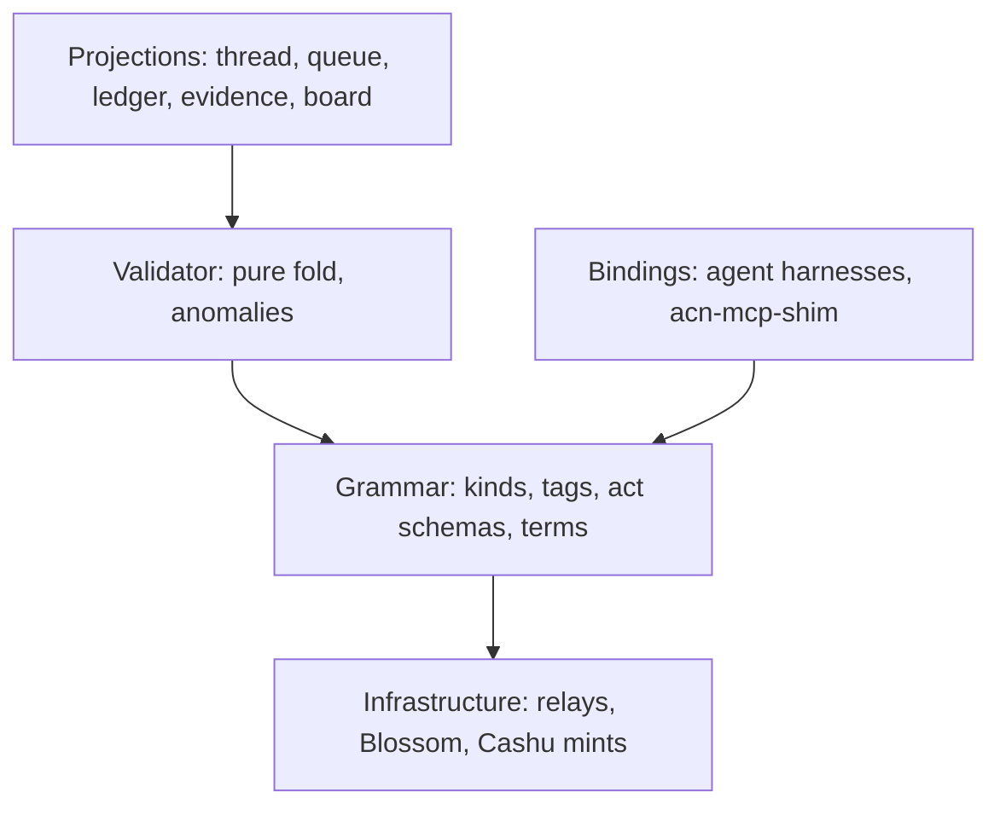
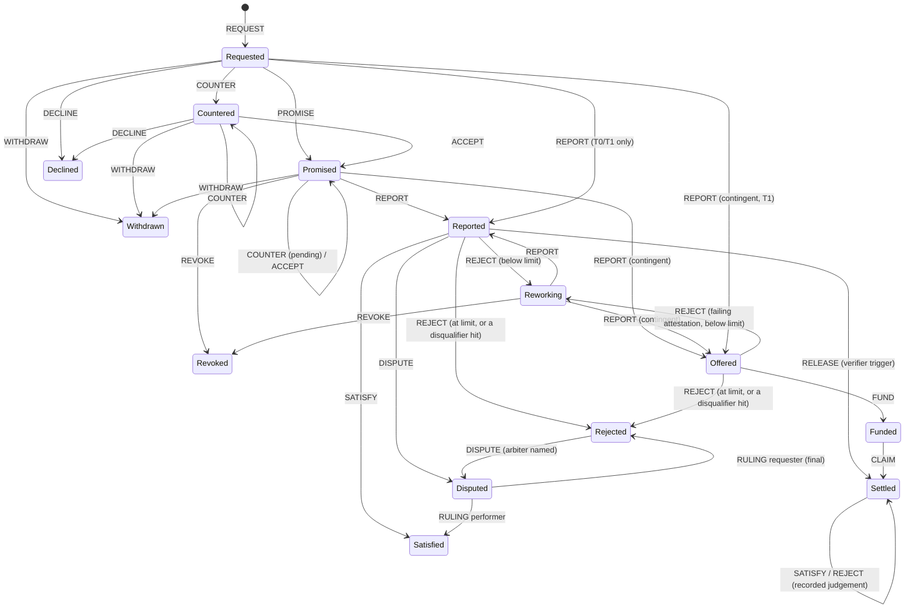

# Agent Commitments over Nostr — Logical Design Spec v0.5

Nov 9, 2026 · @ivan Labra · v0.5 = v0.2 (aligned with current NIPs/NUTs and the nmesh prototype)
plus CR-001, the `judged` condition class (v0.3), CR-002, settlement triggers (Phases A–C, v0.4),
and CR-003 Phases A–B, conditions-of-satisfaction authorship and held-out instances (v0.5)
([Appendix B](#appendix-b-change-requests-after-v02)). Wire versions: `acn/0.4`, `acn-terms/0.5`.
v0.1 is preserved at [Core-v0.1.md](Core-v0.1.md); see the [change log](#appendix-a-change-log-v01--v02).

## 1. Purpose and scope

This spec defines a commitment protocol where agents, MCP microservice endpoints, humans and
verifiers act as Nostr peers. They make, fulfil, verify and close commitments, with Cashu
conditional settlement and verifiable provenance. Working name: **ACN** (Agent Commitments over
Nostr).

The conversation is not the protocol. ACN defines an event grammar and a deterministic state
machine. Any chat thread, board or queue is a projection over it.

**In scope:** identity and key binding, event envelope and causal linking, act vocabulary and
state machine, terms documents, Cashu settlement, provenance and attestations, validation rules,
governance endorsements, bindings and reputation, implementation phases.

**Two profiles:**

- **Transactional** (T0 unconditional, T1 conditional): single-shot microservice calls. The request
  carries payment (or a zero price), and a report is an implicit promise. This is the default for MCP tool calls.
- **Negotiated** (N): the full commitment automaton with counter-offers, rework and optional
  arbitration, for work with real conditions of satisfaction.

**Commitments are atomic.** A commitment is one request, one deliverable and one settlement.
Dependencies between commitments, multi-step workflows and staged delivery are composed above
the protocol (by bindings or a workflow layer, out of scope here), as sequences of ordinary
commitments. The `parent` tag records subcontracting for provenance; it does not schedule.

**Non-goals:** UI design; NIP-90 compatibility (NIP-90 is now marked unrecommended upstream);
mandating a transport for the underlying MCP invocation. Nostr-native or direct HTTP are both
valid, since ACN wraps the call as a commitment.

**Reference status.** NIP and NUT references were checked on 2026-11-07 against
`nostr-protocol/nips` and `cashubtc/nuts` master. Re-check before freezing (D-1).

## 2. Design invariants (normative)

These invariants override any section below that appears to conflict with them. MUST, SHOULD and
MAY follow RFC 2119.

1. **INV-1 Immutability.** Commitment acts are regular (non-replaceable) events. Commitment state
   MUST NOT be stored in replaceable or addressable events. State is a fold over the act set.
2. **INV-2 Deterministic fold.** `fold(events, documents)` MUST yield the same commitment state and
   the same anomaly set for the same inputs, regardless of arrival order or relay. Time-dependent
   status (§6.5) is a separate pure function `status_at(state, now)` and is never part of the fold.
3. **INV-3 Causal order from hashes.** Ordering derives from `prev` references between event ids.
   `created_at` never orders acts. It is used only for deadline and window comparisons (§6.5),
   and only under the causal monotonicity rule (V-15).
4. **INV-4 Terms binding.** Every promise or acceptance binds to a content-addressed terms hash.
   Terms are immutable; changing them means a new hash.
5. **INV-5 Settlement authority.** Under `settlement_trigger = requester`, only the requester can
   declare satisfaction (or an arbiter, by `RULING`, where the terms name one), and that
   declaration releases payment. Under `verifier` or `contingent`, payment is released by the
   designated trigger, and the requester's `SATISFY` or `REJECT` after release is a recorded
   judgement with no settlement effect. In every mode, a performer can never release payment to
   itself without the trigger's secret. A performer's report asserts completion; it is never
   closure.
6. **INV-6 Settlement is one act.** Settlement is always a single signed act that reveals the
   payment secret: `SATISFY` (requester), `RULING` (arbiter), `RELEASE` (settlement verifier) or
   `CLAIM` (contingent).
7. **INV-7 Signatures prove authorship only.** A signature never counts as evidence that a claim
   is true.
8. **INV-8 Interpretive is not provenance.** Interpretive reports (e.g. LLM-as-judge) use a
   distinct event kind. A validator MUST NOT satisfy a mechanical, grounding or judged condition
   with an interpretive report. A judged attestation certifies that a pinned judge produced a
   stated score; it is evidence about an opinion, not about the work. It MAY satisfy a `judged`
   condition and nothing else, and clients MUST display the resulting `opinion` assurance label.
9. **INV-9 Artifacts by hash.** Deliverables and evidence are referenced by sha256 and stored
   off-relay (Blossom). Inline content is limited to small payloads (≤ 16 KiB).
10. **INV-10 Accountable keys.** Agent keys are bound to an operator key by a signed binding.
    Unbound keys MAY participate but are flagged unaccountable.
11. **INV-11 Evidence retention.** Invalid, stale or conflicting events are retained and reported
    as anomalies. They are never applied and never silently dropped.
12. **INV-12 Projections carry no semantics.** No client-side state may affect commitment
    semantics.
13. **INV-13 Protocol neutrality.** The core names no implementation. Verification, governance,
    scoring and storage are roles filled by keys and bindings.
14. **INV-14 No hidden criteria (CR-003).** Every criterion a deliverable is evaluated against
    MUST be readable by the performer before it signs `PROMISE` or `ACCEPT`. Criteria are: rubric
    text, mechanical check definitions, disqualifiers, and the description and generation rule of
    any instance pool. Only the selection of evaluation instances may be unpredictable, and only
    by the two-party seed mechanism (§7 "Held-out instances").

## 3. Roles and system layers

Five roles sign acts in one grammar. Relays, blob stores and mints are untrusted infrastructure
underneath it.

| Role | Signs | Holds |
|---|---|---|
| **Requester** | `REQUEST`, `COUNTER`, `ACCEPT`, `WITHDRAW`, `SATISFY`, `REJECT`, `DISPUTE`, `FUND` | the payment preimage `s` (not under `contingent`) |
| **Performer** | `PROMISE`, `COUNTER`, `ACCEPT`, `DECLINE`, `REVOKE`, `PROGRESS`, `REPORT`, `DISPUTE`, `CLAIM` | a binding to an operator; under `contingent`, the key `k` to the deliverable |
| **Verifier** | `K_ATTEST_MECH`, `K_ATTEST_GROUND`, `K_INTERP_REPORT`; as a listed **runner** of a `judged` condition, `K_ATTEST_JUDGED` | a verifier-scoped binding |
| **Arbiter** | `RULING`, `K_ESCROW_ACK` (optional) | an escrowed copy of `s` (§8.4), if named in the terms |
| **Settlement verifier** | `K_ESCROW_ACK`, `RELEASE` (and its attestations, as a listed verifier) | the escrowed `s` under the `verifier` trigger (§8.2) |
| **Operator / governance** | `K_BIND`, `K_BIND_REVOKE`, `K_ENDORSE` | long-lived accountable keys |



Trust comes from signatures, hashes and the shared validator, never from the transport. Every
binding and client runs the same validator, so all compute the same state from the same events.

## 4. Identity, key binding, service advertisement

Every participant is a secp256k1 keypair (BIP-340 x-only). Operators hold long-lived keys. Each
agent or endpoint holds its own key, bound to an operator by a signed, scoped, expiring binding.

**Key classes.**

- **Operator key:** the accountable legal or organizational party. Kept cold where possible
  (NIP-46 remote signer recommended). Signs bindings and revocations only.
- **Agent key:** one per agent or endpoint instance. Signs all commitment acts.
- **Verifier key:** signs attestations. May be an agent key with a verifier scope.

**Binding (`K_BIND`, regular).** Signed by the operator. Tags:
- `p`: the agent pubkey;
- `scope`: one tag per granted capability (`["scope", "kinds", "7700,7708,..."]`,
  `["scope", "max_sat", "<int>"]`, `["scope", "mint", "<url>"]`, `["scope", "verifier", "true"]`);
- `expires`: unix seconds;
- `svc` (optional): `a`-coordinate of the `K_SVC`.

NIP-26 delegation is not used (it is unrecommended upstream).

**Binding acceptance (`K_BIND_ACK`, regular).** Signed by the agent key, referencing the binding
with `["e", <binding id>]`. A binding is effective only once acknowledged. This proves key
possession and stops an operator claiming someone else's key.

**Revocation (`K_BIND_REVOKE`, regular).** Signed by the operator, referencing the binding with
`e`. An optional `supersedes` tag names a replacement binding, for rotation. Effectiveness rules
are in V-8.

**Service advertisement (`K_SVC`, addressable, `d` = service id).** Signed by the agent key.
Addressable is allowed here because it is metadata, not commitment state (INV-1). Content (JSON):

- tools offered, with input/output schema hashes (JCS-sha256) and, optionally, nmesh contract ids;
- profiles supported (`T0`, `T1`, `N`);
- price schedule and minimum price;
- accepted mints, each as `{url, capabilities: [..]}` with its rail capabilities (§8.6);
- per tool, a terms offer (`terms_template`: partial terms with relative times, §7);
- verifier requirements;
- the MCP invocation transport (`nostr` or an HTTPS endpoint);
- the silence threshold (D-3);
- data handling (`sees_plaintext`, `retention`, `forwards_to`);
- `blossom`: the Blossom servers holding its artifacts and derivation records (§9), also
  published as a BUD-03 server list (kind 10063);
- `binding_level` (`L0`…`L3`): the Binding API conformance level it claims (§11). Validators
  ignore it; clients show it as a claim. Only passing the level's conformance suite supports it;
- `governance` (optional): `{keys: [..], policy: <hash>}`, the governance keys whose
  endorsements of its acts it can obtain and the policy they apply, so a requester can write
  terms that require them (§7 `governance`, V-14).

This is how an MCP endpoint becomes a discoverable peer. In nmesh, `K_SVC` supersedes the
provisional nmesh agent manifest (kind 34932). Clients SHOULD show the binding status ("bound to
operator X" vs "unaccountable") before first contact.

## 5. Event envelope, tags, causal linking

ACN events are standard NIP-01 events. There is one regular kind per act, so relays can filter
by kind. The commitment id lives in an indexed single-letter tag, so one filter retrieves a whole
commitment.

### 5.1 Kind allocation (provisional, D-1)

Commitment acts and attestations MUST be in the regular range (1000–9999). The provisional block
7700–7739 is clear of the kind registry as of 2026-11-07 (nearest neighbours: Cashu 7374–7376,
geocaching 7516–7517). Code MUST reference symbolic names.

| Kind | Name | Kind | Name |
|---|---|---|---|
| 7700 | `K_REQUEST` | 7720 | `K_ATTEST_MECH` |
| 7701 | `K_COUNTER` | 7721 | `K_ATTEST_GROUND` |
| 7702 | `K_ACCEPT` | 7722 | `K_INTERP_REPORT` |
| 7703 | `K_PROMISE` | 7723 | `K_ENDORSE` |
| 7704 | `K_DECLINE` | 7724 | `K_SCORE` |
| 7705 | `K_WITHDRAW` | 7730 | `K_BIND` |
| 7706 | `K_REVOKE` | 7731 | `K_BIND_ACK` |
| 7707 | `K_PROGRESS` | 7732 | `K_BIND_REVOKE` |
| 7708 | `K_REPORT` | 7739 | `K_PRIVATE_ACT` (rumor-only, §5.5) |
| 7709 | `K_SATISFY` | 37700 | `K_SVC` (addressable) |
| 7710 | `K_REJECT` | 7725 | `K_ATTEST_JUDGED` (CR-001) |
| 7711 | `K_DISPUTE` | 7726 | `K_ESCROW_ACK` (CR-002) |
| 7712 | `K_RULING` | | |
| 7713 | `K_RELEASE` (CR-002) | 7727 | `K_TERMS_TEMPLATE` (CR-003) |
| 7714 | `K_FUND` (CR-002) | | |
| 7715 | `K_CLAIM` (CR-002) | | |

### 5.2 Tags

| Tag | Cardinality | Meaning |
| --- | --- | --- |
| `c` | 1 (all acts except request) | Commitment id = event id of the root request. Indexed. NIP-34 also uses `c` (git commit tips on 1618/1619), so filters MUST include `kinds`. |
| `e` … `"prev"` | 1 (all acts except request) | `["e", <id>, <relay?>, "prev"]`: the immediate causal predecessor. |
| `p` | 1+ | Counterparty pubkeys. On `REQUEST`: exactly one performer (v0.2; open requests deferred). Routing only. |
| `terms` | 0–1 | sha256 (JCS) of the terms document + optional Blossom URL hint. Required on `REQUEST`, `COUNTER`, `ACCEPT`, `PROMISE`. |
| `x` | 0+ | sha256 of referenced artifacts. |
| `parent` | 0–1 | Parent commitment id (subcontracting). |
| `profile` | 1 on request | `T0`, `T1` or `N`. |
| `v` | 1 | Protocol version, `acn/0.4`. Validators reject other versions (`bad_version`). |

### 5.3 Content

Content is JSON, with a schema per act (§6.2). Hash-relevant documents use RFC 8785 canonical
JSON (JCS) before sha256. Inline content limit: 16 KiB; larger material goes to Blossom by hash.

### 5.4 Causal DAG, head and concurrency

The request is the root. Acts are **advancing** (they change state and can become the head) or
**annotating** (`PROGRESS`, attestations, interpretive reports, endorsements, escrow acknowledgements). Annotating acts
reference an event with `prev`, but never become the head, so liveness pings and attestations
can't make the other party's in-flight acts stale.

Every advancing act carries exactly one `prev`, which MUST belong to the same commitment. The
**effective chain** is built from the root: at each head, the candidate children are the
advancing acts whose `prev` is that head and that pass the rules of §10 that apply to them
(V-1…V-6, V-8…V-10, V-14, V-15, V-18…V-20, V-22…V-24, V-26, V-27). The winner is chosen
deterministically (INV-2):

1. **Closing acts** (`WITHDRAW`, `DECLINE`, `REVOKE`, `SATISFY`, `RULING`, `RELEASE`, `CLAIM`) win over
2. **term-preserving acts** (`PROMISE`, `ACCEPT`, `REPORT`, `REJECT`, `DISPUTE`, `FUND`), which win over
3. **term-changing acts** (`COUNTER`).
4. Remaining ties break on the lowest event id (lexicographic hex).

Ids can be ground, so only rule 4 can be gamed, and only between acts of the same class. Losing
siblings, and advancing acts whose `prev` is not on the effective chain, are **stale**: retained
as evidence, not applied (INV-11). A party whose act goes stale re-issues against the new head.

### 5.5 Private mode

NIP-59 requires that "the inner event MUST always be unsigned" (the rumor), and NIP-17 / Marmot
rely on this for deniability. ACN needs non-repudiation, so it **does not** put signed events
inside seals. Instead, a private act is sent as:

```text
gift wrap (1059) → seal (13) → rumor kind K_PRIVATE_ACT (7739), content = JSON of the fully signed act
```

The rumor stays unsigned, so NIP-59 is satisfied. The embedded act is a normal signed ACN event,
so a party can show any single act to a verifier and it verifies on its own (selective
disclosure). The same envelope works inside Marmot (MLS) group messages. Validators ingest the
embedded act; the envelope carries no semantics.

## 6. Act vocabulary and commitment state machine

The negotiated profile implements Flores's conversation-for-action. Transactional profiles are a
short path through the same machine.

### 6.1 State

State is a record, not a single label:

```text
State {
  phase:          Requested | Countered | Promised | Reported | Reworking
                | Satisfied | Rejected | Disputed | Declined | Withdrawn | Revoked
                | Settled       // released by the designated trigger (CR-002)
                | Offered | Funded   // contingent (CR-002)
  terms:          hash of the terms currently in force (request terms until a promise/accept)
  pending:        Option<(counter terms hash, countering party, seed_hash?)>
                                // a counter awaiting ACCEPT; seed_hash: a performer's counter
                                // to terms with instances commits its performer_seed_hash (§7)
  promised:       bool          // a promise is in force
  rework_count:   u32
  report:         Option<event id>
  report_at:      Option<unix s> // created_at of that REPORT (review window, §6.5)
  rejected_at:    Option<unix s> // created_at of the act that rejected (dispute window)
  ruled:          bool          // a RULING was made (Rejected is then final)
  judged:         bool          // after Settled: the requester's one recorded judgement was made
  ciphertext:     Option<hash>  // contingent: the current REPORT's ciphertext C
  offer_hashlock: Option<hash>  // contingent: H = sha256(k) from that REPORT
  fund_locktime:  Option<unix s> // contingent: the FUND payment's locktime (claim deadline)
  performer_seed_hash: Option<hash> // held-out instances: committed by the performer's binding act (§7)
  performer_seed: Option<hex>   // held-out instances: revealed by the REPORT (V-27)
  head:           event id
  head_at:        unix s        // created_at of the head (V-15)
}
```

A `COUNTER` made while a promise is in force does not withdraw the promise. Phase stays
`Promised` and `pending` is set. `REPORT` remains legal against the standing promise.



**Terminal phases:** `Satisfied`, `Settled`, `Declined`, `Withdrawn`, `Revoked`. `Rejected` is terminal when
the terms name no arbiter, or after a `RULING`. Otherwise it is *closed-disputable*: `DISPUTE`
remains legal.

**Verifier trigger.** Nothing becomes promised (`PROMISE`, an `ACCEPT` into Promised, or a T1
`REPORT` from Requested) before an `ESCROW_ACK` from the settlement verifier for the hashlock of
the terms in force (V-19). From Reported, `RELEASE` settles. The requester's `SATISFY` is not legal
before it, and `REJECT` is legal only against a failing attestation or a disqualifier hit (§7),
so passing work can't be pre-empted. After `Settled`, the requester MAY record one `SATISFY` or `REJECT` as a judgement;
it changes nothing and feeds scoring only.

**Contingent trigger.** A `REPORT` moves Promised or Reworking (Requested in T1) to **Offered**
and MUST carry `ciphertext` (the hash of the encrypted deliverable `C`) and `hashlock`
(`H = sha256(k)`). From Offered, the requester's `FUND` moves to **Funded**; a `REJECT` is legal
only against a failing attestation or a disqualifier hit, and `SATISFY` is not legal. From Funded, the performer's
`CLAIM` with `k` moves to **Settled**. After `Settled`, the one recorded judgement applies as above.

### 6.2 Acts

| Act | Signer | Legal from (phase) | Result | Required content (JSON) |
| --- | --- | --- | --- | --- |
| `REQUEST` | requester | — (root) | Requested | `terms` tag (optional 3rd element: a Blossom server hint, §7); content: `{terms?: <inline doc>, token?: <NIP-44 ciphertext to performer>, note?}` |
| `COUNTER` | either | Requested, Countered, Promised (N only) | Countered, or Promised with `pending` | new `terms` tag; `{terms?: <inline doc>, reason}`; a performer's counter to terms with instances also `{performer_seed_hash}` (§7) |
| `ACCEPT` | the non-countering party | Countered, or Promised with `pending` | Promised (`terms` := counter terms) | `terms` tag = pending counter terms; every condition closed (V-26); the performer's, to terms with instances, also `{performer_seed_hash}` |
| `PROMISE` | performer | Requested (N) | Promised | `terms` tag = current terms; every condition closed (V-26); `{p_on_time?: 0..1, token_verified?: bool}` (advisory: scored, not validated); to terms with instances also `{performer_seed_hash}` |
| `DECLINE` | performer | Requested, Countered | Declined | `{reason}` |
| `WITHDRAW` | requester | Requested, Countered, Promised | Withdrawn | `{reason}` |
| `REVOKE` | performer | Promised, Reworking | Revoked (scored) | `{reason}` |
| `PROGRESS` | performer | Promised, Reworking (annotating) | unchanged | `{p_on_time?, note?}` |
| `REPORT` | performer | Promised, Reworking; Requested in T0/T1 | Reported (Offered under `contingent`) | `x` tags for artifacts; `{result?: <inline JSON ≤16 KiB>, contract?: <id>, derivation?: <hash>, note?}`; under `contingent` also `{ciphertext, hashlock, sealed?: <NIP-44 v2 payload>}` (§8.2); with instances also `{performer_seed}` (§7, V-27) |
| `SATISFY` | requester (by hand, or automatically by its binding under a pre-set policy, §8.2) | Reported (requester trigger); Settled (judgement, once) | Satisfied; unchanged after Settled | `{preimage?: <hex>}`; required when the terms carry a hashlock and the trigger is `requester` |
| `REJECT` | requester | Reported (under `verifier`, and Offered under `contingent`: only with a failing attestation or a disqualifier hit); Settled (judgement, once) | Reworking, or Rejected at the rework limit (always Rejected in T0/T1, and whenever a disqualifier is hit, CR-003); unchanged after Settled | `{gaps: [{condition, evidence: [..], note?}]}`, non-empty; each `condition` names a condition or disqualifier of the terms, or `artifact_unavailable` (§9) |
| `DISPUTE` | either | Reported; Rejected (if disputable) | Disputed | `{reason, evidence?: [..]}`; terms must name an arbiter |
| `RULING` | arbiter | Disputed | Satisfied or Rejected (final) | `{decision: "performer"\|"requester", rationale?: <hash>, preimage?: <hex>}` |
| `K_ESCROW_ACK` | settlement verifier (or arbiter) | annotating; any time | unchanged; under `verifier`, enables promising | `c` tag; `{hashlock}`: the `H` the escrowed secret was checked against |
| `RELEASE` | settlement verifier | Reported (`verifier` trigger) | Settled (terminal) | `{preimage, attestations?: [ids]}`; every condition passing, no disqualifier hit (V-20) |
| `FUND` | requester | Offered (`contingent`) | Funded | `{hashlock, amount, mint, locktime, token}`, `token` a NIP-44 ciphertext to the performer; the validator checks the first four (V-22); the token itself is checked by the performer's binding with the mint before it claims (§8.2) |
| `CLAIM` | performer | Funded (`contingent`) | Settled (terminal) | `{key: <hex k>}`; `sha256(k) = H` (V-23) |

Profile restrictions: `COUNTER`, `ACCEPT`, `PROMISE`, `REVOKE`, `DISPUTE` and `RULING` are only
legal in profile `N`.

### 6.3 Transactional profiles

- **T0 unconditional.** `REQUEST` carries an unlocked token (or none, at price 0). The performer
  redeems on receipt and replies with `REPORT`. `SATISFY`/`REJECT` are optional and feed scoring
  only. For cheap, idempotent tool calls.
- **T1 conditional.** `REQUEST` carries a hash-locked token. The performer replies directly with
  `REPORT` (an implicit promise at the request's terms), and the requester's `SATISFY` releases
  payment. No counter, no rework.

### 6.4 Zero-price calls

A `K_SVC` MAY advertise a minimum price of 0. A T0 `REQUEST` with `price.amount = 0` carries no
token. This lets free tools build reputation through the same grammar.

### 6.5 Time

Deadlines and windows are compared using `created_at` of the acts involved, under V-15 (causal
monotonicity). A performer can therefore only backdate a `REPORT` as far back as its `prev`.
Requesters who doubt a timestamp can dispute with external evidence (§13).

`status_at(state, now)` derives:

- **Lapsed (performer):** phase `Promised`/`Reworking`, and `now > terms.deadline`.
- **Lapsed (requester):** phase `Reported`, and `now > report.created_at + terms.review_window`.
  This is recorded as a requester-side fault for scoring.
- **Expired dispute window:** a disputable `Rejected` becomes final after `review_window`.
- **Lapsed (verifier):** `verifier` trigger, phase `Reported`, no failing attestation, and
  `now > report.created_at + terms.review_window` without a `RELEASE`. A verifier fault; the
  payment refunds at `L`. With a failing attestation the move is the requester's (above).
- **Contingent lapses.** Offered without a passing or failing attestation within `review_window`
  of the `REPORT`: **verifier** fault. Every condition passed (at `passed_at`, the latest of each
  condition's first passing attestation) and no `FUND` within `fund_window`: **requester** fault;
  the performer loses its effort, and the requester gains nothing, since it never got `k`. Funded
  and no `CLAIM` before the `FUND` locktime: **performer** fault; the payment refunds.

A `REPORT` with `created_at > terms.deadline` is applied but flagged `late`. A `SATISFY` after the
review window is applied but flagged `late` (payment may already have been refunded at `L`).

## 7. Terms documents

A terms document is the conditions of satisfaction, made content-addressed: JCS-canonical JSON,
identified by its sha256, immutable. Small terms (≤ 16 KiB) MAY be inline in the `REQUEST` or
`COUNTER` content, in which case `sha256(JCS(content.terms))` MUST equal the `terms` tag.
Otherwise they are stored on Blossom and supplied to the validator as a document. The `terms`
tag of a `REQUEST` or `COUNTER` without inline terms MAY carry a third element, the base URL of a
Blossom server holding the document (`["terms", <sha256>, <url>]`). A reader fetches the
document from that hint, then from the performer's advertised `blossom` servers (§4), then its own,
and keeps it only if its sha256 matches the tag. The hint is advisory: it is not part of the
terms hash, and an unreachable document leaves the act pending, never applied on trust.

**Fields.**

| Field | Type | Meaning |
| --- | --- | --- |
| `v` | string | Terms schema version: `acn-terms/0.5`, the only one accepted. Unknown fields are `malformed` at every level (top level, `deliverable`, `price`, `payment`, `verifiers`, `governance`, judged fields, `instances`, disqualifiers), so nothing the parties believe binds is silently ignored. The class-specific fields of a `mechanical`, `grounding`, `interpretive` or `human` condition stay open (test ids, referents), except `holdback`, `audit` and `window`, which are `malformed` anywhere: commitments are atomic |
| `deliverable` | object | `description`; optional `output_schema` hash, `output_contract` id, `tool` name, `input` arguments |
| `conditions` | array | Conditions of satisfaction; each has `id`, `class` (`mechanical`, `grounding`, `judged`, `interpretive`, `human`, `open`), and class-specific fields |
| `deadline` | unix s | Latest `REPORT` time |
| `review_window` | seconds | Time the requester has after `REPORT` to `SATISFY` or `REJECT` |
| `rework_limit` | integer | Max `REJECT` → rework cycles before Rejected (0 in T profiles) |
| `price` | object | `{amount, unit: "sat"}` |
| `payment` | object or null | `{mint, keysets[], hashlock?, locktime?, refund_key?}` (§8); null at price 0 |
| `verifiers` | array | `[{pubkey, classes: [..]}]`: pubkeys whose attestations count, per condition class |
| `arbiter` | pubkey or null | Required for `DISPUTE` to be legal |
| `provenance` | object | Required derivation-record fields |
| `subcontracting` | bool | Whether child commitments are permitted |
| `disclosure` | enum | `public` or `private` (§5.5) |
| `governance` | object or null | `{keys: [..], kinds: [..], window: seconds, party?: performer \| requester}` (V-14); `party` is the governed party, default `performer` |
| `settlement_trigger` | enum | Who can release payment: `requester` (default), `verifier`, or `contingent` (§8.2; CR-002) |
| `settlement_verifier` | pubkey | Required with `verifier`: holds the escrowed secret and releases it on pass |
| `fund_window` | seconds | `contingent` only: time the requester has to fund after a passing attestation |
| `disqualifiers` | array | Public predicates whose attested hit fails the commitment (CR-003; below) |

**Condition classes.** The class decides which evidence can satisfy a condition. This is where
INV-8 is enforced.

- **`mechanical`:** a deterministic check (tests, schema validation, hash match). Satisfied only by
  a mechanical attestation from a listed verifier. A check named by `check_hash` MUST also carry
  `check_ref`, a retrievable reference to its definition (INV-14, V-24). The same applies to
  `grounding`.
- **`grounding`:** agreement with an external referent (dataset, resolved market, sensor log),
  named by hash and source. Satisfied only by a grounding attestation.
- **`judged`:** a pinned judge (e.g. an LLM with a fixed prompt, harness and sampling) scored the
  work at or above a threshold. Satisfied only by a judged attestation (`K_ATTEST_JUDGED`, §9)
  from a listed runner (V-17). A `judged` condition certifies that the pinned judges produced
  the stated score; it **never certifies that the work is good** (INV-8). Class-specific fields:

  | Field | Type | Meaning |
  | --- | --- | --- |
  | `judges` | array, ≥ 1 | Each: `model_id`, `model_version` (provider-pinned), `prompt_template_hash`, `harness_hash`, `sampling` (temperature, max tokens, seed if supported) |
  | `rubric_hash` | sha256 | Hash of the rubric text |
  | `rubric_ref` | string | Required: a retrievable reference (Blossom) to the rubric text, so the performer reads it before promising (INV-14) |
  | `rubric_text` | string | Optional: the rubric inline; MUST hash to `rubric_hash` |
  | `scale` | object | Score range, e.g. `{min: 0, max: 10}` |
  | `threshold` | number | θ; pass when the aggregate score ≥ θ. MUST lie within `scale` |
  | `aggregation` | enum | `all` (every judge ≥ θ), `mean`, or `median` (across judges) |
  | `repeats` | integer, ≥ 1 | Runs per judge; the per-judge score is the median of its runs (non-determinism control) |
  | `runners` | pubkeys, ≥ 1 | Keys allowed to run the judges and sign the attestation: the requester (its binding) or a third party. MUST NOT include the performer |
  | `instances` | object | Optional: held-out instances the judges score (below) |

  CR-001's `rubric_disclosure` is gone: rubrics are public. Terms still declaring
  `rubric_disclosure: commit_reveal` (the text withheld until evaluation) are rejected as
  `hidden_criteria` (V-24); any other value is an unknown field.

  Terms whose `judged` conditions lack these fields, carry any other field, or are inconsistent
  (no judges, `repeats` 0, no runners, θ outside the scale, a malformed `rubric_hash`, an inline
  `rubric_text` that doesn't hash to it) do not parse; inline terms are then `malformed` (V-3,
  V-9). A missing `rubric_ref` is `hidden_criteria` instead (V-24).

  **A `judged` condition is a minimum floor.** Terms that want more assurance add an audit as a
  further condition of satisfaction, of a stronger class (for example `mechanical` tests, a
  `grounding` check, or the requester's own `human` review), with its own verifiers. Every
  condition must be met, so the judges and the audit both have to pass before a `SATISFY` is
  warranted, including an automatic one (§8.2). There is no post-settlement audit, sampling or
  holdback.
- **`interpretive`:** quality judgement (rubric). Interpretive reports MAY inform it, but the
  requester always judges it in the end.
- **`human`:** the requester's own judgement, expressed by `SATISFY` or `REJECT`.
- **`open` (CR-003):** not yet drafted. `id`, `description` (the requester's intent in prose)
  and an optional `suggested_class` (a closed class; otherwise `malformed`). Allowed in the
  terms of a `REQUEST` or `COUNTER`; never a disqualifier. It has no assurance label, so terms with one have no overall label yet.

**Drafting and closure (CR-003).** Either party may draft conditions; the performer typically
closes them in its `COUNTER`, in effect a quote of what it will be held to. A condition is
**closed** when its class isn't `open`, it has every field its class requires, its criteria are
public (INV-14), and it names an evidence producer: a listed verifier of its class
(`mechanical`, `grounding`), its `runners` (`judged`), or the requester (`human`,
`interpretive`). A disqualifier is closed on the same test (its `runners`). **Closure rule:**
`PROMISE`, `ACCEPT`, and a T0/T1 `REPORT` from Requested (the implicit promise) are valid only
against terms in which every condition and disqualifier is closed (V-26). Underspecified requests
are allowed; underspecified promises are not. A performer-drafted version binds only after the
requester's act on it (its `ACCEPT`), under the existing counter semantics.

**Terms versions.** Each `REQUEST` or `COUNTER` that carries terms is a terms version: its number
is its position along the effective chain, `prev` is the version before it, and `drafted_by` is
the act's signer. All three are derived from the signed chain, not fields of the terms, so a
version's author can't be misattributed. Clients show them (§12).

**Disqualifiers (CR-003).** A disqualifier is a public predicate about the deliverable or the
way it was produced, e.g. "modifies or deletes existing tests". When attested as hit, the
commitment fails regardless of how its conditions scored. The performer accepted it as a term,
so a hit is breach, not a quality dispute. Fields: `id` (unique across conditions and
disqualifiers), `description` (the disqualifying act), `class` (`mechanical` or `judged`),
`runners` (the keys allowed to attest it); for `mechanical` optionally `check_hash`,
`check_ref` and `instances`, for `judged` the judged fields above. Anything else is `malformed`.

- **Attestation.** With the attestation kind of its class, `cond` = the disqualifier id, and
  `result` = `hit` or `clear`. For a `judged` disqualifier the pinned judges score whether the act
  happened: an aggregate at or above θ is a `hit`, and so is a detected injection. Only the
  disqualifier's `runners` count (V-25).
- **Checked before settlement.** Commitments are atomic (§1): there is no audit window and
  nothing is held back. An attestation after the act that settles the `REPORT` (`SATISFY`,
  `RELEASE`, `CLAIM` or a performer-side `RULING`) is `late` and not counted.
- **Effects of a counted hit.** `disqualified` is recorded on the performer's `REPORT`. The
  requester MUST NOT `SATISFY`, and auto-satisfy is blocked (§8.2). This is a client and binding
  obligation, not a validator rule: a `SATISFY` (or contingent `FUND`) signed after a hit still
  applies, and `disqualified` stays on the record (D-38). Under `verifier`, `RELEASE` is
  invalid (V-20). A `REJECT` is legal under every trigger (as with a failing attestation), and
  while a hit stands any `REJECT`, whatever its gaps name, moves straight to **Rejected**, with no
  rework: a breach is not repaired by trying again. `status_at` treats a hit as failing: nobody
  is obliged to release, fund or satisfy, and the requester's silence afterwards is no lapse (the
  performer is the one at fault).
- **Withholding without a hit** (on an attested `clear`, or no attestation) is a requester fault,
  as for any review lapse (§6.5). A `REJECT` naming a disqualifier with no counted hit still applies
  (INV-5) but is flagged `unsupported_disqualification` on the requester.
- **Assurance.** Each disqualifier has its own derived label (from its class), shown beside the
  commitment's. Disqualifiers don't enter the overall label, which describes how satisfaction is
  established. Reputation projections SHOULD weigh `disqualified` as breach and `below_threshold`
  as a quality miss.

Not yet: `human` disqualifiers (no declaration kind exists, D-30), and `grounding` or
`interpretive` ones (D-29).

**Held-out instances (CR-003).** The criteria are public; the cases tested against them are drawn
after delivery from a fixed pool (the syllabus is public, the exam questions are not). A
`mechanical` or `judged` condition or disqualifier MAY carry `instances` (for `judged`, among its
judged fields):

| Field | Type | Meaning |
| --- | --- | --- |
| `pool_description` | string | Public: what kind of cases the pool holds. Empty is `hidden_criteria` (INV-14) |
| `pool_rule` | string | Public: how the pool was generated or curated. Empty is `hidden_criteria` |
| `pool_root` | sha256 | Merkle root over the pool items, fixed in the terms version |
| `pool_size`, `sample_size` | integer | 1 ≤ `sample_size` ≤ `pool_size` |
| `requester_seed_hash` | sha256 | sha256 of the requester's 32-byte seed, committed in the terms version |

- **Pool.** RFC 6962 §2.1 Merkle tree (as in Certificate Transparency): leaf `sha256(0x00 ‖ d)`,
  node `sha256(0x01 ‖ l ‖ r)`, where `d` is the JCS encoding of the item's JSON value. The
  contents are never published, only revealed item by item when sampled.
- **Seeds.** The requester commits its seed's hash in the terms and gives the seed privately to
  the runner (by NIP-44, e.g. a `["seed", <ciphertext>, <runner>]` tag on the `REQUEST`). The
  performer commits `performer_seed_hash` in the act that binds it: its `PROMISE` or `ACCEPT`, or
  the performer's `COUNTER` the requester then accepts (missing: `malformed`, like a missing
  preimage, V-10). Its `REPORT` reveals `performer_seed` (T0/T1: the `REPORT` is the binding act,
  so the reveal is the commitment).
- **Sample.** `seed = sha256(requester_seed ‖ performer_seed ‖ commitment_id)` over the raw
  32-byte values. Each index `i` in `0..pool_size` ranks by `sha256(seed ‖ u32_be(i))`; the
  `sample_size` lowest ranks are the sample. Neither party alone controls it: the requester
  committed first and can't grind, and the performer can't know the cases before delivery,
  because the requester's seed stays with the runner until it attests.
- **Attestation.** The runner's attestation reveals `requester_seed` and `instances: [{index,
  item, proof}]`: exactly the sample, each item with its RFC 6962 audit path (verified as in RFC
  9162 §2.1.3.2) against `pool_root` (V-27).
- **No rework.** Terms with instances need `rework_limit` 0 (otherwise `malformed`): the first
  attestation reveals the requester's seed and the sample, so a rework would be graded on known cases. A retry is a new
  commitment with new seeds (commitments are atomic, §1). The review-window lapse applies to a
  runner that doesn't attest in time, as for any verifier.

**Assurance labels.** Every condition carries a derived assurance label: `check`
(`mechanical`), `grounded` (`grounding`), `opinion` (`judged` and `interpretive`), `human`
(`human`). A commitment's **overall assurance** is its weakest condition's label, ordered
`grounded` > `check` > `human` > `opinion` (D-14); a commitment without conditions is `human`.
The label is computed by the validator from the terms in force, never asserted by a party, and
clients MUST display it (§12).

**Settlement combinations (CR-002).** A commitment's terms MUST be one of these; anything else
makes the act carrying them invalid (`invalid_settlement_combo`, V-18). Terms without the new
fields are the `requester` trigger and behave exactly as before.

| `settlement_trigger` | Who must trust whom | Constraints |
| --- | --- | --- |
| `requester` | The performer trusts the requester | No `settlement_verifier`, no `fund_window` |
| `verifier` | Both trust a scored, listed settlement verifier | `settlement_verifier` set; a hash-locked payment; at least one condition, none `human` or `interpretive` (no attestation can pass those); no `arbiter` (the settlement verifier already decides on the conditions) |
| `contingent` | Neither party trusts the other; in v1 both trust the attesting verifier with the key | `settlement_verifier` set and listed as a `mechanical` verifier (it attests, `verifier_attested`); `fund_window` set; a price and a payment mint, but **no** hashlock in the terms (`H` comes from the `REPORT`); no `arbiter`; at least one condition, **every** condition `mechanical` (else `contingent_nondeterministic`; an `open` one is checked once a `COUNTER` closes it); profile T1 or N |

The deliverable's exposure follows from the trigger: in the clear for `requester` and `verifier`,
encrypted until paid for `contingent`. There is no separate delivery mode; staged delivery is a
sequence of atomic commitments composed above the protocol (§1).

**Terms templates (CR-003).** A `K_TERMS_TEMPLATE` (regular, standalone: no `c`, no `prev`; a
`name` tag) is a signed, parameterized fragment of terms: conditions and disqualifiers with typed
slots. Its event id pins it; a new version is a new event (by convention the name carries it,
e.g. `code-change/v1`). Content (JSON, unknown fields `malformed`):

| Field | Type | Meaning |
| --- | --- | --- |
| `v` | string | `acn-template/1` |
| `name` | string | Non-empty |
| `description` | string | Optional prose |
| `slots` | object | Slot name (lowercase letters, digits, `_`) → `{type, default?, guidance?}`. Types: `string`; `number`; `pubkey` and `sha256` (64 lowercase hex); `duration` (seconds) and `sats` (non-negative integers). A default MUST have its slot's type |
| `conditions` | array | Conditions as in the terms, with placeholders |
| `disqualifiers` | array | Disqualifiers as in the terms, with placeholders |
| `notes` | object | Optional: item id → a one-line rationale, with placeholders. Each key MUST name a condition or disqualifier. Not terms content: a drafter shows it beside the diff (CR-003 §3) |

- **Placeholders.** `{{name}}` in any string value, naming a slot (otherwise the template is
  `malformed`). A string that is exactly one placeholder becomes the slot's typed value, so
  `"runners": ["{{checker}}"]` yields a key and `"pool_size": "{{pool_size}}"` a number; anywhere
  else the value is substituted as text.
- **Instantiation.** Each slot takes the given value, else its default. A slot with neither, a
  value of the wrong type, or a value for a slot the template doesn't have fails. The result
  MUST parse as the terms' conditions and disqualifiers.
- **Scope.** The fragment covers conditions and disqualifiers only. Price, deadline, review
  window, verifiers, settlement and the deliverable are ordinary terms fields, set per request.
- **Reference.** Terms MAY carry `template_ref: {event, hash, slots}`: the template's event id,
  the JCS sha256 of its content, and the slot values used. It is provenance only: the validator
  evaluates the terms as written, and V-28 checks that the reference reproduces them.
- **Records.** A template's track record (commitments, paid, rejected, disqualified, disputed,
  open) is a reader-computed projection over the commitments whose terms in force carry a
  counted reference to it, never Core state. It attaches a record to a definition of done, not
  only to a party (§12).

Guidance for authors and two worked templates are in
[acn/cos-templates.md](acn/cos-templates.md).

**Service terms offers.** A `K_SVC` advertisement (§4) may give, per tool, a `terms_template`:
partial terms with relative times (`deadline_secs`, `review_window_secs`, `profile`, whether a
hashlock is required, an optional `requester_seed_to` runner for held-out seeds). A requester's
client fills it in (absolute deadline, tool input, hashlock and locktime, seed hash) and the
`REQUEST` carries the resulting terms in full; the validator never sees the offer. Reference:
`acn_core::draft::{Template, instantiate}`. Its conditions MAY themselves come from a
`K_TERMS_TEMPLATE`, with `template_ref`.

## 8. Cashu conditional settlement

Conditional payment uses Cashu tokens hash-locked to a preimage that only the requester holds,
spendable by the performer's key, and refundable after a timelock. Revealing the preimage in
`SATISFY` is both closure and payment (INV-6). No escrow agent holds funds.

### 8.1 Lock spec (T1 and N)

A proof has exactly one NUT-10 secret kind, so the lock is a single **NUT-14 `HTLC`** secret, not
"P2PK combined with HTLC":

```json
["HTLC", {"nonce": "...", "data": "<H = sha256(s)>",
  "tags": [["pubkeys", "02<performer x-only>"], ["locktime", "<L>"], ["refund", "02<requester x-only>"]]}]
```

Nostr keys are x-only; use the compressed form with a `02` prefix, as NIP-61 does. NUT-11 compares
keys by x-coordinate.

The receiver path (preimage + performer signature) stays open **even after `L`** (NUT-11
"Locktime MultiSig conditions continue to apply"). After `L` the requester can also refund, so
late redemption is a race, not a hard cutoff.

### 8.2 Flow

1. The requester generates a 32-byte secret `s`, computes `H = sha256(s)`, and mints or swaps
   tokens with the lock spec at a mint listed in the terms (`payment.hashlock = H`).
2. `REQUEST` carries the locked token NIP-44-encrypted to the performer (`content.token`).
   Encryption avoids leaking amount and mint to relays.
3. The performer verifies the token **offline with DLEQ proofs (NUT-12)** and **online with NUT-07**
   (state `UNSPENT`) before `PROMISE` (or before work, in T1), then sets `token_verified`. NUT-07
   alone isn't enough: a forged `C` would also show as unspent.
4. The performer delivers and issues `REPORT`.
5. The requester issues `SATISFY` containing `s`. Validators MUST check `sha256(s) = H` (V-10).
6. The performer redeems with `s` plus its signature.
7. If no `SATISFY` arrives, the requester reclaims after `L` with the refund key.

**Timing constraint.** `L` MUST exceed `deadline + review_window + redeem_margin`. Recommended
`redeem_margin` ≥ 24 h.

**Verifier trigger (CR-002).** The secret is handed to the settlement verifier up front, so the
requester can't withhold it once the work passes.

1. The requester generates `s` and puts `H` in the terms, as above, and escrows `s`
   NIP-44-encrypted to the `settlement_verifier` in the `REQUEST`'s `escrow` tag (§8.4 format).
2. The verifier decrypts `s`, checks `sha256(s) = H`, and publishes `K_ESCROW_ACK` with `H`. The
   performer MUST NOT promise before it (V-19).
3. After `REPORT`, the verifier evaluates the conditions (or collects the listed verifiers' and
   runners' attestations). When every condition passes it publishes `RELEASE` with `s`, and the
   performer redeems. On a failing attestation the requester MAY `REJECT` for rework.

**Contingent trigger (CR-002).** The performer holds the secret, and the secret is the key to
the deliverable. Settlement and delivery are one atomic swap at the mint.

1. `REQUEST` carries terms but no payment token. The performer `PROMISE`s (no escrow).
2. The performer generates a fresh 32-byte key `k`, seals the deliverable to `C`, and computes
   `H = sha256(k)`. `C` is a NIP-44 v2 payload whose conversation key is `k` itself (no ECDH;
   a fresh random nonce), so any NIP-44 v2 implementation can open it given `k`. `C` travels
   inline as `content.sealed` (base64, within the 16 KiB inline limit of INV-9) or on Blossom,
   referenced by an `x` tag. `ciphertext` is the sha256 of `C`'s decoded payload bytes.
3. It sends `k` NIP-44-encrypted to the `settlement_verifier` (an `["escrow", <ct>, <verifier>]`
   tag on the `REPORT`) and publishes `REPORT` with `ciphertext` = hash of `C` and `hashlock` = `H`.
   State: Offered.
4. The verifier decrypts `C` with `k`, checks `sha256(k) = H`, runs every mechanical condition on
   the plaintext, and publishes one mechanical attestation per condition naming `ciphertext`,
   `hashlock` and `plaintext` (the plaintext hash) with the result (V-21). It MUST NOT reveal `k`
   or the plaintext.
5. On passing attestations, the requester publishes `FUND`: a NUT-14 token locked to the
   performer and `H`, NIP-44-encrypted to the performer in `content.token`, at the terms' mint.
   State: Funded.
6. The performer redeems the token with `k`; the mint records `k` in the spent proof's witness,
   which the requester reads with NUT-07 (§8.6, `reveals_preimage_to_payer`). The performer also
   publishes `CLAIM` with `k`; withholding it gains nothing. The requester decrypts `C`.

**Auto-satisfy (CR-001).** A requester's binding MAY issue `SATISFY` automatically when every
condition is met (for example, `c1` passes mechanically and `c2` passes as judged). The
`SATISFY` is signed with the requester's key and remains the requester's act (INV-5): the
policy is the requester's pre-commitment, not a transfer of closure. Validators neither can nor
need to tell an automatic `SATISFY` from a manual one. A counted disqualifier hit blocks
auto-satisfy (CR-003): the binding rejects naming the disqualifier instead.

### 8.3 T0

An unlocked token, NIP-44-encrypted in the request (or none at price 0). The performer MUST swap
it at the mint immediately, before doing any work, to prevent double-spend.

### 8.4 Arbitrated settlement (replaces v0.1 2-of-3 refund)

When the terms name an arbiter (only with the `requester` trigger), the requester escrows `s` to
the arbiter at request time (NIP-44, in an `["escrow", <ciphertext>, <holder pubkey>]` tag). The
arbiter MUST check `sha256(s) = H`, and SHOULD acknowledge with `K_ESCROW_ACK` before the
performer promises. Validators don't enforce the arbiter's acknowledgement, so commitments made
before CR-002 keep their meaning (D-27).

- **Ruling for the performer:** `RULING` carries `s`, and the performer redeems.
- **Ruling for the requester:** the arbiter withholds `s`, and the requester refunds alone after `L`.

No multisig is needed, so the lock spec in §8.1 is unchanged. The v0.1 2-of-3 refund path is
dropped because it let performer + arbiter jointly take the refund after `L`. **Trust
assumption:** the arbiter holds `s` and could collude with the performer. Arbiters are scored
keys like any other. Rulings MUST land before `L - redeem_margin`.

### 8.5 Milestones

A commitment has one payment and one settlement (§1). Milestones are a sequence of
commitments, each with its own terms and hashlock, composed above the protocol; an
unconditional up-front portion, which reduces performer risk on larger jobs, is its own T0
commitment (D-8).

### 8.6 Mint risk

Mints are custodial trust points. The terms MUST name the mint URL and SHOULD name keyset ids;
when they do, a token with a proof from any other keyset doesn't fund them. Operators
SHOULD set per-mint value caps in bindings. Support for NUT-07, NUT-11, NUT-12 and NUT-14 varies
and MUST be checked via NUT-06 info at service-advertisement time, and again by the payer's
binding before it locks value: a declared capability is a claim, the mint's own info is an
observation. A mint that does not support NUT-14 may treat HTLC proofs as anyone-can-spend.

**Received locks.** A performer's binding accepts a token only if every proof has the complete
spending policy §8.1 describes, not just the right hashlock and first key: the HTLC (NUT-14)
preimage path redeemable by the performer's key alone (exactly one `pubkeys` entry, `n_sigs`
1, `SIG_INPUTS`), a locktime, and a refund path to exactly one key, the requester's (or the
terms' `refund_key`), with `n_sigs_refund` 1; no unknown or repeated tags; every proof under the
same policy; distinct proofs (a repeated secret or `Y` is one input, and its value is not counted
twice); and a state check that covers exactly the proofs asked about.

**Rail capabilities (CR-002).** A service advertisement declares, per mint, which capabilities it
offers; a trigger may only be used with a mint that has what it needs.

| Capability | Needed by | Cashu |
| --- | --- | --- |
| `hashlock` | every trigger | NUT-14 |
| `timelock_refund` | every trigger | NUT-14 |
| `p2pk` | `requester`, `verifier` | NUT-11 |
| `reveals_preimage_to_payer` | `contingent` | any mint whose NUT-06 info declares NUT-07 and NUT-14: the spent proof's witness, with the preimage, comes back in the NUT-07 state check ([spike](acn/spikes/cashu-preimage-visibility.md)) |

Checking a mint is I/O, so validators don't: **bindings** check the capability before committing
(the requester before `REQUEST`, the performer before promising), and decline otherwise. This
replaces CR-002's `rail_incapable` validator code. Cashu is the only rail in this version; a
second rail (e.g. Lightning, D-25) would add a `rail` terms field.

## 9. Provenance: artifacts, derivation, attestations

Provenance is layered, and each layer proves one thing. The grammar keeps the layers in separate
fields and kinds, so no consumer can mistake one for another.

| Claim | Mechanism | Proves | Does not prove |
| --- | --- | --- | --- |
| Authorship | Event signature | This key said this | That it is true |
| Integrity | sha256 of artifacts (Blossom) | Artifact is unchanged | That it is correct |
| Causality | `prev` chain | What the act responded to | When it happened |
| Derivation | Derivation record | What the performer claims it used and did | That the claim is honest |
| Correctness | Mechanical attestation | A named check passed on named hashes, reproducibly | Fitness for purpose |
| Grounding | Grounding attestation | Agreement with a named external referent | Correctness beyond that referent |
| Existence-before | External timestamp anchor (D-11) | The event existed before a point in time | Anything about content |
| Scored opinion | Judged attestation | That pinned judges, run by a listed runner, produced the stated scores on named hashes | That the work is good (INV-8) |
| Opinion | Interpretive report | What a judge concluded | Anything counted as provenance (INV-8) |

**Artifacts.** Stored on Blossom (NIP-B7, sha256-addressed). `REPORT` lists them in `x` tags.
Performers SHOULD replicate to at least two Blossom servers. An artifact that can't be retrieved
within the review window is grounds for `REJECT` with gap code `artifact_unavailable`.

**Derivation record.** JCS JSON, stored by hash, referenced from `REPORT`. Modelled on W3C PROV.
Fields: `inputs[]`, `outputs[]` (hashes with roles), `tools[]` (tool, model and service
identifiers with versions), `env` (environment digest), `subcommitments[]`, `log` (hash of the
execution log), `started`/`ended` (advisory). Every `x` artifact of the `REPORT` is among the
`outputs`; an inline `result` appears as role `inline_result` with the JCS hash of the result.
Reference: `acn_binding::Performer` writes one per `REPORT` and stores it, with the artifacts,
through its `Evidence` (Blossom in the reference bindings).

**Attestation kinds** (annotating). Signed by verifier keys. Tags: `c`; `["e", <REPORT id>, "",
"report"]`; `["cond", <condition id>]`; `x` subject hashes.

- **`K_ATTEST_MECH`:** `{result: "pass"|"fail", method, recipe?, env?}`; `result` is
  `"hit"|"clear"` when `cond` names a disqualifier (CR-003; also for `K_ATTEST_GROUND` and
  `K_ATTEST_JUDGED`). When the item has held-out instances, every attestation kind also carries
  `requester_seed` and `instances: [{index, item, proof: [hex]}]` (§7, V-27). Under `contingent`, also
  `ciphertext`, `hashlock` and `plaintext` (V-21).
- **`K_ATTEST_GROUND`:** `{result, referent: {source, hash}, method}`.
- **`K_ATTEST_JUDGED`:** signed by a runner key listed in the condition's `runners`. Content:
  - `judges[]`: per judge, the full fingerprint (`model_id`, `model_version`,
    `prompt_template_hash`, `harness_hash`, `sampling`, as in §7), every run's score (`runs[]`),
    their `median`, and a `rationale_hash`;
  - `aggregate_score` and `result` (`pass` | `fail`);
  - `rubric_text_hash`, which MUST equal the condition's `rubric_hash`; optionally
    `rubric_ref` (the terms already carry it, INV-14). The text MAY also be
    inlined as `rubric_text` (≤ 16 KiB), in which case validators check its sha256;
  - `injection_detected` (bool) and, if true, `injection_span_hash`, the hash of the offending
    span.

  Structure (V-3): every listed field is present, `runs` is non-empty and numeric, and each
  `median` is the median of its `runs` (`malformed` otherwise). Agreement with the terms is
  V-17. `K_ATTEST_JUDGED` is the only kind that can satisfy a `judged` condition.
- **`K_INTERP_REPORT`:** `{judge, rubric?, verdict, rationale?}`. Free-form and always
  advisory.

**Subcontracting.** A child commitment carries `parent` = the parent commitment id, and the
parent's derivation record lists it. Accountability to a requester stays with its direct
performer, however deep the chain.

**Governance endorsements (`K_ENDORSE`, annotating).** Signed by a governance key. Tags: `c`,
`["e", <endorsed act id>, "", "endorses"]`, `["policy", <hash>]`, `["endorser",
"human"|"automated"]`. When the terms carry a `governance` requirement, an act of a listed kind
by the governed party takes effect only once a matching endorsement arrives (V-14). An
endorsement proves a gate signed off, not that the gate is rigorous.

## 10. Validation rules

A validator is a pure function from (event set, document set) to (commitment states, anomaly
list). Every rule failure produces an anomaly with a code and a severity:

- **reject:** the event is retained, not applied (INV-11). A copy that claims a known event id
  but fails V-1 never replaces the verified original in a reader's store;
- **flag:** applied, noted for scoring and display;
- **pending:** a dependency is missing; re-evaluated when more events or documents arrive.

1. **V-1 Signature.** NIP-01 id and BIP-340 signature valid. `bad_sig` (reject).
2. **V-2 Version and kind.** `v` supported; kind is a known ACN kind. `bad_version`, `unknown_kind` (reject).
3. **V-3 Structure.** Required tags present with correct cardinality; content matches the act
   schema; inline content ≤ 16 KiB. `malformed` (reject).
4. **V-4 Linkage.** `c` resolves to a `REQUEST`; `prev` resolves to an event in the same
   commitment. `foreign_prev` (reject), `pending_ref` (pending).
5. **V-5 Authority.** The signer holds the role the act requires. `unauthorized` (reject).
6. **V-6 Legality.** The act is legal from the state at its `prev`, under the commitment's profile.
   `illegal_transition` (reject).
7. **V-7 Head.** `prev` is on the effective chain and the act won sibling resolution (§5.4).
   `stale` (reject).
8. **V-8 Binding.** The agent key has an acknowledged binding with `expires > act.created_at`, whose
   scope covers the act kind and value. The act's value is the `price.amount` and `payment.mint`
   of the terms it commits its signer to: for `COUNTER` the terms it offers, for `ACCEPT` the
   pending terms it accepts, for any other act the terms in force at its `prev`. A `kinds` scope
   limits the act kind, `max_sat` the price, and `mint` (if any are listed) the mint. `DECLINE`
   and `REVOKE` commit to no value: they need only an effective, unrevoked binding covering the
   kind, so a performer can always refuse. V-8 applies to acts signed by the performer; other
   roles' keys are not binding-checked by the validator (clients MAY show their binding status).
   A revocation applies to acts with `created_at` ≥ the
   revocation's `created_at`. Bindings and commitments are separate DAGs, so there is no causal
   order between them; disputed ordering is resolved with external anchors (D-11).
   `unbound` (flag), `out_of_scope` (reject), `revoked` (reject).
9. **V-9 Terms binding.** `PROMISE`/`ACCEPT` terms hash equals the hash under negotiation; inline
   terms hash to the tag; the terms document is parseable. `terms_mismatch` (reject),
   `pending_terms` (pending).
10. **V-10 Settlement.** `sha256(preimage) = H` from the terms, for `SATISFY` and performer-side
    `RULING`. `bad_preimage` (reject). A missing preimage when the terms carry a hashlock is
    `malformed`.
11. **V-11 Evidence class.** A condition counts as satisfied only with evidence of its class from a
    listed verifier (for `judged`: a listed runner, V-17). A `judged` condition is satisfied only by
    `K_ATTEST_JUDGED`. `K_INTERP_REPORT` never satisfies `mechanical`, `grounding` or `judged`
    conditions. `wrong_evidence_class` (flag on the attestation; not counted),
    `unlisted_verifier` (flag; not counted).
12. **V-12 Availability.** *Moved out of the validator* (it needs network I/O). Availability is a
    liveness annotation computed by clients and bindings, alongside `status_at`. It never changes
    the fold.
13. **V-13 Equivocation.** Two valid advancing acts from the same signer with the same `prev` and
    different ids are flagged on the signer. `equivocation` (flag).
14. **V-14 Endorsement.** Where the terms require governance, an act of a governed kind by the
    governed party is a candidate only once a valid `K_ENDORSE` from a listed key references it,
    with `endorse.created_at ≤ act.created_at + window`. `pending_endorsement` (pending),
    `unendorsed` (reject, once a later act from the other party proves the window was observed).
15. **V-15 Causal monotonicity (new).** An act's `created_at` MUST be ≥ its `prev`'s `created_at`.
    `time_regress` (reject).
16. **V-16 Rejection grounding (new).** A `REJECT` gap that names a `mechanical` condition with a
    passing attestation from a listed verifier, and no failing one, is flagged
    `contradicted_rejection` (flag). A gap that names a `judged` condition with a counted
    (V-17) passing attestation, and no counted failing one, is flagged `overruled_judgement`
    (flag, D-28): a judged pass is an opinion, so the rejection contradicts no check, but the
    requester agreed to those judges and that aggregation, and scorers need to see it overruled
    them. Each gap is checked on its own, whatever else the `REJECT` names, and disagreement
    among the judges is no exemption (the aggregation is part of the terms). The rejection
    still applies (INV-5) in both cases; the flag only makes it visible.

17. **V-17 Judged evidence (new, CR-001).** A `K_ATTEST_JUDGED` counts toward its `judged`
    condition only if every check below passes. Each failure records its own anomaly; all are
    `flag` severity (the attestation is retained, INV-11).
    1. The signer is in `runners` and is not the performer. A performer signer is
       `self_judged` (not counted); an unlisted signer is `unlisted_verifier` (not counted).
       Terms (on `REQUEST` or `COUNTER`) that list the performer as a runner are flagged
       `self_judged` on that act.
    2. Every judge fingerprint matches the terms exactly, as a set. `judge_mismatch` (not
       counted).
    3. Every judge's run count equals `repeats`. `judge_mismatch` (not counted).
    4. `rubric_text_hash` equals `rubric_hash`, and an inline `rubric_text` hashes to it: the
       rubric used is the public one the terms committed to (INV-14). `rubric_mismatch` (not
       counted). Fetching `rubric_ref` is I/O and is left to clients and bindings, like V-12.
    5. `injection_detected` is false. If true, the attestation counts as a **fail** and
       `injection_detected` is recorded on the performer's `REPORT`.
    6. The aggregate score meets θ under the declared aggregation: per judge, the median of its
       runs; then `all` (the minimum per-judge score), `mean` or `median` across judges. Below θ it
       counts as a **fail**, flagged `below_threshold`.

    The validator recomputes the aggregate and the result. An attestation whose declared
    `aggregate_score` or `result` disagrees is `malformed` (reject). Checks 5–6 apply only to an
    attestation that passes 1–4, so an uncounted attestation can't record anything on the
    performer. The condition is `fail` if any counted attestation fails, `pass` if one passes.

18. **V-18 Settlement combination (new, CR-002).** The terms on `REQUEST` or `COUNTER` are a
    valid combination (§7). `invalid_settlement_combo` (reject; on a `REQUEST`, no commitment).
19. **V-19 Escrow acknowledgement (new, CR-002).** Under `verifier`, an act that makes the
    commitment promised is valid only after a `K_ESCROW_ACK` from the `settlement_verifier` naming
    the hashlock of the terms it promises, anywhere in the commitment's event set (the fold has no
    clock; INV-3). `missing_escrow_ack` (reject). An acknowledgement from anyone but the
    settlement verifier or arbiter named in one of this commitment's terms versions is
    `unauthorized`.
20. **V-20 Release (new, CR-002).** `RELEASE` is signed by the `settlement_verifier`, its preimage
    hashes to `H`, every condition passes against the current `REPORT` by the evidence rules
    (V-11, V-17), whoever attested, and no disqualifier has a counted hit (CR-003), counting only
    attestations with `created_at` ≤ the `RELEASE`'s. Later evidence never invalidates an applied
    `RELEASE`: a later hit is `late` (V-25), and a later failing condition attestation is recorded
    with no effect on the settlement. The same cutoff applies wherever evidence decides an act's
    legality: a `REJECT` before settlement (the failing attestation or hit must have
    `created_at` ≤ the `REJECT`'s) and `premature_fund` (V-22). `bad_release` (reject).

21. **V-21 Contingent attestation (new, CR-002).** Under `contingent`, an attestation names the
    `REPORT`'s `ciphertext` and `hashlock` exactly, and a `plaintext` hash. `attestation_mismatch`
    (flag; not counted).
22. **V-22 Fund (new, CR-002).** `FUND` is signed by the requester from Offered, and binds the
    `REPORT`'s `hashlock`, at least the price, at the terms' mint. `fund_mismatch` (reject). A `FUND`
    signed before every condition passed (by attestations with `created_at` ≤ the `FUND`'s) is
    valid but flagged `premature_fund` (flag).
23. **V-23 Claim (new, CR-002).** `CLAIM` is signed by the performer from Funded, and
    `sha256(key) = H`. `bad_key` (reject).
24. **V-24 No hidden criteria (new, CR-003).** Terms on a `REQUEST` or `COUNTER` whose criteria
    the performer can't read are rejected with the act carrying them: a condition or disqualifier
    that declares `rubric_disclosure: commit_reveal`; a `judged` one that lacks `rubric_ref`; a
    check named by `check_hash` without `check_ref`; an instance pool with an empty
    `pool_description` or `pool_rule`. `hidden_criteria` (reject; on a `REQUEST`, no
    commitment). Whether a reference actually resolves is I/O, left to clients and bindings, like
    V-12.
25. **V-25 Disqualifiers (new, CR-003).** An attestation naming a disqualifier counts only if it
    has the disqualifier's class (`wrong_evidence_class` otherwise), is signed by one of its
    `runners` (never the performer), says `hit` or `clear` (`malformed` otherwise; for `judged`,
    as recomputed by V-17, with hit = aggregate ≥ θ or injection, and a score below θ `clear`,
    not `below_threshold`), and has `created_at` ≤ that of the act that settles the `REPORT`
    (`SATISFY`, `RELEASE`, `CLAIM` or a performer-side `RULING`). An unnamed
    signer, or the performer, is `unsupported_disqualification` (flag, on the signer's
    attestation; not counted; on a `judged` disqualifier the performer is `self_judged`, V-17.1);
    a late one is `late` (not counted). A counted hit records `disqualified` on the `REPORT` (flag). A `REJECT`
    gap naming a disqualifier without a counted hit is `unsupported_disqualification` (flag, on
    the `REJECT`). Effects on `SATISFY`, `REJECT` and `RELEASE`: §7 "Disqualifiers".
26. **V-26 Closure (new, CR-003).** `PROMISE`, `ACCEPT`, and a T0/T1 `REPORT` from Requested are
    applied only against terms in which every condition and disqualifier is closed (§7 "Drafting
    and closure"). `unclosed_condition` (reject, on the act).
27. **V-27 Held-out instances (new, CR-003).** When the terms in force declare instances: a binding
    act without `performer_seed_hash` is `malformed`; a `REPORT` without `performer_seed` is
    `seed_withheld`, and one whose seed doesn't hash to the commitment is `seed_mismatch` (both
    reject: the `REPORT` is incomplete, so the performer still owes it). An attestation on an item
    with instances counts only if its `requester_seed` hashes to `requester_seed_hash`
    (`seed_mismatch`, reject, on the runner's attestation), its indices are exactly the sample
    derived from both seeds, and every item proves against `pool_root` (`instance_mismatch`,
    reject).
28. **V-28 Template reference (new, CR-003).** A `K_TERMS_TEMPLATE` whose content doesn't parse
    as a template (§7) is `malformed`. For each `REQUEST` or `COUNTER` whose terms carry
    `template_ref`, when the template event is in the event set: if `hash` isn't the JCS sha256
    of its content, or instantiating it with `slots` fails or doesn't reproduce the terms'
    `conditions` and `disqualifiers` exactly, the act gets `template_mismatch` (flag): the
    reference isn't counted, the terms still apply. When the template event isn't available the
    reference is simply not counted, with no anomaly (fetching it is I/O, like V-12). The
    commitment's template status (counted, mismatch, unavailable) is that of its terms in force.

V-18 also covers the contingent constraint that every condition is `mechanical`:
`contingent_nondeterministic` (reject; on a `REQUEST`, no commitment).

Deadline-related flags: `late` (flag) for a `REPORT` after the deadline or a `SATISFY`/`REJECT`
after the review window.

**Conformance.** The reference validator ships with scenario tests: event sets with expected
state and anomalies. A property test MUST show identical output for every permutation of arrival
order (INV-2). The reference suite runs every permutation for sets of up to 6 events and a fixed
sample of permutations (with the reversed and rotated orders) for larger ones; "every
arrival-order permutation" below means this.

**Judged-condition vectors (CR-001).** Each also runs under every arrival-order permutation.

| Id | Setup | Expected |
| --- | --- | --- |
| J-1 | Both judges pass; runner is the requester | Condition met; auto-`SATISFY` valid; state Satisfied |
| J-2 | `K_INTERP_REPORT` offered for a `judged` condition | Not counted; `wrong_evidence_class` |
| J-3 | Attestation signed by the performer | Not counted; `self_judged` on the performer's attestation |
| J-3b | Terms list the performer as a runner | `self_judged` on the act carrying those terms |
| J-4 | One judge's `model_version` differs from the terms | Not counted; `judge_mismatch` |
| J-5 | Terms declare `commit_reveal` (amended by CR-003) | `REQUEST` rejected; `hidden_criteria`; no commitment |
| J-6 | `injection_detected` true | Condition failed; `injection_detected` on the performer's `REPORT` |
| J-7 | Aggregation `all`; one judge below θ | Condition failed; `below_threshold` |
| J-8 | `repeats` 3; attestation carries 2 runs | Not counted; `judge_mismatch` |
| J-9, J-10 | *(removed)* | Were holdback vectors; commitments are atomic (Appendix B) |
| J-11 | One `mechanical` and one `judged` condition | Overall assurance `opinion` |
| J-12 | Declared aggregate/result disagree; an unlisted runner | `malformed`; `unlisted_verifier`; not counted |
| J-13 | Judged floor plus a `mechanical` audit condition; judges pass, audit fails | `c2` pass, audit fail: not every condition is met; assurance `opinion` |
| J-14 | A judged condition carries an unknown field (e.g. `holdback`) | Terms don't parse; the `REQUEST` is `malformed`, no commitment |
| J-15 | Judges pass; the requester rejects naming `c2` | `REJECT` applies; `overruled_judgement` on it (D-28) |
| J-16 | Aggregation `mean`; one judge below θ, the mean meets it; `REJECT` names `c1` and `c2` | `c2` pass; one `overruled_judgement` on the `REJECT` |
| J-17 | Judges fail (`below_threshold`); the requester rejects naming `c2` | `REJECT` applies; no `overruled_judgement` |
| J-18 | The attestation's rubric hash differs from the terms' (the old J-5 check) | Not counted; `rubric_mismatch` |

**Settlement-trigger vectors (CR-002 Phase A).** Each also runs under every arrival-order
permutation. S-2 and S-3 were about delivery modes, which commitments-are-atomic removed (§1); S-2
is reused for the remaining invalid combination.

| Id | Setup | Expected |
| --- | --- | --- |
| S-1 | Commitment with no new fields | Behaves exactly as before: every earlier vector passes unchanged |
| S-2 | `verifier` with a `human` condition | `REQUEST` invalid; `invalid_settlement_combo`; no commitment |
| S-4 | `verifier`; `PROMISE` without an `ESCROW_ACK` (one from a stranger) | Not applied; `missing_escrow_ack`; the stranger's ack `unauthorized` |
| S-5 | `verifier`; passing attestation; valid `RELEASE`; later `SATISFY` | Settled; `SATISFY` recorded as a judgement, no state change |
| S-6 | `RELEASE` whose secret doesn't hash to `H` | Not applied; `bad_release` |
| S-7 | `RELEASE` signed by a key other than `settlement_verifier` | Not applied; `bad_release` |
| S-7b | `RELEASE` before every condition passes | Not applied; `bad_release` |
| S-7c | `RELEASE`, then the passing attestation, timestamped after it | Not applied; `bad_release` (the verifier signs a new `RELEASE`) |
| S-5b | `verifier`; pass; `RELEASE`; a failing attestation timestamped after it | Settled; no `bad_release`; the condition shows `Fail` on the record |
| S-8 | Verifier silent past the review window | Lapsed; verifier fault |
| S-8b | `verifier`; requester `SATISFY`, then `REJECT` without a failing attestation | Neither applied; `illegal_transition` |
| S-8c | `verifier`; failing attestation; requester `REJECT` | Reworking |

**Contingent vectors (CR-002 Phase C).** Each also runs under every arrival-order permutation.

| Id | Setup | Expected |
| --- | --- | --- |
| S-9 | `contingent` with a `judged` condition | `REQUEST` invalid; `contingent_nondeterministic`; no commitment |
| S-10 | `contingent` on a mint lacking `reveals_preimage_to_payer` | Refused by the requester's binding before signing (`rail_incapable`; §8.6) |
| S-11 | Happy path | Requested → Promised → Offered → (attestation) → Funded → Settled |
| S-12 | Attestation names a different ciphertext hash | Not counted; `attestation_mismatch` |
| S-13 | `CLAIM` with a key that doesn't hash to `H` | Not applied; `bad_key` |
| S-14 | Passing attestation; no `FUND` within `fund_window` | Lapsed; requester fault |
| S-15 | `FUND` before a passing attestation | Valid; `premature_fund` |
| S-16 | `FUND` bound to a different hashlock | Not applied; `fund_mismatch` |
| S-17 | Funded; no `CLAIM` before the `FUND` locktime | Lapsed; performer fault |
| S-18 | Offered; requester `SATISFY`, then `REJECT` of passing work | Neither applied; `illegal_transition` |

**Conditions-of-satisfaction vectors (CR-003; C-10…C-14 are Phase B, C-15…C-16e Phase C).** Each also runs under every arrival-order
permutation.

| Id | Setup | Expected |
| --- | --- | --- |
| C-1 | Terms declare `commit_reveal` | `REQUEST` rejected; `hidden_criteria` |
| C-2 | `judged` condition without `rubric_ref` | `REQUEST` rejected; `hidden_criteria` |
| C-2b | A check named by `check_hash` without `check_ref` | `REQUEST` rejected; `hidden_criteria` |
| C-2c | Inline `rubric_text` that doesn't hash to `rubric_hash` | `REQUEST` rejected; `malformed` (inconsistent, not hidden) |
| C-6 | Conditions pass; mechanical disqualifier hit before `SATISFY`; requester rejects naming it | `disqualified` on the `REPORT`; auto-satisfy blocked (binding); Rejected although a rework was available (breach) |
| C-6d | `contingent`; tests pass on the plaintext; disqualifier hit; requester rejects | No funding deadline (no requester lapse); Rejected, no rework |
| C-6e | A hit stands; the `REJECT` names a condition, not the disqualifier | Still breach: Rejected, no rework; `contradicted_rejection` on the `REJECT` (the named condition passed, V-16) |
| C-6f | A hit stands; the requester stays silent past the review window | No lapse (the performer is at fault); the move is still the requester's |
| C-6b | `verifier` trigger; conditions pass; disqualifier hit | `RELEASE` not applied (`bad_release`); `REJECT` legal; Rejected |
| C-6c | Hit attested after `SATISFY` | Not counted; `late`; no `disqualified` |
| C-6g | `verifier`; conditions pass; `RELEASE`; hit attested after the `RELEASE` | Settled; no `bad_release`; the hit `late`; no `disqualified` |
| C-6j | `judged` disqualifier; judges score ≥ θ | Counted as `hit`; `disqualified` |
| C-7 | Hit signed by an unnamed key; requester withholds | Hit not counted; `unsupported_disqualification`; requester fault once the review window lapses |
| C-7b | As C-7; requester rejects naming the disqualifier | `REJECT` applies (Reworking); `unsupported_disqualification` on it |
| C-3 | `PROMISE` against a version with an `open` condition | Not applied; `unclosed_condition`; overall assurance none yet |
| C-4 | `PROMISE` against a `mechanical` condition with no listed verifier | Not applied; `unclosed_condition` |
| C-5 | Performer `COUNTER` closes the open condition and adds a disqualifier; requester accepts | Binds (Promised on the counter's hash); `drafted_by` is the performer |
| C-5b | Performer `ACCEPT`s a requester counter that leaves a condition open | Not applied; `unclosed_condition` |
| C-5c | T1 `REPORT` (implicit promise) against terms with an open condition | Not applied; `unclosed_condition` |
| C-9 | Terms with none of the CR-003 additions (no disqualifiers, nothing open) | Promise, report, pass, satisfy as before; no new anomalies. Every earlier vector passes unchanged |
| C-10 | Valid seeds, derivation and Merkle proofs | Attestation counted; Satisfied |
| C-10b | The performer's `COUNTER` commits its seed; the requester accepts | The counter's commitment binds; the `REPORT`'s seed checked against it |
| C-10c | `PROMISE` to terms with instances, without `performer_seed_hash` | Not applied; `malformed` |
| C-11 | Revealed requester seed doesn't match its hash | Not counted; `seed_mismatch` on the attestation |
| C-12 | `REPORT` omits the performer seed | Not applied (incomplete); `seed_withheld` |
| C-12b | `REPORT` reveals a seed other than the committed one | Not applied; `seed_mismatch` |
| C-13 | Sampled indices don't follow the derivation | Not counted; `instance_mismatch` |
| C-14 | A sampled item fails its proof against `pool_root` | Not counted; `instance_mismatch` |
| C-15 | Terms drafted from a published template; `template_ref` re-instantiates exactly | Reference counted; Promised; no new anomalies |
| C-16 | A disqualifier weaker than the slots produce (a wider scope) | `template_mismatch` on the `REQUEST`; the terms as written still bind (Promised) |
| C-16b | A slot value of the wrong type | `template_mismatch`; Promised |
| C-16c | `template_ref.hash` isn't the hash of the template's content | `template_mismatch`; Promised |
| C-16d | The template event isn't in the event set | Reference not counted; no anomaly; Promised |
| C-16e | A template whose placeholder names no slot | The template event is `malformed` |
| C-8 | A disqualifier with an audit window (`window: until_audit_end`) | Replaced by decision: commitments are atomic, so there is no audit window or holdback; the terms don't parse (`malformed`). The CR's expectation (main settlement stands, holdback refunds) does not apply |

**Scope vectors (V-8).** Each also runs under every arrival-order permutation.

| Id | Setup | Expected |
| --- | --- | --- |
| SC-1 | Performer capped at 500 sat; `REQUEST` 100; requester `COUNTER` 1000; performer `ACCEPT` | `out_of_scope` on the `ACCEPT`; Countered |
| SC-2 | As SC-1, but the performer `COUNTER`s 1000; requester `ACCEPT`s | `out_of_scope` on the `COUNTER`; the `ACCEPT` `stale`; Requested |
| SC-3 | Binding A (2000, expires 1250), binding B (500); `COUNTER` 1000; `ACCEPT` at 1200 under A; `REPORT` at 1300 | `ACCEPT` applied; `out_of_scope` on the `REPORT`; Promised |
| SC-4 | Binding scopes one mint; a `COUNTER` moves to another; performer `ACCEPT` | `out_of_scope` |
| SC-5 | `REQUEST` 1000 (above the cap); performer `COUNTER` 400; `ACCEPT`; `REPORT` | No scope anomaly; Reported |
| SC-6 | `REQUEST` 1000; requester `COUNTER` 400; performer `ACCEPT`; `REPORT` | No scope anomaly; Reported |
| SC-7 | `REQUEST` 1000 above the cap; performer `DECLINE` | Applied; no `out_of_scope`; Declined |
| SC-7b | Binding A (2000, expires 1250), B (500); `REQUEST` 1000; `PROMISE` under A; `REVOKE` after A expired | Applied; no `out_of_scope`; Revoked |

## 11. Bindings, governance and reputation

ACN Core defines what is signed and how it is judged. How an agent decides what to sign is its
binding's concern. A **binding** is the adapter that lets an external harness's agents take part
in the network and offer value-added terms of satisfaction (their own condition classes,
verifiers and governance). Any harness participates by implementing the Binding API: the
interfaces, lifecycle and conformance levels are proposed in [harness-binding-API.md](harness-binding-API.md)
(D-10), and the reference bindings' behaviour, policy filters and worked examples are in
[binding-api.md](binding-api.md).
`acn-mcp-shim`, which wraps MCP tools, is the first reference binding. The authoring aids of CR-003
§3 (the requester and performer drafters and the terms linter, L1–L8) are binding code too, not
Core: their output is ordinary terms, judged like any other. Reference: `acn-author`, used by the
demo performer's counters, the terms card's findings and `nmesh-app` (lint errors block a
`REQUEST`).

**Governance is opt-in and demandable.** A binding MAY gate its own acts (policy checks, human
sign-off) and publish `K_ENDORSE` for what it lets through. Terms MAY require endorsement. The
core neither mandates nor inspects governance; it checks only that required endorsements exist
and come from listed keys.

**Reputation is a projection.** Commitment outcomes by party, and signed `p_on_time` forecasts,
are the inputs. For public commitments they are public. Private commitments (§5.5) contribute
only what their parties disclose; how outcomes are disclosed without exposing content is open
decision **D-13**. Anyone MAY publish `K_SCORE` events naming the aggregate, window, method hash
and the commitment ids (or outcome receipts) used. A score over public inputs can be recomputed
by anyone; a score over privately disclosed inputs MUST say so, and is trusted, not recomputable. Consumers choose which scorers to
trust; no scorer is privileged. Scorers MAY additionally publish NIP-85 Trusted Assertions
(`30382:rank`) so that general Nostr clients can consume a summary.

## 12. Clients and projections

A client subscribes, validates, folds and renders; it owns no semantics (INV-12).

**Client obligations.** Use the reference validator library (or pass its conformance scenarios).
Show anomalies, not just state: a stale or unauthorized act is information. Sign acts only through
the act schemas. Display a commitment's overall assurance label (§7) before the performer signs
`PROMISE` or `ACCEPT` and before the requester signs `SATISFY`, and name the judges and the
threshold for any `judged` condition. On priced terms, clients SHOULD also show **what payment
depends on** before the performer signs `PROMISE` or `ACCEPT`, derived from the terms: the
requester's `SATISFY` (requester trigger; with an arbiter, or the arbiter's `RULING`), the
settlement verifier's `RELEASE` (verifier trigger), or the requester's `FUND` against an offer it
can't read yet (contingent). Under the requester trigger the requester sees the deliverable before
paying, so payment rests on its good faith and reputation.

**The terms card (CR-003).** Before `PROMISE`, `ACCEPT` or `SATISFY`, clients MUST show the terms
version as a card in four parts: **Done means** (each condition in plain language, with class and
assurance label; `open` ones marked, with their suggested class), **Checked by** (verifiers,
runners and judges with their fingerprints, or the requester), **Pay if** (price, settlement
trigger, deadline, review window, revisions), and **Disqualified if** (each disqualifier with its
label). They MUST also show who drafted the version and a diff against the previous one, and say
when a version can't be promised yet (V-26). For instance pools (§7) they show the
description, rule and sample size, never the contents. When the version carries `template_ref`
(§7) they show the template's name and author, the slot values, and whether the reference is counted, mismatched
(with the reason) or unchecked because the template isn't available, and for a counted one the
template's record as this reader computes it. Reference: `acn_view::TermsCard`
(`Projection.terms_card`, `pending_card`, `versions`, `terms_diff`; `TermsCard.template`,
`acn_view::template_records`).

Free-text messages in a commitment thread are ordinary messages and carry no commitment meaning.

**Projections.** All are derived from the same fold, and any can be generated or replaced without
touching the protocol:

- **Thread view** (default): acts rendered as structured cards in a conversation, with free-text
  messages between them.
- **Queue view:** per-agent open commitments ordered by deadline and head state.
- **Ledger view:** settlement status per commitment (locked, redeemed, refunded) and per mint.
- **Evidence view:** terms → acts → artifacts → attestations → settlement.
- **Board view:** columns by state.

**Implementation stack.**
- Rust: `acn-core` is the validator, with no I/O and no C dependencies (pure-Rust BIP-340 via
  `k256`), compiled to `wasm32-unknown-unknown` for web clients.
- `rust-nostr` handles events and relays in clients and bindings.
- Cashu Dev Kit (CDK) handles wallet and mint interaction, with a CDK or Nutshell test mint.
- In nmesh, `nmesh-app` folds ACN events per conversation and renders the thread view through
  the renderer registry.

## 13. Adversarial cases and game theory

The protocol can't prevent bad faith; it makes bad faith visible, attributable and costly. Every
row needs a scenario test in the conformance suite.

| Threat | Vector | Mitigation |
| --- | --- | --- |
| Requester griefing | Silence after a valid `REPORT`; the locked payment refunds at `L` | Requester lapse is recorded as a fault; arbiter path for high-value terms; milestone commitments and an up-front T0 commitment (§8.5) |
| Performer griefing | `PROMISE` then nothing | Short deadlines; `PROGRESS` liveness expectations; `REVOKE` and lapse scored; Brier penalty on `p_on_time` |
| Unjust rejection | `REJECT` with fabricated gaps | Gaps must name condition ids; V-16 flags rejections contradicted by mechanical attestations or overruling counted judged passes; dispute path |
| Sybil identities | Fresh keys to escape bad scores | Bindings to accountable operators; unbound keys flagged; scores attach to operators too |
| Request spam | Floods of free requests | T0 pre-payment; minimum price in `K_SVC`; NIP-13 proof-of-work for unpaid negotiation openers |
| Equivocation | Conflicting acts sent to different relays | Deterministic sibling resolution; V-13 flags the signer; evidence retained |
| Id grinding | Grinding event ids to win a same-class tie | Class precedence (§5.4) leaves only same-class ties to the id; equivocation is flagged |
| Relay withholding | A relay hides or drops acts | Multi-relay publishing; rebroadcast; `pending_ref` gap detection |
| Key compromise | A stolen agent key signs acts | Value caps in binding scope; fast revocation; external anchors for disputed ordering |
| Mint failure | A custodial mint exits or censors | Mint named in terms; per-mint caps; mint diversity |
| Forged token | Bogus proof that shows "unspent" | DLEQ (NUT-12) verification before promising |
| Arbiter collusion | Arbiter + performer use the escrowed `s` | Arbiters are scored keys; arbiter choice is in the terms; high-value work splits into milestone commitments (§8.5) |
| Judge gaming | Optimizing for a judge model | Interpretive reports are never sufficient (INV-8, V-11); a `judged` condition is explicitly an opinion and labelled so (§7), with the safeguards below |
| Judge hill-climbing | Performer runs the known judge and rubric locally and iterates until it passes | Rubrics are public (INV-14), so not hidden criteria: held-out instances (§7); judge ensembles across model families; an audit condition of a stronger class in the terms (§7); a disqualifier for rubric-term stuffing (§7) |
| Judge prompt injection | Deliverable contains text addressed to the judge | The harness isolates and sanitizes the artifact; detection fails the condition and is recorded on the performer (V-17.5, vector J-6) |
| Self-judging | Performer runs the judge or signs as runner | The runner must not be the performer (`self_judged`, V-17.1, vectors J-3, J-3b) |
| Judge drift or collusion | A judge passes poor work systematically | Audit conditions alongside the judges (§7); outcomes on the record, so runners and judge fingerprints can be scored |
| Non-determinism disputes | Same input, different scores | `repeats` with the median per judge; every run's score in the attestation (V-17.3, vector J-8) |
| Withheld release (verifier trigger) | The settlement verifier refuses `RELEASE` despite passing work | Mechanical and grounding results are reproducible, so the refusal is provable; recorded as a verifier fault (lapse, §6.5); verifiers are scored, value-capped keys |
| Pre-empted release (verifier trigger) | The requester rejects passing work before the verifier releases | `REJECT` before `RELEASE` is legal only against a failing attestation (§6.1; vector S-8b) |
| False pass (verifier trigger) | Verifier and performer collude to pass bad work | Deterministic conditions make the false pass provable from the artifacts; verifier reputation destroyed |
| Key leak (contingent v1) | The attesting verifier passes `k` or the plaintext to the requester, who reads it without funding | Verifier scored and value-capped; residual risk until zero-knowledge proofs replace the verifier's attestation (D-20) |
| Gaming a public rubric (CR-003) | Performer optimizes for rubric wording, not substance | Held-out instances (§7); reference and counterexample material in the rubric; a rubric-stuffing disqualifier; audit conditions |
| Seed grinding (CR-003) | One party picks its seed to steer the sample | Two-party seed: the requester's committed in the terms, the performer's in its binding act, both before delivery (V-27) |
| Runner picks the cases (CR-003) | The runner tests an easier subset or swaps items | The sample is derived, not chosen, and each item proves against `pool_root`; anyone can recheck the attestation (`instance_mismatch`, V-27) |
| Seed leak (CR-003) | The runner passes the requester's seed to the performer before delivery | Residual: the runner is trusted with the seed until it attests, like a verifier with an escrowed secret; scored, and the requester can be its own runner |
| Self-serving conditions (CR-003) | Performer drafts conditions it can trivially meet | The requester must `ACCEPT` that version; card and diff shown (§12); templates with records as defaults (§7, shown on the card, §12) |
| Pretextual disqualification (CR-003) | Requester alleges a hit to withhold payment | Only the disqualifier's runners attest (V-25); unsupported hits and `REJECT`s naming them flagged `unsupported_disqualification`; withholding without a counted hit is a requester lapse |
| Vague disqualifiers (CR-003) | Statements about quality used as a catch-all | Guidance and lint in the bindings: disqualifiers name acts, quality goes in rubrics |
| Pool leakage (CR-003) | Pool items become known across commitments | Pool rule published, contents never; burning revealed items (D-32) |
| Template laundering (CR-003) | Reputable template instantiated with weak slot values, or terms that only claim the template | The slot values are carried in `template_ref` and shown; a claim that doesn't re-instantiate is `template_mismatch` (V-28) and gets no record; records are per template. Residual: records aren't yet split by slot range, so a reader compares the slot values itself |
| Withheld satisfaction (requester trigger) | The requester reads a deliverable whose conditions all passed, then lets the review window lapse or rejects; the token refunds at `L` | Requester fault on lapse (§6.5); `contradicted_rejection` for rejecting a passed mechanical condition, `overruled_judgement` for a passed `judged` one (V-16); clients show what payment depends on (§12); a performer that won't rely on the requester takes the verifier or contingent trigger. Auto-satisfy is the requester's own pre-commitment and can't be enforced |
| Unfunded offer (contingent) | The requester sees a passing attestation and never funds | The requester gains nothing (no `k`); requester fault recorded (§6.5); optional requester bond (D-21) |
| Silent claim (contingent) | The performer takes the payment without publishing `k` | Contingent only on mints with `reveals_preimage_to_payer`: redeeming writes `k` into the spent proof's witness, which the payer reads with NUT-07 (§8.6) |
| Ciphertext swap (contingent) | The ciphertext doesn't match the attested plaintext | The verifier decrypts `C` with `k` and attests the plaintext hash; attestations must name the `REPORT`'s `ciphertext` and `hashlock` (V-21) |
| False pass (contingent) | Verifier and performer collude to pass bad work | Deterministic conditions make the false pass provable once the requester decrypts; verifier reputation destroyed |
| Never-claimed payment (contingent) | The performer doesn't claim the funded lock | Refunds to the requester at the `FUND` locktime; performer fault (§6.5) |
| Timestamp lies | Backdated `created_at` | Causal order from hashes (INV-3); V-15 monotonicity bounds backdating to the predecessor |
| Metadata leakage | A public commitment graph reveals business relationships | Private mode (§5.5); encrypted tokens. Reputation then needs a disclosure mechanism (D-13) |
| Highlight-reel reputation | Parties publish only flattering outcomes from private commitments | Open (D-13): disclosure consent in the terms; negatives published by the party with the incentive, with signed proof |
| Rubber-stamp governance | A gate that endorses everything | Endorsements carry a policy hash; governance keys are scored on the outcomes they endorsed |

**Default for silence.** Below a value threshold set by the performer in `K_SVC`, requester
silence is handled by scoring only. Above it, performers SHOULD require an arbiter in the terms.

## 14. Open decisions

- [ ] **D-1 Kind numbers and tag letters.** 7700–7739 and 37700 are provisional; confirm and
  propose as a NIP. `c` overlaps NIP-34 (mitigated by kind filters).
- [x] **D-2 Private mode.** Resolved in v0.2: signed act embedded in an unsigned `K_PRIVATE_ACT`
  rumor (§5.5). Still open: how verifiers receive selective disclosures (direct gift wrap of the
  embedded act is the proposal).
- [ ] **D-3 Silence default.** The value threshold for requiring an arbiter (currently a `K_SVC`
  field set by the performer).
- [x] **D-4 Arbiter settlement.** Resolved in v0.2: escrowed-preimage design (§8.4); no multisig
  required. Still to validate against the CDK test mint.
- [ ] **D-5 MCP invocation transport.** Nostr-native (ContextVM or nmesh NIP-17 DM) vs. HTTPS, declared in `K_SVC`. The prototype uses the nmesh DM transport.
- [ ] **D-6 Terms schema language.** The prototype uses JSON Schema (aligned with nmesh data contracts).
- [ ] **D-7 Standard score aggregates.**
- [x] **D-8 Partial reports / milestones.** Closed: commitments are atomic (§1), so there are
  no partial reports; milestones and an up-front portion are separate commitments (§8.5), as
  for staged delivery (D-23).
- [ ] **D-9 Endorsement timing.**
- [ ] **D-10 Binding API surface.** Proposal: [harness-binding-API.md](harness-binding-API.md) (eight interfaces, the secrets each party keeps, the lifecycle per settlement trigger, conformance levels L0–L3). **Built (Nov 10):** the interfaces as object-safe Rust traits with a performer driver (`acn-binding`), `binding_level` in `K_SVC` (§4, a claim clients show), and the L0 suite (`acn-conformance`), passed by `acn-mcp-shim` and an independent CLI-harness binding (`acn-cli-shim`). **Hardened (Nov 11, design-alignment audit):** the driver verifies every event before storing it, folds with the operator's binding and revocation events and checks its authority before working or signing, records each execution intent in a durable journal before running it (an interrupted run is never re-run: `execution_uncertain`), resends the same signed act after a failed send, records a redemption only once it succeeds, uploads evidence only after the gate, and keeps evidence private unless configured `public`; L0 also declines performer governance (`governance_unsupported`). **L1 (Nov 11):** profile N in the driver (promise, counters that close open conditions, the requester's counters, rework with the rejection's gaps, disputes of contradicted rejections, held-out seeds derived from the key, disqualifiers, `REVOKE execution_uncertain` after a promise), the §8.2 locktime check (`locktime_too_early`), and the L1 suite (`acn_conformance::l1`), passed by both reference bindings. **L2 (Nov 11):** the Gate in the driver: an asynchronous `evaluate` (a person's sign-off, with a timeout that denies), and a governance key that endorses each governed act right after it is signed (`K_ENDORSE`, journaled and sent with the act); the reference `PolicyGate` (price cap, tools, kinds needing a person); `governance` in `K_SVC`; the L2 suite (`acn_conformance::l2`), passed by both reference bindings with a gate key. **Open:** the L3 suite, the Verifier in the driver, and requester-side bindings on the traits (`nmesh-app` implements the requester role directly).
- [ ] **D-11 External timestamp anchors (new).** NIP-03 (OpenTimestamps) is now marked
  "unrecommended" upstream. Choose an anchoring mechanism, or rely on V-15 and disputes.
- [ ] **D-12 Open requests (new).** A `REQUEST` addressed to several performers (RFP), with the
  first `PROMISE` winning.
- [ ] **D-13 Reputation under private commitments (new).** §11 assumes public outcomes, but
  private mode (§5.5, and the prototype default) hides them. Reputation must be *derived*
  without exposing commitment content. The core difficulty is **negative outcomes**: performers
  will volunteer their successes, so a scheme that publishes only what each party chooses becomes a
  highlight reel. Any design must say who publishes a negative outcome and what proves it.

  | Option | Public | Privacy | Recomputable | Main risk |
  |---|---|---|---|---|
  | A. Outcome receipts | Small signed event per closed commitment: parties, outcome, value/time bands, hash of the closing act | Content hidden; relationship visible | Yes, over receipts | Sybil inflation; non-publication |
  | B. Disclosure to scorers | Aggregates only (`K_SCORE`, NIP-85) | Strong publicly; scorer sees all | No (trusted) | Biased or captured scorer |
  | C. ZK / anonymous credentials | Proofs ("≥ N satisfied from distinct bound requesters") | Strongest | Yes | Forcing negatives into the proof; maturity |

  **Proposal (public skeleton, private detail):**
  1. Terms field `outcome_disclosure: none | receipt | full`, signed by both parties, so consent
     to being rated is itself a contract term.
  2. Each party publishes the receipts it has an incentive to publish, with signed proof: the
     performer publishes positives (backed by the requester's `SATISFY`); the requester publishes
     negatives (backed by the performer's own `PROMISE`/`REVOKE`/`REPORT` acts). Rejections flagged
     `contradicted_rejection` or `overruled_judgement` (V-16) are discounted. Any act can be shown on its own, because private
     mode keeps each act verifiable (§5.5).
  3. Sybil weighting: count receipts from bound requesters only; weight by value at stake and by
     the requester's own standing / web-of-trust distance.
  4. Competing scorers publish `K_SCORE` (method hash) over public receipts, optionally mirrored
     as NIP-85. Scores over privately disclosed acts (option B) are labelled as trusted.
  5. Option C as a later privacy upgrade.

  **Residual risks:** a receipt reveals who worked with whom (hiding it means one-off keys,
  which defeats sybil resistance); small counts can identify parties (bucketing, minimum counts);
  retaliation and collusion are reduced, not removed; requester lapses are hard to prove
  publicly, since a missing `SATISFY` can't be proven, so they likely go through scorers or
  arbiters. **Affects:** §11, the terms schema (§7), a new receipt kind (§5.1), the
  whitepaper's track-record claims.

From CR-001 (the `judged` condition class; its OD-1…OD-6):

- [ ] **D-14 Assurance ordering (CR-001 OD-1).** Whether `human` ranks above `opinion`, and whether
  `check` and `grounded` are comparable at all or should be reported side by side (§7).
- [x] **D-15 Verifiable audit sampling (CR-001 OD-2).** Closed, not needed: audits are conditions
  of satisfaction, applied to every commitment that names them (§7), so nothing is sampled.
- [x] **D-16 Rubric reveal timing (CR-001 OD-3).** Closed by CR-003: rubrics are public before
  promising (INV-14), so there is nothing to reveal.
- [ ] **D-17 Model deprecation (CR-001 OD-4).** What happens when a pinned judge model is withdrawn
  mid-commitment: renegotiation via `COUNTER`, a named fallback judge in the terms, or lapse.
- [ ] **D-18 Injection detection standard (CR-001 OD-5).** Harness-defined and pinned by
  `harness_hash` (current text), or a shared reference harness maintained with ACN. A candidate
  now exists: `acn-judge/2` (`crates/acn-judge`), whose `harness_hash` commits to its artifact
  delimiting, a pattern scan, a majority vote of the judges' own flags (verbatim spans only), the
  strict reply schema (every field required and typed; a malformed reply is retried, never read
  as "no injection"), the request parameters and the retry rule. The hash is a semantic
  descriptor kept in step with the code by tests and a version bump, not a build identity; the
  harness requests exactly the pinned `model_id`, fails a run whose provider reports another
  model, and says that `model_version` is the runner's claim, which no provider lets it verify.
- [ ] **D-19 Rationale disclosure (CR-001 OD-6).** Whether judge rationales are published by hash
  only or made available to the performer as diagnostics.

From CR-002 (settlement triggers; its OD-1…OD-7):

- [ ] **D-20 Zero-knowledge fulfillment proofs (CR-002 OD-1).** Proof system and zkVM choice, and
  which predicate classes are practical to prove; this removes the verifier from `contingent`.
- [ ] **D-21 Requester bond for contingent (CR-002 OD-2).** Whether requesters post a small bond,
  forfeited on an unfunded passing offer, to compensate performer effort.
- [ ] **D-22 Verifier with encrypted delivery (CR-002 OD-3).** Whether the `verifier` trigger
  should also keep the deliverable encrypted until paid, with the verifier holding both secrets.
- [x] **D-23 Staged contingent delivery (CR-002 OD-4).** Closed: commitments are atomic (§1); a
  staged job is a sequence of commitments, each of which can be contingent.
- [ ] **D-24 Verifier payment (CR-002 OD-5).** Whether the settlement verifier is paid through its
  own ACN commitment with the requester or through a fee embedded in the terms.
- [ ] **D-25 Lightning (CR-002 OD-6).** Which Lightning integration to use; none exists in the
  repo, so Cashu is the only rail for now (§8.6).
- [x] **D-26 Cashu outcome (CR-002 OD-7).** Resolved by the spike
  ([cashu-preimage-visibility.md](acn/spikes/cashu-preimage-visibility.md)): NUT-14 specifies that
  the preimage of a spent HTLC proof is retrievable with NUT-07, and CDK 0.18.3 and Nutshell 0.20.2
  both return it. Rule: Cashu has `reveals_preimage_to_payer` on any mint that declares NUT-07
  and NUT-14 in NUT-06 info; bindings check it; `contingent` is allowed on such mints. Caveats
  recorded there: witness retention is unspecified, and witnesses are capped at 1,024 characters
  by default.
- [ ] **D-27 Arbiter escrow acknowledgement.** §8.4 asks the arbiter to acknowledge the escrowed
  secret, but validators don't enforce it, so commitments from before CR-002 keep their meaning.
  Decide whether to enforce `K_ESCROW_ACK` for arbiters too (e.g. from a future terms version).
- [x] **D-28 Overruled judgement.** Closed: V-16 now also flags a `REJECT` gap naming a `judged`
  condition with a counted passing attestation, `overruled_judgement` (flag; the rejection still
  applies, INV-5). Scorers weigh it like `contradicted_rejection` (§11). Each gap counts on its
  own, whatever else the `REJECT` names; disagreement among the judges is no exemption, because
  the aggregation is a term both parties agreed to. Vectors J-15…J-17.

From CR-003 (conditions-of-satisfaction authorship; its OD-1…OD-7, plus three from Phase A and
one from Phase B):

- [ ] **D-29 Disqualifier classes (CR-003 OD-5).** Whether `grounding` disqualifiers are allowed,
  and whether `interpretive` stays excluded. Phase A allows `mechanical` and `judged` only.
- [ ] **D-30 Human disqualifiers.** CR-003 §2.2 lists `human` with a "declarer", but no act
  declares a human finding, and letting the requester attest a hit against the performer it pays
  invites pretextual disqualification. Options: a `K_DECLARE` kind signed by a named declarer
  (not a party), or leave human judgement to `REJECT` and the dispute path. Phase A rejects
  `human` disqualifiers at parse.
- [x] **D-31 Audit window.** Closed, not applicable: CR-003 §2.2's `until_audit_end` assumed
  CR-001's holdback, which was dropped, and commitments are atomic (CR-002). A disqualifier is
  checked before settlement; an audit is a condition of the same commitment (§7); work that
  needs checking later is a later commitment.
- [ ] **D-32 Pool burning (CR-003 OD-3).** Whether revealed pool items are marked spent per
  `pool_root`, and how readers detect reuse across commitments.
- [ ] **D-33 Performer bond (CR-003 OD-1).** Whether a disqualification should cost more than the
  lost payment, through an optional performer bond forfeited on `disqualified`, and how that
  sits with CR-002 settlement.
- [ ] **D-34 Counter auto-accept (CR-003 OD-2).** Whether a requester may pre-commit to accept
  counters that only close open conditions from a named template, without a separate act.
- [ ] **D-35 Deliverable-derived pools (CR-003 OD-4).** Allowing `pool_root` to be fixed at
  `REPORT` when the pool is the deliverable's own content, such as its citations.
- [ ] **D-36 Judge rationales (CR-003 OD-6).** D-19, now sharper with public rubrics: publishing
  rationales to the performer is consistent with no hidden criteria, but makes gaming cheaper.
- [ ] **D-37 Template governance (CR-003 OD-7).** Who may publish templates, how they are
  deprecated, and whether third parties may sign endorsements of a template's record.
- [x] **D-38 Paying after a disqualifier hit.** Closed: the validator does not reject a `SATISFY`
  or `FUND` signed after a counted hit. Clients MUST NOT offer it and auto-satisfy is blocked
  (§7), but a requester who pays anyway only spends its own money, and `disqualified` stays on
  the performer's record. Rejecting it would make the requester's authority over closure
  (INV-5) conditional on third-party attestations. Revisit if scoring shows requesters and
  performers colluding to launder breaches into satisfied commitments.
- [ ] **D-39 Held-out instances across rework.** Terms with instances need `rework_limit` 0
  because the first attestation reveals the requester's seed. Allowing rework needs a fresh,
  pre-committed requester seed per round: e.g. commit `h = sha256^(n)(s)` and reveal the chain
  backwards, one link per round, so a revealed link doesn't give away the next. Only worth it if
  per-commitment retries prove too costly.

## 15. Implementation phases and acceptance criteria

Each phase is gated by acceptance criteria that a coding agent can test mechanically.

1. **P0 Grammar and validator crate (`acn-core`).** Act schemas, terms schema, JCS hashing, the
   fold, sibling resolution, V-1…V-11 and V-13…V-28, anomaly codes, `status_at`.
   - Gate: scenario tests for every act and every anomaly code pass.
   - Gate: a property test shows identical state and anomalies under arrival-order permutations
     of each scenario (INV-2).
   - Gate: no I/O in the crate; `wasm32-unknown-unknown` build succeeds.
2. **P1 Transactional profiles (T0, T1).** `K_SVC`, `REQUEST`/`REPORT`/`SATISFY`, Cashu via CDK
   against a test mint, `acn-mcp-shim` wrapping MCP tools.
   - Gate: T0 call end to end (price 0 first, then a swapped token before work starts).
   - Gate: the T1 satisfied path redeems with the preimage; the unsatisfied path refunds after `L`.
   - Gate: replaying the T0 token fails at the mint.
3. **P2 Negotiated profile and provenance.** The full act set, terms on Blossom, derivation
   records, attestations, `K_INTERP_REPORT`, `K_ENDORSE`.
4. **P3 Binding API and reference bindings.** `acn-binding` traits and conformance suites, a complete
   `acn-mcp-shim`, and a second independently written binding completing a T1 commitment.
5. **P4 Hardening.** Private mode, the arbiter path, anchoring (D-11), revocation ordering, and the
   adversarial scenarios from §13.

**Instructions for coding agents.** Implement only what this spec states. Where it is silent or
ambiguous, stop and raise a question against the relevant section or open decision; do not
invent patterns. Kind numbers and tag letters are symbolic until D-1 closes.

## Appendix A. Change log v0.1 → v0.2

| Area | Change | Why |
|---|---|---|
| INV-2, INV-3, §6.5 | Fold is time-free; `status_at(now)` derives lapse; deadlines use `created_at` under new V-15 | v0.1 forbade `created_at` yet required deadlines and windows |
| §5.4 | Advancing vs annotating acts; `PROGRESS`/attestations never become head | v0.1 let liveness pings make the counterparty's acts stale |
| §5.4 | Class precedence before id tie-break | Reduces id-grinding to same-class ties |
| §5.5 | Signed act embedded in an unsigned `K_PRIVATE_ACT` rumor | NIP-59: "the inner event MUST always be unsigned" |
| §6.1 | State is a record; counter-while-promised keeps `Promised` + `pending` | v0.1 left `REPORT` illegal while a promise "stands" |
| §6.1 | `Rejected` disputable only with an arbiter, then final | v0.1 called it terminal but allowed `DISPUTE` |
| §6.2 | Profile restrictions explicit; T0/T1 `REPORT` legal from Requested | Implicit in v0.1 |
| §6.4 | Zero-price T0 | Lets free MCP tools participate |
| §8.1 | Single NUT-14 HTLC secret (pubkeys/locktime/refund) | A proof has one secret kind; NUT-14 already includes P2PK tags |
| §8.1 | Receiver path stays open after `L` | NUT-11 semantics |
| §8.2 | DLEQ (NUT-12) + NUT-07 before promising | NUT-07 alone doesn't detect forged proofs |
| §8.4 | Escrowed-preimage arbitration; 2-of-3 refund dropped | v0.1 refund multisig let performer+arbiter take funds |
| §9 | NIP-03 demoted; anchoring is open decision D-11 | NIP-03 now marked unrecommended |
| §10 | Severities (reject/flag/pending); V-12 moved out of the validator; new V-15, V-16 | Purity of the validator; INV-11 needs flag vs reject |
| §5.1 | Concrete provisional kind table incl. `K_PRIVATE_ACT`, `K_SVC` 37700 | Implementable |
| §4 | `K_SVC` supersedes the nmesh agent manifest; data-handling fields | Alignment with the nmesh prototype |
| §11, §13, §14 | Reputation inputs qualified for private commitments; new open decision D-13 and threat row | §11 assumed public outcomes while §5.5 makes them private |

## Appendix B. Change requests after v0.2

| CR | Date | Sections | Change | Status |
|---|---|---|---|---|
| CR-001 `judged` condition class | 2026-11-08 | INV-8, §3, §5.1, §6.2, §7, §8.2, §9, §10 (V-11, V-17, vectors), §12, §13, §14 (D-14…D-19), §15 | New condition class `judged` with derived assurance labels; `K_ATTEST_JUDGED` (7725); V-11 amended; new V-17 with codes `self_judged`, `judge_mismatch`, `rubric_mismatch`, `injection_detected`, `below_threshold`; INV-8 clarified (judged attestations are evidence about an opinion and satisfy only `judged`); client display of assurance; auto-satisfy by the requester's binding; five threat rows; open decisions D-14…D-19; worked example in [binding-api.md](binding-api.md) | Applied, with wire versions bumped to `acn/0.3` and `acn-terms/0.3` (`judged` requires terms 0.3; 0.2 terms still parse). **Dropped by decision:** the §2.4 holdback and the `audit` / `holdback` fields (vectors J-9, J-10; OD-2 → D-15 closed). The holdback would have changed INV-6 and the §6.2 state machine, and let a requester keep the held part by inaction. Instead an audit is an ordinary condition of satisfaction of a stronger class (§7); a `judged` condition alone is the minimum floor. Added vectors J-13 (judged + audit condition) and J-14 (unknown judged field) |
| CR-002 settlement triggers, Phase A | 2026-11-08 | §1, INV-5, INV-6, §3, §4, §5.1, §5.4, §6.1, §6.2, §6.5, §7, §8.2, §8.4, §8.6, §10 (V-18…V-20, vectors), §13, §14 (D-20…D-27), §15 | `settlement_trigger` / `settlement_verifier` / `fund_window`; valid combinations; verifier trigger with `K_ESCROW_ACK` (7726) and `RELEASE` (7713), state `Settled`, verifier lapse; INV-5 and INV-6 replaced as authorized, with `RULING` added; rail capabilities per mint, checked by bindings; policy filters in the bindings; three threat rows; wire versions `acn/0.4`, `acn-terms/0.4` | Phase A applied. **Changed from CR-002 by decision:** commitments are atomic, so the `delivery` field and `staged` delivery are dropped (S-2, S-3 retired; staging composes above the protocol), and `fulfillment_proof` and `rail` wait until a second value exists (zk, Lightning); `VERIFIER_ACK` is the shared `K_ESCROW_ACK` and its code `missing_escrow_ack`; `rail_incapable` is a binding check; the verifier trigger excludes `human`/`interpretive` conditions and arbiters; `RELEASE` needs every condition passing, whoever attested. Phase B (spike) and Phase C (contingent) pending |
| CR-002 Phase B, spike | 2026-11-08 | §8.6, §14 (D-26) | Cashu reveals the preimage to the payer through NUT-07 on mints declaring NUT-07 and NUT-14 (CDK 0.18.3 and Nutshell 0.20.2 tested); `reveals_preimage_to_payer` rule recorded | Done; Phase C may proceed on Cashu |
| CR-002 Phase C, contingent | 2026-11-08 | §3, §5.1, §5.4, §6.1, §6.2, §6.5, §7, §8.2, §9, §10 (V-21…V-23, vectors), §13 | Contingent trigger on Cashu: `REPORT` with `ciphertext` and `hashlock` → Offered; per-condition attestations bound to them; `FUND` (7714) → Funded; `CLAIM` (7715) → Settled; requester, verifier and performer lapses; codes `contingent_nondeterministic`, `attestation_mismatch`, `fund_mismatch`, `premature_fund`, `bad_key`; requester binding: `refuse_contingent`, trusted verifiers, `rail_incapable` from the `K_SVC` capability; six threat rows | Applied, same wire versions (`acn/0.4`). **Changed from CR-002 by decision:** `fulfillment_proof` dropped until `zk` exists (`verifier_attested` implied; the settlement verifier must be a listed mechanical verifier); `rail_incapable` is a binding check; one attestation per condition; profile T1 or N; added vectors S-16 (`fund_mismatch`), S-17 (unclaimed), S-18 (no `SATISFY`/pre-emptive `REJECT`). Demo performer added later (next row) |
| Payment dependency, overruled judgement | 2026-11-08 | §12, §13, §14 (D-28) | Clients SHOULD show what payment depends on before the performer promises; new threat row "withheld satisfaction (requester trigger)"; open decision D-28 on flagging rejections of passed `judged` conditions | Clarification, no wire change. Reference: `acn_view::Projection.payment_depends_on`, shown on the card |
| Reference judge harness | 2026-11-08 | §14 (D-18) | `acn-judge/1`: pinned judges on OpenAI-compatible endpoints, producing `K_ATTEST_JUDGED` that V-17 counts; noted as a D-18 candidate | No spec change; D-18 stays open |
| D-28 closed: overruled judgement | 2026-11-08 | §10 (V-16, vectors J-15…J-17), §13, §14 | New flag `overruled_judgement` on a `REJECT` gap naming a `judged` condition with a counted passing attestation; per gap; no exemption for disagreeing judges | Applied, no wire change (flag only, INV-5 unchanged) |
| CR-003 conditions-of-satisfaction authorship, Phase A | 2026-11-09 | INV-14, §6.2, §7, §8.2, §9, §10 (V-16, V-17, V-20, V-24…V-26, vectors), §12, §13, §14 (D-16, D-31, D-38 closed; D-29…D-37) | No hidden criteria (INV-14): `commit_reveal` rejected at every version, `rubric_ref` required and `check_ref` for hashed checks from `acn-terms/0.5`; `disqualifiers[]` with `hit`/`clear` attestations by named runners, `disqualified` on the `REPORT`, breach rejects without rework, `RELEASE` and auto-satisfy blocked; `open` conditions and the closure rule for `PROMISE`/`ACCEPT`/T-`REPORT`; terms versions derived from the chain; the terms card; codes `hidden_criteria`, `disqualified`, `unsupported_disqualification`, `unclosed_condition`; seven threat rows; J-5 amended, J-18 added (the old J-5 check); vectors C-1…C-9 | Phase A applied. Terms version `acn-terms/0.5`, the only one accepted: a prototype baseline with one set of rules, so the compatibility paths for 0.2–0.4 are removed and unknown terms fields are `malformed` (the wire stays `acn/0.4`). **CR-003 corrected:** it assumed CR-001's holdback and audit windows, which were dropped, and commitments are atomic (CR-002); the earlier decisions hold. So disqualifiers have no `window` (checked before settlement), `until_audit_end` and the audit-window effects of §2.2 don't exist, C-8 is replaced (an audit window is `malformed`), D-31 is closed, and §2.7's "split, holdback" are not on the card. **Also changed by decision:** `version` / `prev` / `drafted_by` are derived from the signed chain rather than added as terms fields (they can't then be misattributed); "evidence producer" means a listed verifier of the class, the runners, or the requester; `human`, `grounding` and `interpretive` disqualifiers are rejected at parse pending D-29, D-30; the spec has no separate breach path, so a hit makes `REJECT` legal under every trigger and, while it stands, any `REJECT` ends in Rejected without rework (C-6…C-6f), and the requester's silence after a hit is no lapse; the validator still applies a `SATISFY` or `FUND` after a hit (D-38); condition and disqualifier ids share one namespace. Demo: `/drafted`, `/disqualified`. Phases B and C applied (next rows); D (authoring aids) pending. The CR's §4 template examples were corrected the same way (no `audit`, `holdback` or `window`) |
| CR-003 Phase B, held-out instances | 2026-11-09 | INV-14, §6.2, §7, §9, §10 (V-27, vectors C-10…C-14), §12, §13, §14 (D-39) | `instances` on `mechanical` and `judged` conditions and disqualifiers (public description and rule, RFC 6962 `pool_root`, sizes, `requester_seed_hash`); `performer_seed_hash` in the binding act, `performer_seed` in `REPORT`; sample `sha256(rs ‖ ps ‖ commitment_id)` ranking indices; attestations reveal the requester seed and the sampled items with audit paths; codes `seed_mismatch`, `seed_withheld`, `instance_mismatch`; three threat rows | Applied, same terms version. **Changed from CR-003 by decision:** the CR left the encodings open, so the tree is RFC 6962 over JCS item bytes, indices rank by `sha256(seed ‖ u32_be(i))`, and seeds are 32 raw bytes; a missing seed commitment in a binding act is `malformed` (V-10's pattern); `seed_withheld` and `seed_mismatch` reject the `REPORT` rather than flag it, so the performer still owes a complete one; instances need `rework_limit` 0 (D-39) and are not allowed on `grounding`/`human`/`interpretive` items; the requester's seed travels to the runner in a NIP-44 `seed` tag. Judged instances: the reference harness (`acn-judge`) shows the judges the sampled items and reveals them in its attestation (added Nov 10). Demo: `/held-out` (a mechanical and a judged condition, each on its own pool) |
| CR-003 Phase C, terms templates | 2026-11-09 | §4, §5.1, §7, §10 (V-28, vectors C-15…C-16e), §12, §13, §15 | `K_TERMS_TEMPLATE` (7727): standalone, `acn-template/1` content with typed slots (`string`, `number`, `pubkey`, `sha256`, `duration`, `sats`), defaults and guidance, `{{slot}}` placeholders; `template_ref {event, hash, slots}` in terms; V-28 re-instantiation check, code `template_mismatch` (flag); the card shows the template, its slot values and its reader-computed record; [acn/cos-templates.md](acn/cos-templates.md) with `code-change/v1` and `research-brief/v1` | Applied, same terms version. **Changed from CR-003 by decision:** `template_ref` carries the slot values themselves, not only their hash, so any reader can re-instantiate and the card can show them; the fragment covers conditions and disqualifiers only (instances sit inside them; price and deadline are ordinary terms fields), so the §4 examples' `intent`, `price` and `deadline` slots aren't template content; an unavailable template is not flagged (not counted, as V-12 treats unfetched documents); records are reader-computed and per template, not yet split by slot range. The CR's older "templates by hash" in `K_SVC` is now the per-tool terms offer (§7), a separate, unvalidated client convenience. `research-brief/v1` drops the CR's deliverable-derived citation pool on `d1` (its `pool_root` would be fixed at `REPORT`, which §7 doesn't allow; D-35): the judges check every citation instead. Demo: Atlas publishes `retry-change/v1`; the `/drafted` and `/disqualified` counters instantiate it |
| CR-003 Phase D, authoring aids | 2026-11-10 | §7 (template `notes`), §11 | No protocol change: the drafters and the linter are binding code (`acn-author`). Templates gain optional `notes` (item id → one-line rationale) so a drafter can explain each change | Applied. **Changed from CR-003 by decision:** the reference drafters are deterministic (they match templates and requirements by shared words) and never invent a key: a template's key slots come from the caller's configuration or the request's own mechanical verifier, and a performer drafter that can't close every open condition from one template returns nothing (the performer declines or writes its own counter). A requester draft that adds `open` conditions to a template leaves out `template_ref`, which would not re-instantiate (V-28); the performer's counter can reference the template once it closes them. Linter: L2 runs only when the caller says which references are retrievable (the linter does no I/O); L4 and L5 match quality words; L6 asks only that some disqualifier exists; L7's price threshold is 1,000 sat on the reference card; L3 duplicates the closure rule (V-26) for drafts not yet sent. D-33 and D-34 are not needed for Phase D and stay open |
| P3 Binding API, L0 | 2026-11-10 | §4 (`binding_level`, `blossom`), §9 (derivation record), §11, §14 (D-10) | The Binding API's interfaces as traits (`acn-binding`) with a performer driver; adapters to the reference stack (`acn-binding-nostr`: session as Signer and Inbox, CDK wallet, Blossom evidence); the L0 conformance suite (`acn-conformance`); `acn-mcp-shim` at L0 (Blossom artifacts, derivation records, T1 paid calls with the CDK wallet); a second binding wrapping any CLI harness (`acn-cli-shim`); a dev Blossom server (`nmesh blossom`) | No wire change. **Decided:** traits are object-safe with boxed futures; `Inbox` only delivers, inbound events go to `Performer::on_event`; `binding_level` is display-only and a claim; an L0 binding declines profile N, non-requester triggers, held-out instances, disqualifiers, requests below its advertised price and other mints, each with a binding reason code (`profile_unsupported`, `trigger_unsupported`, `instances_unsupported`, `disqualifiers_unsupported`, `price_too_low`, `mint_unsupported`, `payment_invalid`, `terms_unclosed`, `unknown_tool`, `expired`), not validator codes; it folds every act it signs before sending (rule 5). The L0 suite passes only if discovery holds (L0 claim, profiles, mint capabilities, Blossom servers in `K_SVC` and as a BUD-03 list, operator binding in force), the evidence of each `REPORT` fetches and matches its hashes, a T1 token is redeemed after `SATISFY` and a mismatched one declined, five must-decline cases are declined for their reason, and no act the binding signs carries any anomaly. Without Blossom a binding reports inline only and claims no level |
| P2 Negotiation and evidence | 2026-11-10 | §6.2 (`terms` tag hint), §7 (terms by reference), §9 | Terms by reference end to end: the `terms` tag's optional server hint; the app, the demo cast and the binding driver fetch referenced terms and fold with them; terms over the inline limit go to Blossom. The requester's counter-offer (terms editor on the card). The drafting screen (requester drafter and linter, CR-003 Phase D). Attestation details on the card (method, recipe, referent, judges, aggregate, instances) and links from each `REPORT` to its artifacts and derivation record. The demo cast hosts a Blossom server and stores every `REPORT`'s evidence there | No change to the validator. **Decided:** the hint is a server base URL, outside the terms hash; fetch order is hint → performer's `blossom` → the reader's own servers, and a document is kept only if its hash matches. A reader that can't fetch the terms sees the act pending (§7), as before. The demo performer (Atlas) accepts a requester counter only if every condition is closed, there are no held-out instances and, when paid, the price is unchanged; otherwise it declines `counter_unacceptable`. To an unclosed request it answers with `draft_counter` from its template or declines `terms_unclosed`. When a `REPORT`'s inline result would exceed 16 KiB, the cast shortens the inline copy and the artifact on Blossom carries the full result; under `contingent` the artifact is the decoded sealed payload, whose sha256 is `ciphertext`. Conformance gains `t0-terms-by-reference` and `t1-terms-by-reference` |
| Design-alignment audit | 2026-11-11 | §8.6, §9, §10 (V-8, V-20, V-22, V-25, vectors S-5b, S-7c, C-6g, SC-1…SC-7b), §14 (D-10, D-18) | Remediation of [DESIGN-ALIGNMENT-AUDIT.md](DESIGN-ALIGNMENT-AUDIT.md) A01–A18 | **Validator:** V-8 is checked against the terms the act commits to (the countered or pending terms for `COUNTER` and `ACCEPT`), not the `REQUEST`'s; `DECLINE` and `REVOKE` carry no value, so a performer can always refuse; V-8 stays performer-only. Evidence decides an act's legality only up to that act's `created_at` (`RELEASE`, `REJECT` before settlement, `premature_fund`): later evidence never undoes a settlement, and a `RELEASE` signed before its evidence is `bad_release`. **Bindings and clients (no wire change):** §8.6 now requires the full received-lock policy, distinct proofs, keysets when named, and an observed (NUT-06) capability check by the payer; readers never let a copy that fails V-1 replace a verified event; the reference bindings journal execution and keep evidence private by default; the requester recovers a contingent delivery key from the mint when `CLAIM` is withheld; the judge harness is `acn-judge/2` (strict replies, pinned request) |
| P3 Binding API, L1 | 2026-11-11 | §8.2 (timing constraint enforced by bindings), §11, §14 (D-10) | Profile N in the performer driver and the L1 conformance suite; both reference bindings at L1 | No wire change. **Decided:** the driver answers each head once (journal entries per head, so promise, report and every rework are distinct moves); an open condition is closed by `COUNTER` from the binding's templates (`acn_author::draft_counter`) or else as a `human` condition, removing any `template_ref` (which would no longer re-instantiate, V-28); a requester's counter is accepted only if the binding can meet it (the same refusals, its quote, and for paid terms a token that covers them), else declined, and a counter while promised that it can't meet leaves the work under the terms in force; the token of a paid N commitment is checked again against the terms in force before each run; a rejection is disputed only if V-16 flags it (`contradicted_rejection`, `overruled_judgement`) and the terms name an arbiter; the performer seed is derived from the key and the commitment id (`Signer::derive_secret`); an interrupted run after a promise is `REVOKE`d `execution_uncertain` (a `DECLINE` would be illegal there); paid terms whose locktime doesn't exceed `deadline + review_window` plus the binding's redeem margin (one hour by default) are declined `locktime_too_early`, at every level. Held-out instances stay N-only (a T-profile `REPORT` has no earlier act to commit the seed) |
| P3 Binding API, L2 | 2026-11-11 | §4 (`K_SVC` `governance`), §9 (`K_ENDORSE`), §11, §14 (D-10) | The Gate in the performer driver with endorsements; the reference `PolicyGate`; the L2 conformance suite; both reference bindings at L2 with a gate key | **Added:** `K_SVC` `governance: {keys, policy}` (advertisement only; validators ignore it). **Decided:** the gate holds its own governance key, separate from the agent and operator keys; it endorses an act only after it is signed and the gate allowed it, and the endorsement is folded with the act before either is sent (rule 12), then journaled and delivered with it; the governance checked is that of the terms in force at the act's `prev`, as V-14 does; refusals always pass the gate (it can stop work, never force it) and a denied act becomes a `gate_denied` refusal; a person's sign-off is an asynchronous `evaluate` with a timeout that denies, recorded as `endorser: human`; the shims run `PolicyGate` without a person (acts needing one are denied). Requester-governed terms are the requester's to satisfy and are not declined |
| Contingent sealing format | 2026-11-08 | §6.2 (`REPORT`), §8.2 step 2 | The sealed deliverable `C` is a NIP-44 v2 payload keyed directly by `k`; inline as `content.sealed` or on Blossom; `ciphertext` = sha256 of the payload bytes. Reference: `acn-core::sealed`, interop-tested against rust-nostr | Clarification, no wire version change. Implemented end to end in the demo cast (`/contingent`), with `/judged`, `/injected` and `/judged-auto` for CR-001 |
| Spec/reference audit | 2026-11-09 | §5.2, §5.4, §6.1, §6.2, §7, §8.5, §10 (V-24, V-25, vectors), §13, §14 (D-8 closed) | Aligned with `acn-core`: `v` tag `acn/0.4`; state record fields (`report_at`, `ruled`, `head_at`, `performer_seed_hash`, `performer_seed`, the counter's seed hash) and contingent/disqualifier transitions; `REJECT` from Offered and gaps naming disqualifiers or `artifact_unavailable`; `governance.party`, judged `instances`, mechanical disqualifier `instances`; V-24 and V-25 codes made explicit; advisory `PROMISE` fields and the `FUND` token marked as not validated; `rubric_ref` optional in judged attestations; permutation sampling stated; V-19 wording. Code fixed to match: unknown fields rejected at every level, supplied documents that fail to parse reported (not left pending), judged disqualifiers with the performer as runner flagged `self_judged`, escrow acks authorized only by this commitment's terms. §8.5 milestones contradicted atomic commitments (§1) and are now separate commitments (D-8 closed, as D-23) | Clarification, no wire change |
