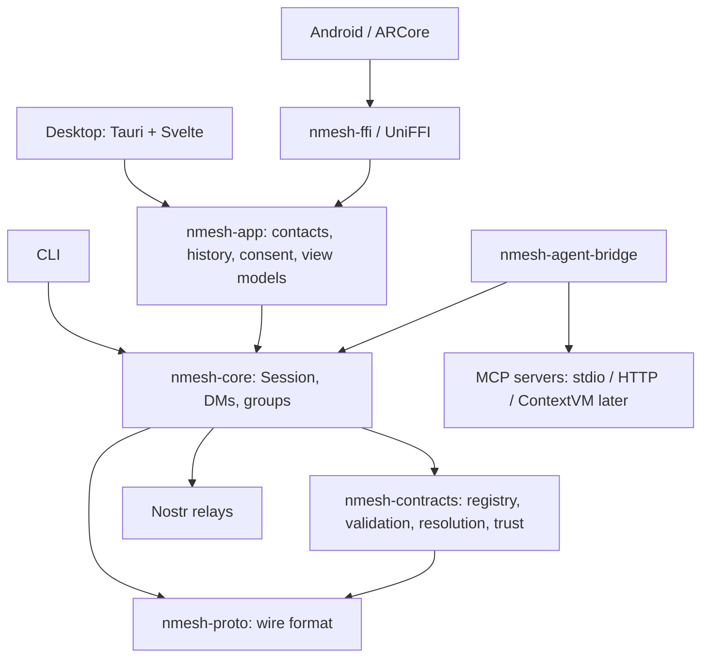
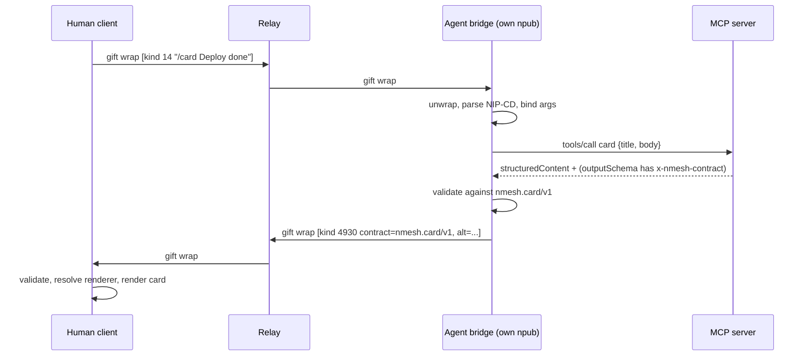

# nmesh design

## Goals

1. **Clean and lightweight.** Small surface, few concepts, fast on a phone.
2. **Human ↔ human ↔ agent.** Agents are first-class participants, not a side panel.
3. **Easy to extend.** Adding an agent means pointing at an MCP endpoint. Adding a renderer means
   publishing a manifest.
4. **Structured data with contracts.** Every structured payload says which schema it conforms
   to. Hosts validate before rendering.
5. **Spatial-ready.** The same payload can render in chat, on the web, or anchored in AR
   (ARCore).
6. **Don't reinvent.** Use existing NIPs, MCP and Marmot. Add new kinds only where nothing
   exists, and document them as proposals.

## Layers

| Layer | Responsibility | Built on |
|---|---|---|
| Protocol | keys, signing, relays, encryption | `nostr-sdk`, NIP-01/17/44/59/65 |
| Conversation | DMs, groups, threads, membership | NIP-17, Marmot (MDK) |
| Contracts | typed payloads, validation, pinning | JSON Schema 2020-12 |
| Renderers | contract → UI, per target | Tier 0 declarative / Tier 1 MCP Apps-compatible web / Tier 2 native |
| Agents | MCP-backed peers | MCP (`rmcp`), NIP-CD slash commands, NIP-24 `bot` |
| Registry and trust | discovery, curation | addressable events, NIP-51, NIP-89 pattern, NIP-85 |

## Key decisions

ADRs are in [`adr/`](adr/):

- [0001](adr/0001-nostr-not-xmpp.md): Nostr as the substrate
- [0002](adr/0002-rust-core.md): Rust core, with UniFFI for mobile and AR
- [0003](adr/0003-groups-mls.md): E2E groups via Marmot (MLS); NIP-17 for DMs; no relay-trusted groups by default
- [0004](adr/0004-agents.md): agents are peers; all three hosting models; plaintext visibility is explicit
- [0005](adr/0005-trust.md): trust starts as an allow-list; web of trust is the goal, built from existing NIPs
- [0006](adr/0006-renderers.md): three renderer tiers; Tier 1 is wire-compatible with MCP Apps

## Specs

Normative wire formats are in [`spec/`](spec/):

- [0001 kinds and tags](spec/0001-kinds-and-tags.md)
- [0002 contracts](spec/0002-contracts.md)
- [0003 renderers](spec/0003-renderers.md)
- [0004 agents](spec/0004-agents.md)
- [0005 spatial](spec/0005-spatial.md)

## Message flow (agent call)

## XMPP mapping

| XMPP | nmesh / Nostr |
|---|---|
| JID | pubkey (npub); NIP-05 for human-readable names |
| Server, s2s | relays; the client publishes to several; no federation |
| Stanza + namespace | event `kind` + tags |
| `<body>` fallback | `alt` tag (required on every structured message) |
| 1:1 chat + OMEMO | NIP-17 (NIP-44 + NIP-59 gift wrap) |
| MUC with OMEMO | Marmot (MLS over Nostr) |
| MAM | relays store events; gift wraps can be fetched later |
| Carbons | built-in: we gift-wrap a copy to ourselves |
| Chat states / presence | ephemeral kinds (e.g. agent status 24930, reserved) |
| PubSub | addressable events (`3xxxx` + `d` tag) |
| Disco (XEP-0030) | agent manifests, NIP-CD command definitions, renderer manifests |
| Ad-hoc commands (XEP-0050) | NIP-CD slash commands → MCP `tools/call` |
| Data Forms (XEP-0004) | `nmesh.form/v1` + `nmesh.form.submit/v1` actions |
| Components (XEP-0114) | agent bridges as independent peers |

## Prior art we build on rather than replace

- **MCP Apps** (`ui://` resources rendered in sandboxed iframes): Tier 1 renderers use the same
  host↔view protocol, so existing MCP Apps work in nmesh with a thin adapter.
- **ContextVM** (MCP over Nostr): complements the bridge. Planned as a bridge transport so it can
  reach MCP servers that are themselves on Nostr.
- **Marmot / MDK, White Noise**: E2E groups.
- **NIP-CD** slash commands: agent invocation that works from any Nostr client.
- **NIP-89** handler pattern and **NIP-85** trusted assertions: registry discovery and trust.
- **NIP-90 DVMs**: deliberately *not* used. The NIP is now marked unrecommended in favour of
  use-case-specific standards.
